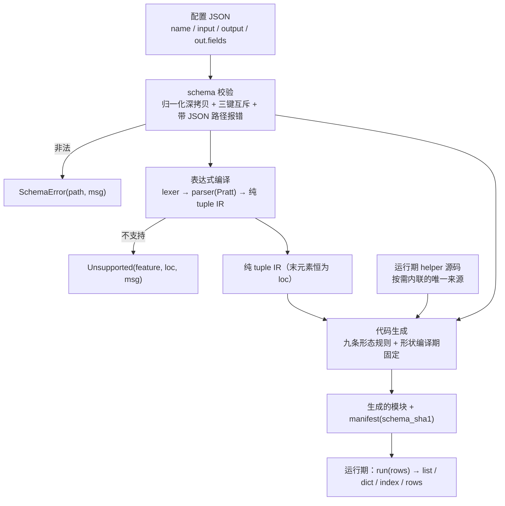

# DCG 整体设计方案与架构文档

> **读者**：项目技术负责人
> **定位**：本文是 DCG 的整体设计与架构基线，**所有实现必须按本文的设计与架构执行**；接口细节见 `DCG 接口实现细节文档.md`。
> **范围**：本文只讲**设计与架构**——为什么这样设计、各层怎么分工、产物长什么样、边界在哪里。

---

## 0. 一页速览

| 问题 | 答案 |
|---|---|
| DCG 是什么 | 运行时代码生成器：用 JSON schema + JSONata 子集描述“怎么转”，build 期编译成固化的 Python 模块 `gen/<name>.py`，运行期直接运行，无解释器开销 |
| 交付物是什么 | `gen/<name>.py`：纯 Python、除运行期 helper 模块外零依赖、可读可 diff、同 `generator_version` 下逐字节可复现 |
| 输入是什么 | 一份 schema：`name` + 输出结构（形状 / 嵌套字段）+ `out.fields`（取值 / 计算 / 对齐规则） |
| 运行期目标 | 向手写代码看齐：运行期无解释器、无表达式求值、无 `isinstance` 分派，循环体只做裸取值与裸运算 |
| 性能策略 | ①能证明就发裸代码，否则发 helper；②EAFP（耗时比 LBYL 少约 31%，约 1.46× 吞吐）；③去掉不改语义的调用层。详见 §7.5 |
| 依赖 | 整工程不依赖 `jsonata` 包：JSONata 语义由自研 lexer/parser/compiler 在编译期完成 |

---

## 1. 定位与目标

### 1.1 DCG 是什么

DCG 是运行时代码生成器：转换逻辑写在 schema 里（取值、路径、表达式、输出形态），build 期编译成固化模块 `gen/<name>.py`，运行期直接跑，产物只有一个入口 `run(rows)`。

```jsonc
{
  "name": "cap",
  "output": {"shape": "list", "before": null, "after": null},
  "out": {"type": "object", "fields": {
    "hourA": {"type": "int64", "value": "$.5.a.1"},
    "hourB": {"type": "int64", "value": "$.5.a.2"},
    "hourD": {"type": "str",   "expr": "$string($.5.a.1) & $string($.5.a.2)"},
    "hourE": {"type": "int64", "expr": "$.5.a.1 + $.5.a.2"}
  }}
}
```

> **安全前提**：schema 是**构建期可信输入**。反引号段与 `py{}` 会被原样嵌入产物并在运行期执行任意 Python（不是沙箱），`Registry` 也只能注册模块级可导入的函数。因此 schema 必须来自受控代码库，不能接受终端用户提交的表达式或 schema 片段。三类扩展点（表达式层外部函数 / 数据级外部函数 / 内联 Python）的定义与约束见 §7.6。

同一份 schema 编译出的产物（真实 `dcg.generate()` 输出）：

> 块首 `# dcg: <schema 名>` 是文档守护标记（`tests/test_doc_products.py` 用它把该块钉到 `tests/workload.py` 同名 schema 的 `generate()` 输出逐字符比对），**不是产物内容**。

```python
# dcg: V2_CAP
def run(_d):
 _o=[]
 _c=_o.append
 for R in _d:
  _a=R[5]['a']
  _a1=_a[1]
  _a2=_a[2]
  _c([_a1,_a2,(str(_a1)+str(_a2)),(_a1+_a2)])
 return _o
```

### 1.2 适用边界

* **DCG 做**：行级取值 / 计算 / 结构转换、自定义输出结构、异构输入到统一结构化模型的对齐、按配置生成可评审的定制模块；
* **DCG 不做**：数据接入与调度、跨源关联 / 合并、输入校验与错误隔离、分布式执行、文件与协议序列化；
* **最合适**：数据品种多、变更频繁、单份量大、每行逻辑浅到中等、需要产物入库评审与统一维护的场景。

---

## 2. 设计动机：为什么是「编译期直出代码」

### 2.1 设计基线：为什么不能停在「通用引擎逐行解释」

| # | 事实 | 对本设计的约束 |
|---|---|---|
| 1 | 纯 Python 的执行开销本身就接近手写，慢的不是「解释」这一步 | 目标直接锚定手写形态：编译期展开、运行期零解释 |
| 2 | 行级转换的开销大头是每行构造输出对象，不是表达式求值 | 输出形状必须在编译期固定，运行期不做容器判断 |
| 3 | 同一字段每行重复取一次，代价可观（1.33×） | 每个被引用的下标前缀在行首只取一次（规则 1，见 `DCG 接口实现细节文档.md` §4.2） |
| 4 | 换静态编译（Cython）本机实测 **≈1.0×**（13 项 `cy/py` 中位数 1.02×、11 项在 ±10% 内），抵不上额外复杂度与输入形状要求 | Cython 降为可选产物形态，同源生成、不改语义；**不宣称加速**（实测见验收报告 §5.4） |
| 5 | 通用模板路线天生结构性冗余：无意义中转变量、重复的 append 别名、只被再解包的容器、随机变量名 | 不用模板：schema 直接驱动代码生成，产物形态唯一、可 diff 可评审 |
| 6 | 若输出形状留到运行期判断，每行都要付一次分派 | shape / before / after 全部编译期常量 |
| 7 | 若每行靠前缀约定区分「列还是变量」，规则靠约定、报错难懂 | value / const / expr 三键互斥；嵌套必须显式 fields |

---

## 3. 架构总览

### 3.1 单向依赖链路

```
配置校验（Schema） → IR → 代码生成（Generator） → 运行期 helper
                        ↑
                  表达式编译（JSONata）
```

* 配置校验层：只做 schema 校验与归一化，不依赖任何其它层。
* IR 层：节点定义 + 结构遍历，不依赖任何其它层。
* 表达式编译层：只依赖自身的词法/语法/路径/策略，产出 IR 常量。
* 代码生成层：依赖校验结果、IR、表达式编译与运行期 helper 的源码文本。
* 运行期 helper 层：不依赖任何其它层 —— 它既是运行期实现，又是生成码内联文本的唯一来源。
* 硬约束：依赖方向单向、无环；校验层 / IR 层 / 运行期 helper 层不得反向依赖代码生成层，由模块职责与评审约定把守。
* 扩展点不新增层：三类扩展点（§7.6）都只是从既有的四层里借道 —— `Registry` 走表达式编译层的 `rfunc` 节点、数据级外部函数走校验层的 `output.before/after` 归一化 + 生成层的 `_hN` 解析、内联 Python 走表达式编译层的 `py` / `pyblock` 节点。

### 3.2 数据流



一个字段的完整旅程：

```
out.fields["hourE"] = {"type":"int64", "expr":"hourA + hourB"}
      │
      ├─ schema 校验：三键恰好一个（expr）、type 合法 → 归一化
      ├─ 表达式编译("hourA + hourB")
      │     → ("bin","+",("field","hourA",(1,1)),("field","hourB",(1,9)),(1,7))
      ├─ codegen._Gen.emit → "hourA + hourB"（裸名走 defined 表）；
      │     若 type 声明为 int64 ⇒ 裸运算；若为 any ⇒ 退化成 `_ad(hourA,hourB)`
      └─ 产物：`_c([...,hourA + hourB])`（`_c=_o.append` 提到循环外）
```

### 3.3 为什么不用「通用模板 + AST 改写」

通用链路的中间表示是 Python 源码字符串（模板 → AST → 改写 → `ast.unparse`），带随机命名与中途变量；DCG 是 IR tuple 直接拼表达式字符串，少一次 parse + 一次 unparse，产物形态可预测。逐维度：**变量命名** —— `_` + 字段名、前缀记忆化，可 diff、同 `generator_version` 下逐字节可复现（`DCG 接口实现细节文档.md` §4.2 规则 8），对比运行期随机字符；**形状** —— 编译期常量，对比模板里的运行期判断 `tuple(doc.items())`；**取值语义** —— `value`/`const`/`expr` 三键互斥，对比 `$`/`#` 前缀闸门，前者消除「同一前缀被反复展开」→ 命中 1.33×；**冗余** —— 九条形态规则 + 结构性约束，对比中途变量 / append 别名 / 空桩；**不支持项的处置** —— build 期 `Unsupported`/`SchemaError` 带列号 / JSON 路径，对比运行期才炸。

---

## 4. Schema 结构设计（输入 DSL；用法见 README §2）

Schema 是 DCG 唯一的输入：一份 JSON 同时声明「输出什么结构」和「每个值怎么来」。三个设计目标：**能表达真实结构**（嵌套对象/数组、四种输出形态）、**能确定性校验**（错误在 build 期以 JSON 路径定位）、**能 diff 与评审**（纯 JSON，无隐式规则）。

### 4.1 顶层四块

| 键 | 必填 | 作用 | 形态 |
|---|---|---|---|
| `name` | 是 | 产物模块名（同时也是产物名） | `[A-Za-z_][A-Za-z0-9_]*` |
| `input` | 否 | 行集合在输入数据里的路径 | `{"source": "$.a.b"}`，缺省 `$` 表示整份输入就是行集合 |
| `output` | 是 | 怎么产出 | `shape` / `before` / `after` / `trace` 四键（§4.2） |
| `out` | 是 | 输出长什么样 | 一个 `object` 节点，字段树见 §4.4 |

一份 schema 只对应一个产物、一个入口 `run(rows)`：输入是行集，输出由 `output.shape` 决定。

### 4.2 输出形态（`output`）

输出形态是**编译期常量**，不是运行期参数：

| 键 | 默认 | 取值 | 设计含义 |
|---|---|---|---|
| `shape` | `list` | `list` / `dict` / `index` / `rows` | 产物返回的形状：逐行 list、列式 dict、`{行下标: 行值}`、逐行 dict |
| `before` | `null` | 表达式 / `py{}` / `@函数名` | **数据级前处理**：输入定位后一次求值，入参是全量数据，返回值替换输入数据 |
| `after` | `null` | 表达式 / `py{}` / `@函数名` | **数据级后处理**：结果组装后一次求值，入参是全量结果，返回值替换返回值 |
| `trace` | `false` | bool | 调试产物开关，与正式产物分离，不污染热路径 |

各组合的可观察行为在 §8 给出；这里只强调一条：**形状不可运行期切换** —— 要两种输出就 build 两个产物。

### 4.3 取值三键与类型声明

每个字段（`FieldSpec`）用三键之一声明值从哪来，**恰好一个**：

| 键 | 形态 | 编译结果 | 适用 |
|---|---|---|---|
| `value` | `"$.a.b"` / `"$.5.a.1"` | 直接引用输入列的访问链，零额外开销 | 直接取值 |
| `const` | 任意 JSON 常量 | 内联常量 | 固定值 |
| `expr` | JSONata 子集 + 反引号内联 Python | 编译成定制表达式 | 计算/加工/结构重组 |

与三键配套的声明：

* `type`：**必填**，八选一：`int64` / `int32` / `float64` / `str` / `bool` / `list` / `object` / `any`。`type` 是**声明**不是转换：声明越具体，生成码越能省掉类型判断（规则 4，见 `DCG 接口实现细节文档.md` §4.2）。
* `optional`：默认为 `false`；为 `true` 时值可能是 undefined，产物生成一次守卫（undefined → `None`）。未声明 `optional` 的字段一律发裸链，缺键直接抛 `KeyError`。
* `default`：可选；字段算出 undefined 时替换成该 JSON 常量（`0`、`""`、`null`、`[]` 等），产物固化成一次 `_df(<expr>, <default>)`。`default` 必须与 `type` 相容，且不能与 `fields` 同用；设了 `default` 就不再生成 `optional` 的 `None` 分支。
* 嵌套形态由 `type` 决定（具名对象 / 位置行），见 §4.4；数组不声明元素，直接用 `value`/`expr` 给出。

### 4.4 嵌套结构

嵌套**必须显式声明**，且只有 `fields` 一个键，没有隐式特例：

* **具名对象**：`"type": "object"` + `"fields": {字段名: FieldSpec, ...}`（`fields` 必填，空对象报错）→ 运行期是带键的 dict；
* **位置行**：`"type": "list"` + `"fields": {字段名: FieldSpec, ...}` → 运行期是按字段声明顺序的 list（undefined 落成 `None` 以保住位置），用来承接「行本身就是位置 list」的文档结构，如 `{"doc": [[...], ...]}`；
* **数组不声明元素**：列表值由 `value` / `expr` 直接给出（`{"type":"list","value":"$.tags"}`），DCG 不逐元素重建数组；
* **`aggregate`**：只能写在 `type:"object"` + `fields` 的字段上，`aggregate: true` 表示该字段是**列容器**（每个子键各聚成一列，可逐层嵌套）；它只在 `shape:"dict"`（列式容器）下有意义 —— `shape != "dict"` 又写了 `aggregate` 时**在 build 期报 `SchemaError`**，不静默失效；行式容器下要「每行一份具名对象」就不标 `aggregate`，逐值相等；
* **fields**: 只能配 `type:"object"` 或 `type:"list"`；不带 `fields` 的列表字段必须用 `value` / `expr` 给出来源（只写 `{"type":"list"}` 会报 `SchemaError: value/const/expr 必须恰好提供一个`）；
* 嵌套深度不限，同一套 `fields` 规则递归适用。

显式声明的代价是要多写一层，换来的是编译期能完全确定产物形态：生成器不需要在运行期猜「这是 list 还是 dict」。

### 4.5 声明顺序与计算顺序

**字段的声明顺序只决定输出结构，不决定计算顺序。**

* **输出按声明顺序**：`list` 形状按字段声明顺序取值；`dict` 形状按声明顺序建键；嵌套 `object` 按内层声明顺序。行数据的键顺序不影响输出顺序。
* **计算按依赖关系**：字段之间通过表达式里的字段引用（裸名、`$.` 链里的字段名、动态下标段里的字段名；`$字段名` 是变量形态、不构成字段依赖）构成依赖；生成器在 build 期建立依赖图，按依赖先后计算，与声明顺序无关。
* **允许任意声明顺序**：后声明的字段可以被先声明的字段引用（前向引用合法）。例如 `hourX` 声明在 `hour` 前面，只要 `hourX` 引用 `hour`，计算时先算 `hour`，输出仍按声明顺序排列。
* **依赖必须无环**：环在 build 期报 `SchemaError`（给出环上的字段链）；引用不存在的字段同样在 build 期报错。
* **每个字段最多算一次**：被多个字段引用时复用同一局部绑定，不重复求值；未被引用的字段照常输出。
* **作用域**：每个 `fields` 是一层独立作用域；内层嵌套字段可以引用外层字段，同层兄弟可以按裸名互相引用；内层同名字段遮蔽外层（就近优先）；外层不能引用内层字段名。
* **确定性**：同一依赖层次内按声明顺序计算；输出始终按声明顺序组装。

#### 4.5.1 依赖来源

| 写法 | 是否构成依赖 | 计算时拿到的值 |
|---|---|---|
| 裸名 `hour` | 是 | 该字段的计算结果 |
| `$hour` | 否 | **不构成字段依赖**：`$name` 一律编成变量形态（接口 §3.4 的 `$v` 行），没有「与字段同名就降级」的规则，生成器在 build 期报 `SchemaError` |
| 动态下标段里的字段名 `$.a[hour]` | 是（依赖 `hour`） | 该字段的计算结果作为下标 |
| 普通路径 `$.a`、`$.5.a` | 否 | 原始行（行首解包） |
| 函数字面量体内的自由字段 `function($x){ hour + $x }` | 是 | 进入函数前绑定 |
| `py{}` 块、反引号段里的 `$.字段名` | 否（只校验已声明） | 原始行 |
| 反引号段里的裸名 `` `a + 1` `` | 是 | 该字段的计算结果 |
| 嵌套 `fields` 内同层兄弟裸名（如 `doc.hourE = "hourA + hourB"`） | 是（该嵌套作用域内） | 兄弟字段的计算结果 |

`$.字段名` 只做「必须是已声明字段」的校验，然后直接读原始行，**不记依赖边**；因此不会产生假环：`v = py{ $.a }` 与 `a = v + 1` 可以正常生成（块读的是行里的原始 `a`）。反引号段里的裸名才是字段引用，读该字段的计算结果、参与依赖图。

#### 4.5.2 依赖建图

* **节点** = 某一层 `fields` 里的每个输出字段；**每层 `fields` 各自成图**（嵌套作用域，见本节末「嵌套作用域」），内层字段引用外层名字时，被引用的外层字段仍按顶层图的顺序先算。
* **边** = 「被引用字段 → 引用字段」，方向即求值先后；字段引用自己不算边，直接按环处理。
* 只保留已声明字段之间的边；引用未声明字段在生成该字段表达式时 build 期报 `SchemaError` 并列出可用字段名。
* 图在 `plan` 阶段一次建好，`body` 按它决定求值顺序。

**环检测与报错**：某一轮 `ready` 为空但仍有字段未完成 → 依赖成环，build 期报 `SchemaError: out.fields: 字段依赖成环: a -> b -> a`。报错给出环上的字段链（从剩余节点沿依赖回溯取一条闭合链），而不是只说「有环」。

**嵌套作用域**：规则同编程语言的词法作用域（见 §4.5「作用域」）——同层兄弟可裸名互引（`doc.fields.hourE = "hourA + hourB"`），成环时路径写到该层：`out.fields.doc.fields: 字段依赖成环: a -> b -> a`；每层各自拓扑排序，被兄弟引用的字段在本层先算一次并落成局部绑定，组装仍按本层声明顺序；`py{}` / 反引号 `$.` 链看不到兄弟名字，块内只读原始行。

#### 4.5.3 求值顺序（稳定拓扑排序）

Kahn 式的贪心拓扑排序，每轮取「依赖已全部算完」的字段：

1. 按**声明顺序**扫描剩余字段，收集本轮 `ready`（其依赖都已在完成集合里）；
2. 把 `ready` 按声明顺序整批加入完成集合；
3. 重复直到没有剩余字段。

同一层里「谁先就绪」按声明顺序 tie-break，所以同一 schema 的求值顺序**唯一确定**，产物逐字节可复现（规则 8 的前提，见 `DCG 接口实现细节文档.md` §4.2；跨 `generator_version` 时字节可能变）。不用任意拓扑序，是因为任意顺序会随实现细节漂移，破坏字节级复现。

**绑定与复用**：

* 被别的字段**按名引用**的字段：按计算顺序先算，并落成局部变量（如 `a=R['x']+1`），引用处直接用这个名字；
* 只被引用一次的字段：可以在使用处内联，不落局部；
* 没有被任何字段引用的字段：只在组装输出行时内联；
* 每个字段最多求值一次（共享的局部绑定只有一份）；
* 行首解包顺序跟计算顺序走；输出行始终按声明顺序组装（按 `fields` 声明序取各字段值）。

**与函数字面量、`py{}` 的关系**：
函数字面量体内的自由字段按普通字段引用进依赖图，在进入函数前绑定；函数参数遮蔽同名字段，不算引用。`py{}` 与反引号段的 `$.` 链读原始行，因此不进依赖图、不影响计算顺序，只校验字段名已声明；反引号段里的裸名是真正的字段引用（见 4.5.1）。

### 4.6 硬规则与报错

两条硬规则（全部在 **build 期**触发，不允许漏到运行期）：

1. **裸字符串不是路径**：`"a"` 这种值必须报 `SchemaError`；路径只能以 `$` 开头（允许数值下标），或走 `const`。不存在「靠前缀猜语义」的第三态。
2. **嵌套必须显式**：嵌套只能用 `fields` 声明（具名对象 / 位置行，规则见 §4.4），没有 `items` 键，写了即未知键报错；数组由 `value`/`expr` 直接给出，不逐元素重建。list 里可以放 dict 并原样输出，要展开成结构化字段必须写进 schema，不能靠「数据里出现 dict」自动推导。列表**元素类型**（不描述结构）用可选键 `itype`，只对 `type:"list"` 且不带 `fields` 的字段有效（见接口文档 §2.3）。

报错形态统一：`SchemaError(path, msg)`，`path` 是 JSON 路径（如 `out.fields.sum`），`str(e)` 形如 `out.fields.sum: value/const/expr 必须恰好提供一个（给了 2 个）`。路径定位是这个设计的关键 —— 配置写错时，用户先看到的是「哪个字段的键错了」。schema 用纯 JSON 而不是 YAML / 自定义 DSL，就是为了让这些形态能被逐条写死：上面两条硬规则加这条报错形态，就是这个冻结面。

## 5. IR 设计

IR 共 **41 个符号**（16 个节点常量 + 3 个算子集合 + 16 个构造器 + 6 个结构工具）。

### 5.1 节点表（DCG 接口实现细节文档 §1）

16 个节点（`lit` / `field` / `index` / `root` / `var` / `unary` / `bin` / `cond` / `call` / `rfunc` / `array` / `object` / `py` / `pyblock` / `range` / `lambda`）的完整形态表见 `DCG 接口实现细节文档.md` §1.2，本文件不重复。

`range` 虽然列在节点表里但**永远不会出现在 IR 里**：`..` 在表达式编译期就抛 `Unsupported`，它是**契约的完整性声明**，不是可达节点。`lambda` 不同：函数字面量 `function($x){...}` 可达，编成 `lambda` 节点后由代码生成器编译成 Python 函数（§6.5）。

### 5.2 「末元素恒为 loc」与「纯 tuple」

* **末元素恒为 `loc`**：`loc = (line, col)` 或 `None`。工具函数 `loc_of(node)` 只在最后一项是 2-tuple 时返回它。好处是：任何节点都能报出**列号**，`Unsupported`/`SchemaError` 的定位不需要额外传参，AST 遍历不需要 visitor。
* **纯 tuple，不是 class**：可比较、可哈希、零构造开销、snapshot 友好 —— 四条理由的完整表述见 `DCG 接口实现细节文档.md` §1.1，本文件不重复。

实测：`compile_expr("$.a")` → `('index', ('root', (1, 1)), ('lit', 'a', (1, 2)), (1, 2))`，`loc` 在最后一项。

### 5.3 `bin` 各算符的 undefined 传播规则（口径见接口文档 §1.3）

op 表（`+ - * / %`、`&`、`=` `!=`、`< <= > >=`、`and or`、`in` 各自的 undefined 传播与运行期 helper）见 `DCG 接口实现细节文档.md` §1.3，本文件不重复。

op → (含义, undefined 家族) 在 IR 层实现为 `BIN_OPS`，构造器 `bin_(op, left, right, loc)` 对非法 `op` 直接 `ValueError`。运行期对每条 undefined 规则都有专用函数（不分派表！）—— 规则 5 的判定条件见 `DCG 接口实现细节文档.md` §4.2。

### 5.4 结构工具

`kind(node)` / `loc_of` / `children`（按节点类型给出子节点）/ `walk`（DFS）/ `is_const`（字面量、全常量数组/对象、常量一元/二元）/ `key_path`（把 `field`/`index` 链折成 key path，如 `$.5.a.1` → `(5,"a",1)`，要求 `index` 的 `idx` 是 `lit` 且值为 `int`/`str`）。`key_path` 是「常量链」判定的单一实现，生成器的命名与常量链折叠都依赖它。

---

## 6. 表达式层设计（JSONata + 反引号内联 Python）

### 6.1 三层结构

| 层 | 职责 | 产物 | 要点 |
|---|---|---|---|
| 词法 | 正则扫描 TOKEN | `[(kind, value, col), ...]` | 反引号段是词法边界：段内容原样捕获到下一个未转义反引号，段内不解析 JSONata（JSONata 从不使用 `` ` ``，零歧义）。`py{...}` 多语句块整体扫描 |
| 语法 | Pratt 解析器（BP 表按 JSONata 2.2.2） | 语法树 | 调用/下标/路径统一在中缀循环的后缀位置处理；只在 prefix 处理会让 `$not(miss)`、`a[0]` 报「多余内容」 |
| 编译 | 纯函数 `compile_expr(src, *, loc_base=(1,1), registry=None)` | DCG 接口实现细节文档 §1 的纯 tuple IR | 同输入同输出，不读任何全局 `MODE` |

Pratt 结合力（越小越松）：`or 10` · `and 20` · 比较/`in` 30 · `& 40` · `+ - 50` · `* / % 60` · 一元 `- + not` 70 · 后缀 `.` `[` `(` **90** · `..` 45 · 三元 `? :` 5。JSONata 的 `` ` `` 段由 lexer 先切走，所以 `str($.5.a.1) + str(hourB)` 整段是一个 `py` 节点。

表达式层对外导出 21 个符号，其中DCG 接口实现细节文档 §5 要求的三个必须在：`compile_expr` / `Unsupported` / `Registry`。

`Registry` 的完整方法面、异常与幂等语义见 **DCG 接口实现细节文档 §3.1**（本节不重复方法列表，避免两处维护漂移）；它作为**表达式层外部函数扩展点**的产物形态（`_x()` 惰性分派）与三条架构约束见 **§7.6.1**。此处只保留架构层面的约束：**注册对象必须是模块级可导入的、且其 `qualname` 前若干段能拼成真实模块路径**（`qualname` 是产物可导入性的唯一守卫；从长到短的解析算法见 §7.6.1）。

### 6.2 能力边界：四类函数与永久拒绝

设计原则：**绝不静默降级** —— 任何不在支持范围里的调用、任何永久拒绝的构造，都必须抛 `Unsupported`。

**A 类｜行内函数（55 个，逐名见 `DCG 接口实现细节文档.md` §3.5）**：字符串 25 / 数值 12 / 布尔与其他 4 / 数组与对象 12 / 时间 2。

A 类的实参只要**逐行可求值**即可：字面量、字段取值、动态下标、数组/对象字面量都行。`$sum([$.5.a.1, $.a.c])` 与 `$sum($.items)` 同属这一类——DCG 逐行求值，这一行里的数组就是普通值，不需要跨行状态。

**B 类｜高阶函数（需要函数字面量，§6.5）**

`$map $filter $reduce $each $sift`，以及带比较器的 `$sort(array, function)`；`$position()` 只在 B 类函数体内有意义（序列上下文）。函数字面量 `function($x){...}` 编成 Python 函数，函数体仍是逐行表达式，自由字段进依赖图。

**C 类｜非确定函数（支持，但结果不可复现，§6.6）**

`$now $millis $random $shuffle`：产物代码固定，运行期从注入的时钟/随机源取值。

**永久拒绝**

* `$eval`：运行期求值任意表达式 = 运行期解释器 + 注入面，违反「运行期无解释器」。
* 语法构造：`a..b` 区间、正则字面量 `/.../`、位置绑定 `#`、join 绑定 `@`、变换操作符 `~>` / `|...|`、Sort `^`、Reduce `{k:v}` 路径阶段、分组聚合 `{..}`、`$$` 文档根（jx 词法/语法层拒绝）。
* `$x` 不是永久拒绝：jx 是纯函数、看不到 schema，把它编成 `var` 节点本身是正确的编译结果；只有代码生成器知道逐行模式下无处求值，因此走 `SchemaError` 而不是 `Unsupported`。`$name` 没有同名降级，判定顺序与动态下标的后果见 `DCG 接口实现细节文档.md` §3.9，本节不复述。
* 非函数值冒充调用 `(expr)(args)`：`(…)` 只是分组（**不是**官方的序列/数组构造），分组结果从来不是可调用对象，故 `('s'.x)('a')`、`($.a)($.b)` 与带字面量括号的 `(*.x)('a')` 全部在 build 期拒绝（`只有 $ 函数可以被调用` 或词法层 `不支持的起始记号 '*'`）。

**裸名调用别名 `BARE_CALL_ALIASES`（6 个）**：`str→$string`、`int→$number`、`float→$number`、`bool→$boolean`、`len→$length`、`abs→$abs`。真实生产 schema 的 ext 写的是 `str($.x)` 而不是 `$string($.x)`；只有这张表里的裸名可被调用，表外的 `a(...)` 仍按「只有 `$` 函数可以被调用」拒绝。

**先判归属、再 emit 实参**：`$map(xs, $string)` 按 `$map` 自己的规则判定（实参须是函数字面量），不被实参里的 `$string` 抢答成 `$string 需要 ctx 绑定`。

### 6.3 反引号内联 Python 与 `py{}` 语句块

反引号承接「字段级自定义表达式」这一能力（见 `JSONata 语法.md` §14）。词法层原样捕获段内容，段解析步骤做两件事：

1. `ast.parse(src, mode="eval")` 校验（**必须是单个 Python 表达式**）；
2. 找出段内的 `$.` 字段链与裸名，登记进 `free_field_names`（链文本，不含前导 `$.`）。

文档里把 `expr` 表达式与反引号内联 Python 统称**扩展算子**：简单加工走 `expr`，复杂加工走反引号（单表达式）或 `py{}`（多语句块）。反引号 / `py{}` 作为**内联 Python 扩展点**的边界与纪律见 §7.6.3；要给所有 schema 加新的 `$算子`（而不是在某个 schema 里就地塞 Python），走 **`JSONata 语法.md` §17「怎么扩展内置算子」**。本节只描述反引号/`py{}` 这一条路径的实现细节。

实测锚点（`py{}` 块由多语句块编译处理）：

```
analyze_py_segment('$.a + 1')                     -> ('$.a + 1', ['a'])
analyze_py_segment('$.5.a.1')                     -> ('$.5.a.1', ['5.a.1'])
analyze_py_segment('$.data')                      -> ('$.data', ['data'])
analyze_py_segment('$.data.ID')                   -> ('$.data.ID', ['data.ID'])
analyze_py_segment('$.data[\'AIRPORTIATA\']')     -> (..., ['data'])      # 动态键不经链解析
analyze_py_segment('str($.5.a.1) + str(hourB)')   -> (..., ['5.a.1', 'hourB'])
analyze_py_segment("'hourB' + str($.5.a.1)")      -> (..., ['5.a.1'])     # 字符串字面量内的裸名不登记
```

**三条硬规则**

1. **`$` 是唯一的字段/变量入口。** 反引号内容不暴露裸字段名，否则 `int`/`str`/`math` 与字段名静默撞车。`$.x` → 生成局部名；`$` 单独 = 当前行；`$v` = JSONata 变量。
2. **段内必须是 Python 表达式**（`ast.parse(seg,"eval")`），不能声明新名字、不能 `import`。拒绝样例与实际报错：
   * `` `import os` `` → `Unsupported: 第 1 列: 反引号段 Python 语法错误 不可逐行编译（invalid syntax（段内偏移 1）—— 必须是单个 Python 表达式）`
   * `` `a=1` `` → 同上（段内偏移 2）
3. **build 期报错带字符偏移**（上例的「段内偏移 N」），不留到运行期 `SyntaxError`。

`py{}` 多语句块在 `def _pyN(...)` 里定稿为函数体，块内局部名改 `__jx*` 前缀避免与字段撞车，并校验恰好一个 `return`；调用处传已解包字段（禁止 lambda/IIFE）。逐条形态见 `DCG 接口实现细节文档.md` §3.8。

**边界（`DCG 接口实现细节文档.md` §6 如实声明）**：反引号 = **任意 Python 执行，不是沙箱**；build 期不执行代码，只 `ast.parse` 校验；真正的沙箱需要进程级手段。`PY_SAFE_MODULES`（25 个）只约束**裸模块名**（`math re json decimal datetime itertools ...`），**不约束内置函数** —— 实测 `` `open(x)` `` 被接受为 `('py', 'open(x)', ['x'], (1, 1))`。这是能力，也是风险，必须在 README 里如实写明。

`__jx` 是表达式层保留给生成器的占位符/别名命名空间（前缀 `__jx`，占位符 `__jx_f`），用户段里出现即报错。

### 6.4 不支持的结构与理由

**以下构造永久拒绝**（**十类结构构造 + `$$`，共 13 条现象**；键定义在 `dcg/jx/policy.py` 的 `STRUCTURAL` 元组，共 10 个键 —— `regex` 一键含带不带 flags、`transform` 一键含 `~>` 与 `|...|`、`group` / `reduce` 是 `{...}` 在两个位置的两条现象，所以**条数与键数不是一回事**；逐条现象清单与 `JSONata 语法.md` §16.2、`DCG 接口实现细节文档.md` §3.9 一致）：

* **运行期解释器入口**：`$eval(...)` —— 运行期求值任意表达式，且是注入面；
* **需要整批 / 序列语义**：`a..b` 区间、正则字面量 `/../`（含 flags）、位置绑定 `#`、join 绑定 `@`、排序 `^`、变换操作符 `~>` / `|...|`、分组聚合 `{...}`、Reduce 路径阶段 `{k:v}`；
* **路径形态**：路径必须锚在 `$` 上、段只能是标识符段或常量下标段（长度不限）；分组 / 字面量 / 调用的结果再接路径段（`('s').x`、`($.a).b`），或把 `$` / `$$` 当路径下标（`$.a[$$]`）都拒绝；
* **`$$`（整篇文档根）**：逐行函数只看到当前行，在 jx 层即拒绝；它**不在** `STRUCTURAL` 的 10 个键里，是额外一类。

逐条现象的完整报错文案见 `DCG 接口实现细节文档.md` §3.9（权威定义处）。

**不在本表内的构造：`$x`（变量引用）** —— 它能编译、但逐行模式下无处求值：

| 构造 | 编译结果 | 抛出层 | 理由 |
|---|---|---|---|
| `$x`（未被函数字面量形参绑定的变量引用） | IR `("var", "x", loc)` | **生成器层** `SchemaError: 行模式没有变量作用域` | 逐行模式没有变量绑定；要取本行字段请写裸名 `x` 或 `$.x`。**没有同名降级**：`out.fields` 里声明了同名字段也不改判（`$i` ≠ 字段 `i`，是两个不同形态的 token） |

`$x` 只走 `SchemaError`、不走 `Unsupported`：jx 是纯函数、看不到 schema，"把 `$x` 编成 `var` 节点" 本身是正确的编译结果；只有代码生成器知道逐行模式下无处求值。与 `DCG 接口实现细节文档.md` §3.9 的口径一致（该表列出十类结构构造与 `$$` 共 13 条现象，并注明 `$x` 不属本表）。`dcg/codegen.py` 的 `var_name` 判定顺序是「回调形参 → 抛 `SchemaError`」，没有「已声明字段」这一级。§7.5 的动态下标内联（`R['a'][i]`）只对**裸名下标**成立（`$.a[b]`/`$.a[hour]`），`$.a[$i]` 进不了内联、在 build 期就报错。

函数字面量、行内数组函数、高阶函数与非确定函数**不在拒绝之列**，见 §6.2 / §6.5 / §6.6。

**明确不做**：自创第二套 DSL · 运行期解释 JSONata · 运行期按参数切换形状 · 静默降级 · 语言层沙箱。

### 6.5 函数字面量与高阶函数

JSONata 的函数字面量写作 `function($x){ <表达式> }`，**只能**作 `$map` / `$filter` / `$reduce` / `$each` / `$sift` / `$sort` 的实参。放错位置分两种情形：直接当字段表达式 → **生成器层** `SchemaError`；作为调用头（如 `(function($a){$a})('a')`）→ **表达式层** `Unsupported`（`lambda() 不可逐行编译（只有 $ 函数可以被调用）`）。两者都只在 build 期抛出。

* **编译期**：函数字面量编成 `("lambda", [参数...], body, loc)`；代码生成器把它编译成一个 Python 函数（表达式体）；回调按固定两位置参数调用，少写的参数用 `_i0`/`_i1` 补齐，例如 `function($x){ $x*2 }` → `lambda x,_i1:_ml(x,2)`。

> 注意：`$map`/`$filter` 的 lambda 只在**无法展开**时出现——未使用 `$position()` 时去调用层直接发列表推导式（源头不保证是数组时套 `_as_list()` 在运行期做单值提升）（接口文档 §4.4「产物里不保留不改变语义的调用层」），lambda 形态留给需要索引/累加器的场景。
* **函数体规则**（单条表达式、`py{}` 的限制、自由字段绑定、求值时机）：见接口文档 §3.6，不在此重复。
* **语义基准**：以 JSONata 2.2.2 为语义基准（空数组、`undefined` 元素、比较器返回值约定、`$position` 语义；基于 2.2.2）；**显式偏离集中见 `JSONata 语法.md` §1.4「与 JSONata 2.2.2 的显式偏离」表**（8 条），模型边界差异（输出单值塌缩等）见同章 §1.4.1、仍保留的差异见 §1.4.2。

### 6.6 非确定函数与可复现性

`$now()`（ISO 8601 UTC 毫秒时间戳）、`$millis()`（epoch 毫秒）、`$random()`（`[0,1)` 浮点）、`$shuffle(array)`（洗牌）由运行期 helper 提供，产物里只出现 helper 调用。

* **产物仍可复现**：生成代码是确定的，同一 schema 逐字节一致；非确定只发生在运行结果。
* **结果不可复现**：同一产物两次运行结果可能不同。使用 C 类函数的切片，证据里必须标注「输出含非确定值」，并用注入的固定时钟/随机源重跑一次作为复跑证据。
* **注入接口**：运行期 helper 从模块级可替换的时钟/随机源取值（测试与证据重跑用固定源）；不引入环境变量这类隐式全局开关，避免产物行为随宿主环境静默变化。
* **决定论的边界**：`$eval` 不在 C 类，永久拒绝（§6.4）。

---

## 7. 代码生成策略

### 7.1 生成器内部结构

生成器分五步完成一次生成：plan（建立字段依赖图、确定计算顺序、行首解包顺序与前缀命名）→ emit（IR → Python 表达式源码）→ body（生成循环体）→ module（组装模块、按需 import）→ finish（生成返回形态）。各步职责：

| 阶段 | 作用 |
|---|---|
| 校验与指纹 | canonical JSON → sha1；模块名 = `schema.name`；禁止 random |
| 常量链折叠 | 把 `index` 常量链折回 `root`，得到段元组；非常量链返回 `None` |
| 生成状态 | 单次生成的全部状态：fields/shape/before/after/src/helpers/rfuncs/head/pre/paths |
| 依赖分析 | 从每个字段的表达式里收集字段引用（裸名、`$.` 链里的字段名、动态下标段里的字段名；`$字段名` 是变量形态，不构成字段依赖）建依赖图；按依赖做稳定拓扑排序（每轮按声明序取就绪字段，顺序唯一确定）；环与未声明引用在 build 期报 `SchemaError` |
| 命名与解包 | 前缀只取一次的记忆化命名（规则 1）+ 按计算顺序的行首解包：被引用字段先算并绑定一次 |
| 表达式生成 | IR → Python 表达式源码；`&` 与裸运算有快路径 |
| 裸名校验 | 裸名查 `defined` 表，查不到 → build 期 `SchemaError` 并列出可用字段名（绝不留到运行期 `NameError`） |
| 反引号段 | `$.` 链替换为生成局部名、裸名查 `defined`；`py{}` 块发成 `run()` 外的辅助函数 |
| 取值分派 | const / value / expr / fields |
| 组装与收尾 | 生成循环体、组装模块（含按需 import 行）、生成返回形态 |

`generate(schema, *, cython=False, inline_optional=True, registry=None, strict_qualname=True)` 内部**只调用一次 `compile()`**（规则 6，见 `DCG 接口实现细节文档.md` §4.2）。构建期的 qualname 可行性探测不是 `compile()`。`registry` / `strict_qualname` 的语义见 §9.1 与 `DCG 接口实现细节文档.md` §4.1。返回前已证明产物可编译。

### 7.2 九条形态规则

九条规则的逐条判定条件、生成形态、报错口径，以及「九条由谁保证」（门禁 `evidence/accept.py::g_zero_redundancy` 只判结构上可判的子集，`tests/codegen_rules.py` 的九个分析器与 `tests/test_codegen_snapshot.py::TestZeroRedundancy` 判全九条）全部收口在 `DCG 接口实现细节文档.md` §4.2，本文件不重复；实测数据见 §7.5。

**与计算顺序的关系**：字段按依赖图求值（§4.5），被其它字段引用的字段按拓扑序先算并绑定，只被引用一次的字段在使用处内联。前缀记忆化与求值顺序无关，但**提升只在有行首语句的位置生效**：`shape:"list"` 的行循环里同一前缀绑定一次、后续复用局部名；`shape:"rows"` 把整行压成一条推导式、没有行首语句可落，多次读取在表达式内内联。**安全链（`optional` 路径）前缀同样计入有效提升**（见 §7.3；数据级钩子 `_data_var=="D"` 没有行循环前缀，仍就地拼文本）。输出始终按声明序组装。

**内联纪律**：helper 按需内联并只带传递依赖；产物只在真的用到 helper 时才发导入行
（CAP 与 M0 两个样例连一行 import 都不需要）；产物不写 docstring，来源由 `build()` 的 manifest 记录。

### 7.3 产物形态

**产物形态样例**：CAP 与 M0 两个真实 `dcg.generate()` 输出、以及 `# dcg:` 守护标记的完整产物清单，见 `DCG 接口实现细节文档.md` §4.5（本文 §1.1 另有一份 CAP 样例）。

**说明两处形态**：①位置式路径 `$.5.a.1` 的前缀 `_a` 与常量下标 `_a[1]` 是裸下标（`input.source` 是
schema 声明的固定结构，缺键就该 `KeyError`）；②`expr` 引用同一条已提升的位置式链时，命中的是 `plan()` 绑好的局部名 `_a1`/`_a2`，**不重复求值**（§4.2 规则①）。

只有声明 `optional` / `default` 的字段才进入**安全取值路径**（四档、自上而下命中即定：①带 `default`（**无论有无 `optional`、无论 `type`**）固化成 `_df(_ix_get(...), <default>)`，**`default` 优先于 `type` 分档**；②无 `optional` 且无 `default`（含 `type: "any"`）发裸链；③`optional` + 具体 `type` 走 `.get(k, _U)` 快链；④`optional` + `type:"any"` 或未声明 `type` 走 `_ix_get`）。不能笼统说成"退回 `_ix_get`"——那是"缺键 ⇒ undefined"的口径之一，
与 `value` 的"缺键 ⇒ 报错"不同，混用会改变语义；这类字段不做「required 裸链式」的局部名提升；但安全链引用统一走 `safe_ref()` 令牌化，`plan()` 之后由 `text_of()` 从最近的前缀绑定派生逐段 `_ix_get`，绑定被消费端复用。数据级钩子 `_data_var=="D"` 没有行循环前缀，仍就地拼文本。

**字段互相引用时**：被引用字段的求值提前到计算顺序前段，输出仍按声明序。例如字段 `b` 声明在 `a` 前、`b = $a * 2`，会先算 `_a` 再算 `_b`，但 append 里仍是 `[_b,_a]`；§4.5 的两个样例字段互不依赖，所以看不出顺序差异。

**其它形状的尾部**（同一行字面量，只换结尾）：

| shape | `return` 形态 |
|---|---|
| `list` | `return _o` |
| `dict` | `return{k:[r[i]for r in _o]for i,k in enumerate([...字段名...])}` |
| `index` | `return{i:r for i,r in enumerate(_o)}` |
| `rows` | `return[{k:r[i]for i,k in enumerate([...字段名...])}for r in _o]` |

嵌套对象按 `type` 发不同 helper：`type:"object"` + `fields` 发 `_ob([(字段名, 值), ...])`（具名对象）；`type:"list"` + `fields` 发 `_rl([按声明序的值, ...])`（位置行，undefined 落 `None`）。这只影响该层嵌套的表示，不改变 `shape` 的返回形态。

### 7.4 运行期 helper 与 undefined 哨兵

运行期 helper 是 undefined 语义的**唯一实现处**，同时是生成码的内联来源：

* **undefined 用单例表示**：一个空 `__slots__` 的哨兵类、一个模块级单例，判定用身份比较（`is`），不用值比较；
* **98 个 helper**：算术/比较/逻辑/字符串/数值/数组/类型/钩子守卫/行展开；生成码内联文本由 helper 源码派生，与实现同源，不存在"手抄漏项"的漂移空间；
* **`import math` 按需生成**：生成器的判据是现扫产物文本里的 `math.` 字面量，**不读任何清单**。`SOURCE_NEEDS_MATH`（= `{"_fl","_ce","_sq"}`）的身份、自检不变量与完整发射口径（正文生成后现扫 `math.` 字面量、出现才补 `import math`；`_M` 只是 runtime 内部别名、产物里不出现）**见接口 §4.4**；新增用 `math` 的 helper 不需要同步维护任何清单。
* **产物不自建哨兵**：产物需要 helper 时首行导入运行期 helper 模块（显式导出 108 个名字，含全部下划线 helper 与哨兵），哨兵直接用模块里那**一个**单例，短名 `_U`。
  为什么不用整数字面量：CPython 对小整数做缓存，值比较会被身份比较劫持（`0 is 0` 为真），合法值会静默变成 undefined；且产物会抛 `SyntaxWarning: "is" with 'int' literal`。故哨兵只可能是运行期单例，产物里不出现整数字面量哨兵。
* **产物的 undefined 六条语义**：`&` 当空串不传播 / `or`/`and` 参与运算 / `=`/`!=` 返回 `False` / 大小比较返回 undefined / 数组字面量跳过 undefined / 对象字面量丢弃 undefined 键。另有**三条附加约定**：`null` 参与算术是错误、`$not(miss) == undefined`、`a[0]` 对标量成立。
* **helper 签名只留一种调用形态**：`_ob` 只接 `_ob([(字段名, 值), ...])`（`dcg/codegen.py` 的两处发射点）；参数形态以产物的实际调用为准，不为「理论上更通用的写法」付运行期代价，新增 helper 同理。
* **自包含性的取舍**：产物导入运行期 helper 模块即不再是单文件自包含产物 —— 这是用「哨兵唯一一份」换来的。DCG 接口实现细节文档 §4.4 的"自包含"因此解释为不依赖第三方包，而非"不依赖 DCG 自身"。若要单文件交付，需要另立 `embed` 模式的产物（当前不在范围内）。

---


### 7.5 性能优化策略：编译期证明内联 + helper 热路径 EAFP

性能不是靠某一条规则，而是两条互补的策略：**能证明的放到编译期决定产物形态，证明不了的把开销放到 helper 里，并让 helper 的正常路径尽量短。**

**策略一：编译期证明 → 直接发 Python 原生表达式（裸代码）。**
证明分三级，只有证明成立才内联：

| 证明级别 | 条件 | 例子 |
|---|---|---|
| ① 字面量 | 值是编译期常量 | `1 + 2` → `(1+2)`；`[1,2,3]` → `[1,2,3]` |
| ② 声明类型 | 输出字段 `optional` 非真且声明了具体 `type`，且以**裸名字段**引用；直接写 `$.字段名` 是路径读值，不参与类型证明，运算走 helper | `hA + hB`（hA、hB 声明 int64）→ `(hA+hB)` |
| ③ 操作数级证明 | 与目标字段类型无关，只看操作数本身可证 | `$.a` 不可证 → helper；`1 + hA` 可证 → 裸 |

在此之上，以下形态会直接发裸代码或内建等价：

| 类目 | 内联形态 |
|---|---|
| 算术 / 一元 / 拼接 | `+ - * / %`、`-x`/`+x`、`&` → 裸运算符 |
| 比较 / 逻辑 / 条件 | `= != < <= > >=`（同类型可证）、`and`/`or`（两侧真值可证）、`in`（右侧同类型字面量数组）、`x if c else y`（条件真值可证）；`$map`/`$filter` 回调形参的类型由字段的 `itype` 声明时可证（见策略四） |
| 数组 / 对象字面量 | 元素（值）全部可证非 undefined → `[a,b]` / `{'k':a}`；否则 `_ar` / `_ob` 跳过 undefined |
| 字符串 | `$uppercase`/`$lowercase` → `.upper()`/`.lower()`；**`$trim` 不内联**：走 helper `_tm`（先把内部连续空白压成一个空格再剥首尾）；`str.strip()` 不压内部、不等价 —— `$trim('  a  b  ')` 得 `'a b'`，`'  a  b  '.strip()` 得 `'a  b'`；`$length`→`len()`；`$contains`→`in`；`$split`（无 limit）→`.split()`；`$substring`（字面量非负下标）→切片；`$substringBefore`→`.partition()[0]`；`$replace`→`.replace()`；`$pad`→`.ljust()`；`$string`（数值可证）→`str()` |
| 数值 | `$abs`→`abs()`；`$floor/$ceil/$sqrt`→`math.*`（`$sqrt` 仅可证非负）；`$power`→`a**b`。**`$round` 不内联**：它在 2.2.2里是银行家舍入（round half to even，`$round(2.5)` = 2、`$round(3.5)` = 4），且带 precision 时走 `toString()` 十进制移位（`$round(2.675,2)` = 2.68，`round(2.675,2)` = 2.67），一律走 helper `_ro`（`Decimal(...).quantize(ROUND_HALF_EVEN)`） |
| 数组函数 | `$count`→`len()`（元素可证为数组；标量按 1 计，走 helper `_ct`）；`$sum/$max/$min/$average`（元素可证为数值；空数组仅 `$sum`）；`$reverse`→`([...])[::-1]`；`$sort`（同类型字面量数组）→`sorted()` |
| 布尔 | `$boolean`→`bool()`（真值域可证时；否则走 `_B`：`_B` 是 JSONata 2.2.2 真值——非空串为真、`null`/空容器为假、`undefined` 原样传播、字符串不解析 `'true'`/`'false'`；与内联 `bool()` 对可证类型结果一致）；`$not`→`not` |

**策略二：所有算子必须是 EAFP（Easier to Ask Forgiveness than Permission）。**
**实现方针：假定绝大多数参数合法，类型判断与类型保护全部后置到异常分支**。A 类 55 个行内函数对应的运行期 helper 全部按此改写：

- **正常路径先做最可能的操作，异常再兜底**：`_ix_get` 直接 `a[i]`，`IndexError`/`KeyError` → undefined；`TypeError` 时容器返回 undefined、标量返回自身。
- **算术族的正确骨架**（`_ad`/`_sb`/`_ml`/`_dv`/`_md`/`_pg` 六个同构，`_ad` 为例）：

```python
def _ad(a, b):
    try:
        return a + b                   # ① 唯一的一条语句：算出来就直接返回
    except TypeError:
        if a is UNDEF or b is UNDEF:
            return UNDEF               # ② 失败后才判 undefined 传播
        raise TypeError(_ADD_MSG) from None   # ③ 剩下的才是真正的类型错误
```

  **纯 EAFP 骨架**：`try: return a + b` 之外没有任何前置判断。Python 的 `+` 对 `bool`/`str`/`list` 是合法运算（`True + 2 == 3`、`'a' + 'b' == 'ab'`、`[1] + [2] == [1,2]`），结果一律照收——「Python 算得出来就算成功」是显式语义；类型判定、undefined 传播、除零处理只出现在 `except` 分支里。
- **类型判断统一用 `type(v)`**（不用 `v.__class__`；也不用 `isinstance` 链；`bool` 只在比较 / `_eq` / `_num` 这类类型判断里由精确类型比较自然排除——算术不走类型判断，`_ad(True, 2)` 按 EAFP 直接得 `3`）。
- **算子之间不互相调用、不引入 `op()` 间接层**：`op(a,b)` 间接调用的**耗时比内联 `a*b` 多约 25%**（热循环 123.66 → 98.48 ns/elem），六个算子各自内联同一骨架。
- 字符串 / 数值 helper 先试内建方法，`AttributeError` / `TypeError` / `ValueError` 再映射为 undefined。
- `_ty` 用 `_TY_MAP` 查表（`{int:"number", float:"number", str:"string", ...}`），`type(v)` 未命中才落 isinstance 兜底链。
- **`_pg` 归属注**：`_pg`（`a ** b`）不是 `$power` 的实现，当前生成器**不产出**任何 `_pg` 调用；`$power` 的 helper 兜底是 `_pw`（`math.pow`，float），可证时内联 `(a**b)` 得 int。
- **实测收益**：EAFP 形态耗时比 LBYL（先判类型再算）少约 31%（热循环 168.54 → 115.20 ns/elem）。这是算子级微基准，只说明形态选择，不作门禁；端到端以 `evidence/perf_protocol.json` 为准。
- 语义不降级：`null` 参与算术仍报错、除零仍 undefined、负数 `$sqrt` 仍 undefined、字段读值按 `optional`/`default` 分档（required 缺键抛 `KeyError`；`optional` 缺键落 `None` 或默认值，算子遇 undefined 按六条语义传播）、`1 = true` 仍为 `false`；`True + 2` 得 `3`、`"a" + "b"` 得 `"ab"`（跟随 Python），只有 Python 自己也抛 `TypeError` 的组合（`"a" + 1`）才报 `$add` 错误。

**策略三：去掉产物里的调用层（不改变语义的那一层）。**

| 形态 | 优化前 | 优化后 | 收益 |
|---|---|---|---|
| `$map(arr, f)` 回调 | `_mp(R[6], lambda v,_i1:_ml(v,2))` | `[_ml(v,2) for v in _as_list(R[6])]` | 1.94×（只去 lambda 壳，`_ml` 语义检查原样保留） |
| `$filter(arr, f)` 回调 | `_fi(R[6], lambda v,_i1:_gt(v,1))` | `[v for v in _as_list(R[6]) if _gt(v,1)]` | 1.88× |
| `$filter` 的布尔域节点 | `[v for v in arr if _tru(_gt(v,1))]` | `[v for v in arr if _gt(v,1)]` | 1.43×（`_gt` 只产 `True`/`False`/`undefined`，`_tru` 对这三者恒等） |
| 无中间容器的输出 | `for R in _d: _c([R[0],R[2]])` + `[r[i] for r in _o]` | `{'a':[r[0] for r in _d],'c':[r[2] for r in _d]}` | 行容器一进一出占 41% |

第一实参在 build 期证不出是数组（根元组下标、路径链）时，推导式源头套一层 `_as_list(...)` 做运行期单值提升；上表收益是微基准口径，多这一层约 0.06 µs/行，协议口径复测见验收报告 §5.1（`hires_map` 1.30×、`hires_filter` 1.37×）。

`_tru` 省略的**判据是白名单**（`_bool_valued()`）：只放行比较/`in`/`and`/`or`/`not`/`$exists`/`$boolean`/`$contains`，以及两支都是布尔的三元。`$count(x)`、`'a'`、`1` 这类值域含其他真值的表达式**一律保留 `_tru`**。`dcg/runtime.py` 的哨兵类定义处（`_Undef.__bool__` 返回 `False`）保证：对 `True`/`False`/`undefined` 三种结果，`if x` 与 `if _tru(x)` 等价；判据本身不改。`$reduce`（累加语义）与 `$sort` 带比较器**无法展成推导式**，保持 helper 调用。

**策略三补充：helper 的局部绑定。** `from dcg.runtime import *` 只会把 helper 放进模块全局，函数体里每次调用都是 `LOAD_GLOBAL`。产物因此在 `run()` 之前发一行 `_g=globals()`、在函数开头把**实际用到**的 helper 各绑一次（`_gt=_g['_gt']`），此后同名在函数内是局部变量，走 `LOAD_FAST`。名字按字典序发出，保证同一 schema 产物逐字节稳定；一个 helper 都不用的裸运算产物连 `_g` 行都不发。

* 收益很小且**与 Python 版本强相关**：CPython 3.13 的 `LOAD_GLOBAL` 已有内联缓存，实测每次调用只差 **8.2 ns**（74.0 → 65.8 ns），所以每行只有 1–3 次 helper 调用时端到端只有 **1% 上下**（`hires_filter` 1.008×、`optwide_hit` 0.993×、10 个 helper 的合成行 1.014×），落在测量噪声内；helper 越密集的表达式收益越大。
* 这条**不改任何语义**，只是换个查找路径；与策略一/二/四互不冲突。

**策略四：编译期折叠与公共子表达式消除。**

| 形态 | 优化前 | 优化后 | 说明 |
|---|---|---|---|
| 纯字面量算术 / 拼接 / 比较 | `(1+(2*3))`、`('a'+'b')` | `7`、`'ab'` | `/`、`%` 不折（`ZeroDivisionError` 不能提前到 build 期）；`true = 1`、`null & 'x'`、`true + 1` 不折 |
| 同字段内的重复纯调用 | `_ad(_sm(xs),_sm(xs))` | `_t1=_sm(xs)` + `_ad(_t1,_t1)` | 只合并同构**纯**调用；`$random`/`$shuffle`/`$now`/`$millis`/`$eval`/`$clone` 排除 |
| 嵌套同构子树 | `_ct([...]) + _sm([...])`（同一推导式算两遍） | 内层推导式提升为 `_t1=...` 复用一次 | 由内向外分配 `_tN` |

**元素类型声明 `itype`**：`type:"list"` 字段可写 `"itype": "int64"` 之类的可选键，把元素类型传到 `$map`/`$filter` 的回调形参，回调体里的算术/比较因此发裸运算 —— `[v for v in xs if (v>1)]`、`[(v*2) for v in xs]`，每元素省一次 helper 调用。**实测收益取决于每行元素数**：协议用例的数组只有 2 个元素（`$.6` = `[i, i+1]`），省下约 0.03 µs/行、落在噪声内（`hires_map` 1.12×、`hires_filter` 1.00×、`hires_reduce` 1.01×）；元素多时收益随元素数线性增长（L=128 微基准：helper 推导式 14.553 vs 裸 7.595 µs/行 ≈ 1.9×）。它是**声明式承诺**：数据里出现 `null`/异类元素时裸运算直接抛 `TypeError`。

**元素类型推断**（`itype` 省略时的兜底，`_infer_elem_types`）：生成器从**使用方式**反推 `type:"list"` 字段的元素类型，命中即视同声明。证据只有三种 —— 该列表被 `$sum`/`$average`/`$max`/`$min`/`$number` 用过；它的 `$map`/`$filter` 回调形参参与了算术或顺序比较；或参与只收字符串的函数。**不做运行时探测**：`$filter(xs, function($v){$v > 1})` 这个写法本身已经宣告 `xs` 是数值数组，推断只是把这一必然含义读出来。冲突（同一字段既被当数值又被当字符串用）、`optional`、`fields`、显式 `itype` 一律不推；显式声明永远优先。100k 行 × 2 元素实测 1.3277 → 0.8624 µs/行（**1.54×**），产物零 helper、无 `from dcg.runtime import *`。违约后果与显式 `itype` 完全一致（同样抛 `TypeError`）。


**边界（不为了内联牺牲语义）：**
- **读值形态（`value` 与 `expr` 完全同一套规则）**：未声明 `optional` 一律发裸链（`R['a']`、`R[5]['a'][1]`、`R['a'][0]`），零 helper；缺键 / 越界 / 对 `null` 取下标都是真实异常（`KeyError`/`IndexError`/`TypeError`），由用户承担。声明 `optional` 的整条链走 §7.3 的安全取值路径，**任何一段都不抛**。同一路径被多处引用时在有行首语句的位置绑定一次（`plan()` 的前缀提升），安全链前缀同样计入（数据级钩子 `_data_var=="D"` 没有行循环前缀，仍就地拼文本）。
- 动态下标 `$.a[b]` / `$.a[hour]`（下标里的裸名是**字段引用**，不是变量；`$.a[$i]` 这种 `$` 变量形态在 build 期报 `SchemaError`，见 §6.4，进不了内联）：required 字段内联为裸下标（越界/类型不符 = 真实异常）；optional/default 字段走 `_ix_get`，把越界/类型不符落成 undefined 再交给守卫或默认值。
- `optional: true`、`type: "any"`、类型不可证的实参、可能返回 undefined 的中间值 → 一律 helper。
- 不为微优化牺牲可读性：helper 不把源码内联进产物，只按需 import。

---

**策略五：可选的原生加速后端（双活）。**

前四条策略都在 Python 里省开销；省到尽头后，剩下的成本是「解释器逐元素跑循环」本身，产物形态已无法再优化（循环体只有一条运算），只能**把循环搬进原生代码**。原生代码不能成为必选项（`dcg` 的定位是零依赖、纯 Python 可跑、`py{}` 与 Registry 语义完整），因此采用**双活（dual-path）**：两条臂始终都在，运行期按「扩展在不在 + 实参规模够不够」选择。

**1) 设计约束与取舍**

| 约束 | 取舍 | 理由 |
|---|---|---|
| 生成物必须逐字节可复现（同 schema 两次 build 完全一致） | 门控**不写进产物文本**，写在 `dcg.runtime` 的 helper 体内 | 探测结果若进产物或 manifest，同一 schema 在不同机器上产物不同，可复现性与 manifest 校验同时失效 |
| `runtime_helper_hash` 指纹覆盖全部 helper 源码 | 接受指纹随门控变更（改 helper 体必然改指纹），不做「指纹豁免名单」 | 指纹的用途是「产物与运行期 helper 是否同批」，门控确实改了运行期行为，指纹应当变 |
| 未安装扩展的用户不能变慢 | 门控写成**嵌套形态**：`if _ACC is not None:` 外层 + `if len(a) >= N:` 内层 | 未装扩展时外层只查一次模块全局，`len()` 根本不执行；扁平写法 `if _ACC is not None and len(a) >= N:` 在 n=32 实测白付 +31.6% |
| 不支持的类型必须落回 Python，且回退要便宜 | 原生函数对域外输入返回 `None`（Python 侧 `if r is not None: return r`），**不抛异常** | `NotImplementedError` 的构造 + 抛出 + 捕获约 1 µs，比算子本身还贵；返回 `None` 只是引用传递（约 20 ns） |
| 语义必须与 Python helper 逐位一致 | 只在能证明等价的窄域内计算（精确 `int`/`float` 数组、ASCII 与纯数字串、UTF-8 边界），域外一律 `None` | 例如 `$average` 的 int 路径用 `checked_add` + 2^53 上限，超过就回退，保证与 Python 任意精度整数真除法逐位相同；float 路径按同一顺序做 f64 累加，与 Python `total += v` 顺序一致 |
| 打包零第三方运行依赖 | `pyo3` 只在构建期需要；产物是 `abi3` 二进制，加载只用标准库 `importlib` | `pyproject.toml` 的 `dependencies` 保持空；`abi3-py38` 一个 wheel 覆盖 3.8–3.15 |

**2) 运行期结构**

```
dcg/runtime.py            # 模块级一次探测
    try: from ._accel import _accel as _ACC
    except Exception: _ACC = None

    def _mn(a):
        ...
        if _ACC is not None:            # 未装扩展：只多一次全局查表
            if len(a) >= 24:
                r = _ACC.mn(a)
                if r is not None:       # 域外输入 → None → 继续走 Python
                    return r
        ...原有 Python 实现...
```

`dcg/_accel/` 是随 wheel 发布的扩展包：`src/lib.rs`（数组统计与去重）、`src/newfn.rs`
（字符串 / 时间 / 整数格式化 / URL 编解码 / 数字格式化），`build_accel.py` 负责本机构建。
`packages` 白名单必须包含 `dcg._accel` 并放行 `*.pyd` / `*.so`，否则 wheel 里没有二进制、
双活静默退化成单活 —— 这是打包层最容易出错的一处。

**3) 门控阈值：只在「稳定过门槛」的规模上启用**

阈值不是拍出来的，而是用 `evidence/accel_thresholds.py` 在同一份 helper 源码上做同源两臂
（`_ACC=None` vs 真扩展）、交错测量、滑动窗口判定的结果。当前取值：

| 算子 | 阈值 | 依据 |
|---|---:|---|
| `$min` / `$max` / `$average` | 24 | 纯数值列的实测交叉点其实在 4–6（n=4 为 1.44–1.53×、n=8 为 1.65–2.10×），但聚合对**字符串列**同样会被调用：原生遇到非数值会立刻返回 `None` 让上层回退（不白跑），可那一次跨界调用本身要 200 ns 上下，在 n=8–16 的小列上占两成耗时。实测 `$min(str)` n=8 为 0.80–0.85×、n=16 为 0.88–0.97×、n=64 才回到 1.04–1.07×。**24 是有意留的折中，不是交叉点** —— 门槛降到 8 只让数值列早 16 个元素享受到几百纳秒，却让字符串列净回退两成 |
| `$distinct` | 8 | 纯 int 序列；n=2 就有 1.90–2.00×，n=8 为 1.70–2.76×（同档两次运行可差 0.3）。字符串列 n=8 为 0.83–0.97×，但比数值列少一个数量级的调用量，保留 8 |
| `$zip` | **恰好 2 列**且每列 192 | 2 列 n=64 为 1.26–1.39×（**跨在门槛上、不稳**，所以不取 64）、n=192 为 1.45–1.54×、n=384 起稳定 1.54–1.65×、n=512 为 1.60–1.68×。3 列退化很快：n=256 为 1.26–1.51×、n=512 为 1.46–1.57×（中位数刚过线而 min 仍在门槛下）；4–6 列（n=1024）只有 1.28–1.41× —— 列数越多，原生省下的那部分越被 Python 侧的行构造摊薄，所以**三列以上直接留在 Python 侧**。1.3× 门槛下把每列下界由 384 降到 192 是**重测后放开**的：192/208/224/256/288/320/352/383 逐档实测 1.451/1.488/1.519/1.470/1.539/1.602/1.561/1.610×（字符串列 1.46–1.52×、int·str 混合 1.47–1.49×、含 `None`/`bool` 1.51×），对照臂（门槛抬到 1e9、等价纯 Python）同批次 0.970–1.015 —— 整带 8 档无一低于 1.45×，这才是取 192 而不是取 64 的理由；门槛按 `min(len(c))` 生效，不等长列 n=384→较短列 192 时为 1.347×。旧值 384 在该带上比值只有 0.920（白付一次跨界判断）。详见 `evidence/accel_threshold_1_3.md` §1 |

**门槛规则：实现必须有稳定 ≥1.3× 的规模，否则不实现**（2026-11 由 1.5× 下调；1.3× 高于 ±10% 噪声带上沿约 18%，不再有 1.5× 时代「两倍以上」的余量，所以判据叠加 `BORDERLINE` 边界带与多档同向滑动窗口共同抑制噪声误判）。按这条规则：

* `$sum`、`$sort`、`$uppercase`、`$distinct(str)` 不实现（实测
  0.24–0.81× 恒慢：Python 侧本来就是 C 实现的 `sum()` / `sorted()` /
  `str.upper()`，原生版每元素还要多一次对象解包与新建）。
* `$match` 同理不实现（0.63×：原生只是给 Python 正则引擎套壳，跨语言回调成本大于
  省下的 dict 组装）。
* `$zip`（2 列 n≥192 时 1.45–1.61×）、`$clone`（dict 宽 2 起 1.80–1.99×、list/tuple
  宽 8 起 1.74–1.99×；口径见下表 `$clone` 行注：均为扁平 int/str 元素）、`$formatInteger`（十进制掩码图样 1.8–3.1×）按门槛**三个都注册并
  接上门控**；Rust 实现在 `newfn.rs`，域外（图样不在窄域、嵌套深度 >64、
  整数超出 i128、英文单词超出 trillion 量级）一律返回 `None` 落回纯 Python。

**字符串 / 时间 / 格式化类没有规模门控，改看「形态是否落在窄域」。** 这七项
（`$encodeUrl` `$decodeUrl` `$toMillis` `$fromMillis` `$formatNumber` `$parseInteger`
`$formatInteger`）的单次调用本身就是几百 ns 到几 µs 的整块工作，与数组长度无关，因此
门控条件不是 `len(a) >= N`，而是「实参形态可被原生版逐位复刻」：

| 算子 | 门控条件 | 为什么这样收窄 |
|---|---|---|
| `$encodeUrl` / `$decodeUrl` | `type(v) is str` | 输入是单串，长度不影响是否走原生；非字符串一律回退 |
| `$toMillis` | `type(v) is str` | 同上；ISO8601 解析全在原生侧 |
| `$fromMillis` | **`picture is UNDEF or picture is None`** | 带 picture 时要完整复刻官方的 `analyseDateTimePicture`（分量/宽度/名字/ISO 周/时区/`[[`·`]]` 转义），原生侧只实现了常用分量，放行会让 `[M]` 等得出与官方不同的结果 |
| `$formatNumber` | **`_fnm_rust_ok(parts, info)`**：十进制、无指数子图、小数侧无 `#`、无字面前后缀、分组规则每 3 位 | 官方图样语义（正负子图、可选位、不规则分组、`options` 十个属性、`D3080`–`D3093`）由 Python 侧完整实现；原生只覆盖最常见的一档，且负号必须写在前缀之外（`-$0.00` 而非 `$-0.00`） |
| `$parseInteger` | 三个形参都是 `str` | 字母图样与超长数字（>18 位）回退 |
| `$formatInteger` | `type(v) is int/float` 且 `type(picture) is str`，且图样不含字母、不含 `.`；原生侧再按量级自限 | 按图样实测差距很大：十进制掩码（`0`/`0000`/`#,##0`）1.8–3.1×，而 `#,##0.00` 只有 0.90×（含 `.` 时原生先付边界成本再返回 `None`）、字母图样 `A`/`a` 在小值区间 0.57–0.82×（要 7 位以上才 1.7–1.9×）、`w`/`W`/`Ww` 1.18–1.48×、罗马图样 `I`/`i` 任何量级都 0.96–1.01×（罗马数字在 Python 侧是纯字符串拼接，原生没有优势）。故门控只放行**十进制掩码**：`picture not in _FGI_ALPHA and "." not in picture`。量级上：整数超出 `i128`、浮点非有限或 `abs ≥ 1e30`、英文单词超出 `trillion` 时原生返回 `None` —— 这些都是**回退**而不是截断，因为 Python 有任意精度能算出正确字符串 |
| `$clone` | 实参是 dict 且**长度 ≥ `_CL_MIN_DICT`（2）**，或 list/tuple 且**长度 ≥ `_CL_MIN_SEQ`（8）** | 门控依据是本层宽度而不是深度，两种形状的阶跃点不同（每档 7–9 轮取 min/median/max）：dict 宽 2 就有 1.80–1.99×、宽 4 为 2.02–2.31×，从一开始就过线；list 宽 2 只有 1.02–1.37×、宽 4 为 1.48–1.61×（压线，某一次 1.48 已在门槛下）、宽 8 才 1.74–1.99×；tuple 与 list 同档（宽 8 为 1.81–1.99×）。另外原生 `deep_copy` 深度上限 64，超过即返回 `None` 落回 `_deep`；标量顶层本来就是 `undefined`，不进原生。**口径限定**：上列区间均为**扁平 int/str 元素**的直接计时口径；比值强烈依赖元素类型，元素本身是容器时显著更高 —— ABBA 11 轮取中位数的重测里，同为 `w=8`，`list<int>` 为 1.30–1.58×（中位 1.46）而 `list<dict>` 为 2.47–2.60×（中位 **2.55**），相差近 1.8 倍。较新的数据点：`dict<int>` w=2 中位 1.63、`list<int>` w=4 中位 0.97（故 `_CL_MIN_SEQ=8` 维持不动）、`list<int>` w=8 中位 1.46。历史上三处区间（本表、`dcg/runtime.py` 的 `_CL_*` 注释、`evidence/accel_threshold_1_3.md`）看似互相矛盾，主因正是**元素类型未控制**，口径差异（`_ungated` 闭包比直接计时多一层帧）只是次要因素 |
| `$zip` | `len(cols) == _ZP_COLS`（2）且 `min(len(c)) >= _ZP_MIN`（192） | 单列 `$zip` 只是「每元素包一层 list」，原生反而不划算；三列起原生收益被摊薄（见上表）。192 是 1.3× 倍级门槛（2026-11 由 1.5× 下调）下的重测取值，不再是「7 轮里 min 也过 1.5×」的最小档：2 列 192/208/224/256/288/320/352/383 逐档实测 1.451/1.488/1.519/1.470/1.539/1.602/1.561/1.610×（对照臂 0.970–1.015），每档都高于 1.3×；门槛按 `min(len(c))` 生效，不等长列取较短一侧。旧值 384 在该带上比值只有 0.920 —— 那不是「不到门槛」，而是**白付一次跨界判断后仍然回落**，所以按 1.3× 判据应当放行。数据见 `evidence/accel_threshold_1_3.md` §1 |

**门控不要用正则粗判图样**：`$formatNumber` 用
`^[#0][#0,]*(?:\.[#0]*)?$` 这类正则在函数入口早退会放过 34/145 个与 Python 臂不一致的形态（`#,##,##0`、`00#`、`##0` 分组、`#,##0,` 等）；正确做法是**先按官方语义把图样解析成结构（`_fnm_split_parts` / `_fnm_validate` / `_fnm_analyse`），再对解析结果判定窄域**。

**双活会掩盖纯 Python 臂的缺陷**：门控生效时，helper 体内 `_ACC` 分支之后的代码不执行，
「原生能算对」会让 Python 回退臂的错误长期不被发现。因此约定：**任何 helper 改动都必须配套
「显式把 `_ACC` 置空」的用例**（`tests/test_jsonata_22.py` 的 `FALLBACK_CASES`）。

**4) 覆盖边界**

* 只有 helper 有调用点的算子才可能被门控。`$map` / `$filter` / `$reduce` 在生成期就被
  展成推导式或行级循环（策略三），运行期没有 helper 调用点，因此**不受加速后端影响**。
* 加速是逐算子、按规模的，不是整体加速：13 项基准用例的内层数组只有 2 个元素，全部低于
  阈值，开与关的产物逐值相同、耗时差异落在噪声带内 —— 这一点在验收报告 §5.5 有独立实测。
* 扩展缺失、平台不受支持、`abi3` 不匹配时行为完全等价于纯 Python 版本（回退路径有独立测试）。

### 7.6 DCG 的三类扩展点

DCG 的能力不是一块铁板：除了 schema 结构本身（它**不开放**生成器代码注入），有三条受控的路径可以接进「自定义行为」。三条路径定义在不同层、编译成不同产物、生效时机也完全不同 —— 混用会得到「能编译但跑不对」的配置，所以本节把三者并排写清。

schema 本身**不开放**「生成器代码注入」：配置只能声明值、结构与输出形态，不能改生成逻辑；反引号与 `py{}` 是仅有的两个执行入口，且都是任意 Python 执行、不是沙箱（§7.6.3）。三类扩展点都不改变 schema 结构 —— 新增能力走扩展点，而不是给 schema 加新语法；三者都是**用**已有的 `$算子` / 钩子，不是**加**算子：给所有 schema 都能用的新 `$算子` 属于扩语言本身（改 `dcg/runtime.py` 的 helper 与 `dcg/jx/policy.py` 的能力表），流程与硬约束见 **`JSONata 语法.md` §17「怎么扩展内置算子」**（改引擎前先读 §17.7 的只读确定性事实表）。**边界**：JSONata 的扩展机制（`JSONata 语法.md` §17）**只覆盖「扩展 JSONata 内置算子」**（改语言：新增 `$算子`），**不包含**本节的三类扩展点（表达式层外部函数 `Registry` / 数据级 `before`/`after` 钩子 / 内联 Python 反引号段与 `py{}`）；三类扩展点的定义、产物形态与约束只在 §7.6。

| 扩展点 | 定义在哪 | 写什么 | 编译成什么 | 何时生效 | 粒度 | 可复现 |
|---|---|---|---|---|---|---|
| A 表达式层外部函数 | `dcg.jx.Registry` + `compile_expr(..., registry=r)` / `generate(..., registry=r)` | Python 函数注册成 `$name` | IR `("rfunc", qualname, [args...], loc)` → 产物模块级 `_x(q,*a)` 惰性分派 | 每行每次求值调用一次 | 行内 | 取决于实现 |
| B 数据级外部函数 | `output.before` / `output.after` 写 `"@pkg.mod.fn"` | 一个「全量数据 → 全量数据」的函数 | 产物模块级 `import importlib as _il` + `def _sh(q)` + `_hq{i}` / `_h{i}` 三件套，`run()` 里各调用一次 | 整批各一次（before 在行循环前、after 在组装后） | 整批 | 取决于实现 |
| C 内联 Python | 表达式里的反引号段 `` `expr` `` 与 `py{}` 语句块 | 任意 Python（**不是沙箱**） | IR `("py", ...)` / `("pyblock", ...)` → 原样嵌入表达式或模块级 `def _pyN(...)` | 逐行（`py{}` 每行调用一次辅助函数） | 行内 | 取决于实现 |

三类之外的入口在编译期就关闭：未登记的 `$xxx` 报 `Unsupported（不在任何能力表内）`；裸名冒充调用只放开 6 个别名（`str` `int` `float` `bool` `len` `abs`）；`output.before` 写布尔值被 `SchemaError` 拒绝（它不再是开关，而是数据级转换钩子）。

#### 7.6.1 A：表达式层外部函数（`Registry`）

表达式层不认任何未声明的 `$xxx`。要加一个**逐行可调用**的算子，唯一正路是把它登记进 `dcg.jx.Registry`，再把 registry 交给 `compile_expr` / `generate`：

```python
from dcg.jx import Registry, compile_expr
r = Registry()
r.fn("$double", my_double)                # 名字必须写成 "$double"
ir = compile_expr("$double(3)", registry=r)
```

它的产物形态由 codegen 的 `rfuncs` 通道发射（`dcg/codegen.py`，`_x` 包在 `_xr={}` 缓存里）：

```python
import importlib as _il
_xr={}
def _x(q,*a):
 f=_xr.get(q)
 if f is None:
  s=q.rfind('.')
  while s>0:
   try:
    m=_il.import_module(q[:s]);o=m
    for k in q[s+1:].split('.'):
     o=getattr(o,k)
    f=_xr[q]=o;break
   except ImportError:
    s=q.rfind('.',0,s)
  else:
   raise ImportError('$ 函数不可导入: '+q)
 return f(*a)
```

三条架构级约束：

* **只有显式传 `registry=` 才解析 `rfunc`**：`compile_expr` 保持纯函数、不读全局状态；不传就看白名单。
* **注册对象必须是模块级可导入的**：产物运行期按 `qualname` **从长到短试**（`pkg.mod.Class.method` → `pkg.mod.Class` → … → `pkg`，逐级 `importlib.import_module` + 剩余段 `getattr` 属性链），所以 lambda / 闭包 / 局部函数 / 推导式在 **build 期**就报 `Unsupported`（不会拖到部署后才 `NameError`）；生成器在 `generate()` 里先做一次可导入性预检，把 `ImportError` 前移到构建期。
* **每个注册函数必须是每行可重复调用的纯函数**：要做整批变换请走 B 类（数据级外部函数）。`Registry` 的完整成员面（8 个成员）、异常与幂等语义见 `DCG 接口实现细节文档.md` §3.1，本节不复述以免两处漂移。

#### 7.6.2 B：数据级外部函数（`output.before` / `output.after`）

`output.before` / `output.after` 是**整体数据 → 整体数据**的钩子，取值三态（`dcg/schema.py::_norm_hook`）：

| 写法 | 规范化结果 | 说明 |
|---|---|---|
| `"@pkg.mod.fn"` | `("func", "pkg.mod.fn")` | 数据级外部函数；`_QUALNAME_RE` 不匹配报 `SchemaError: output.before: 外部函数必须是 "@pkg.mod.fn" 形式，得到 ...` |
| `"= <JSONata 表达式>"` | `("expr", "<表达式>")` | 显式标记的表达式形态 |
| 其它非空字符串 | `("expr", ...)` | 最常见写法：省略 `=` 的表达式 |
| 布尔 / 数字 / null | 拒绝 | `SchemaError: output.before: 不接受布尔值：它是「整体数据 → 新数据」的转换钩子…` / `不能是空字符串` |

外部函数形态在产物里是**模块级一次性解析**，不进每行开销（`dcg/codegen.py::_Gen.module`）：

```python
import importlib as _il
def _sh(q):
 s=q.rfind('.')
 while s>0:
  try:
   m=_il.import_module(q[:s]);o=m
   for k in q[s+1:].split('.'):
    o=getattr(o,k)
   return o
  except ImportError:
   s=q.rfind('.',0,s)
 raise ImportError('钩子函数不可导入: '+q)
_hq0='pkg.mod.fn'
_h0=_sh(_hq0)
```

`_sh()` 与 A 类的 `_x()` 用**同一套**「从长到短试模块地址」算法。语义：`before` 收到「`input.source` 定位后的全量数据」，`after` 收到「按 `shape` 组装完成的全量结果」，返回值直接替换数据；**没有逐行版本**。返回值受两道守卫约束（`dcg/runtime.py` 的 `_hb` / `_ha`）：`before` 返回 undefined → `TypeError: output.before: 返回了 undefined（没有值）—— 钩子必须返回数据本身（裸 `$` 就是它）；要取字段请写 $.路径`；`before` 返回不可迭代标量 → `TypeError: output.before: 必须返回数组（行集合），得到 <类型> —— 钩子必须返回数据本身（裸 `$` 就是它）；要取字段请写 $.路径`；`after` 返回 undefined → `TypeError: output.after: 返回了 undefined（没有值）—— 钩子必须返回数据本身（裸 `$` 就是它）；要取字段请写 $.路径`。表达式形态则由 codegen 就地编成 `(lambda D: <expr>)` 并在 `run()` 里调用 —— 钩子里的裸 `$` 指向**全量数据本身**（`_data_var="D"`），不是行。

#### 7.6.3 C：内联 Python（反引号段与 `py{}`，不是沙箱）

反引号段与 `py{}` 块把**任意 Python** 编进产物：引擎只做 `ast.parse` 校验——反引号段不限制调用；`py{}` 有语法白名单（见接口 §3.8），但仍不是安全沙箱（`open` 等内置可用）；build 期也不执行代码。词法层原样捕获段内容，段解析步骤做两件事：`ast.parse(src, mode="eval")` 校验（必须是单个 Python 表达式），以及把段内的 `$.` 字段链与裸名登记进 `free_field_names`。

| 写法 | 编译结果 | 说明 |
|---|---|---|
| `` `json.dumps(1)` `` | 通过，free 名单为空 | 安全模块（`PY_SAFE_MODULES` 25 个），产物自动补 `import json`，推荐用法 |
| `` `os.system('x')` `` | 通过，free 名单里出现 `os` | 模块不在安全名单 → 当**裸名**（字段引用），不是 import |
| `` `__jx_a + 1` `` | 拒绝 | 生成器占位符命名空间（`__jx` 前缀），用户不可占用 |
| `` `import os` `` / `` `a=1` `` | 拒绝 | 段内必须是单个表达式：`Unsupported: 第 1 列: 反引号段 Python 语法错误 不可逐行编译（invalid syntax（段内偏移 1）—— 必须是单个 Python 表达式）` |

`PY_SAFE_MODULES` 只约束**裸模块名**、**不约束内置函数**（实测 `` `open(x)` `` 被接受为 `('py', 'open(x)', ['x'], (1, 1))`），所以反引号段不是沙箱；`py{}` 多语句块的三件额外处理见 §6.3。

**纪律**：能写成表达式就别写内联 Python —— 表达式层会被静态证明成裸代码，内联的 Python 一律原样注入（逐行产物形态、可复现性、`$` 语义都不再由 DCG 保证）。

> **边界**：`py{}` 的语法白名单只限制**语句形态**（仅 `let` 绑定与结尾一条 `return`），**不限制 `return` 表达式里能调用什么**：`open()`、`eval()`、`exec()` 等内置仍可使用（只有 `__import__` 这个名字本身被拒）。所以它不是沙箱，与反引号段同等级别——schema 必须来自可信来源。

#### 7.6.4 三者的选择判据

* 逐行、纯、需要复用、希望被能力表统一治理 → **A（`Registry`）**；
* 整批、需要看全部数据（排序 / 去重 / 汇总 / 外部 IO） → **B（数据级外部函数）**；
* 一次性、逻辑简单到一个表达式，且能接受「原样注入产物」的代价 → **C（内联 Python）**；
* 想给所有 schema 都能用的 `$算子` → 不是扩展点，是**改语言**：见 `JSONata 语法.md` §17。

---

## 8. 输出形态

输出形态全部是**编译期常量**。

### 8.1 `output.shape` 的四个取值与产物形态

| 字段 | 取值 | 行为 |
|---|---|---|
| `output.shape` | `list` / `dict` / `index` / `rows` | 四选一，编译期固定。`index` = `{行下标: 行值}` |

行为示例（字段只有一个 `x`）：

| schema | `run(rows)` 返回 |
|---|---|
| `shape=list` | `[[1], [2]]` —— 每行是 **list** |
| `shape=dict` | `{'x': [1, 2]}` 列式 |
| `shape=index` | `{0: [1], 1: [2]}` 行下标为 int |
| `shape=rows` | `[{'x': 1}, {'x': 2}]` 逐行 dict，键序 = 声明序 |

**边界情形（`DCG 接口实现细节文档.md` §4.1）**：

1. **undefined 键的处置是编译期常量**：`optional: true` 生成守卫；设了 `default` 的字段固化成一次 `_df(<expr>, <default>)`；必然存在的字段零判断。
2. **形状不可运行期切换**：要 list 与 dict 两种输出就 build 两个产物。

### 8.2 before/after/trace 与 shape 的组合

`before` / `after` 的三种写法（两者**完全等价支持**）：`"= <JSONata 表达式>"`（`=` 可省，整批求值一次）、`"= py{ let …; return … }"`（多语句块，`let`/`return`）、`"@pkg.mod.fn"`（按名 import 一次后整批调用一次）。表达式里的裸 `$` 就是那份整体数据本身；`py{}` 里的裸 `$` 同理（走末尾一个额外形参）。

组合示例（字段只有一个 `x`）：

| schema | `run(rows)` 返回 |
|---|---|
| `shape=list, before="= `[r for r in $ if r[0] > 1]`"` | 只剩首元素 > 1 的行 |

**边界（`DCG 接口实现细节文档.md` §4.1）**：求值顺序固定为 `before` → 行循环 → `shape` 组装 → `after`，`before` / `after` 各只求值一次、不进循环；`trace` 走独立产物。

---

## 9. 公开 API

### 9.1 顶层公开面 —— 12 个符号（与《DCG 接口实现细节文档》§5 完全一致）

```python
__all__ = ["validate", "SchemaError", "generate", "build", "gen_name",
           "compile_expr", "Unsupported", "Registry",
           "Table", "prepare", "bind", "specs_of"]
```

真实签名表（12 个符号的完整签名与说明）见 `DCG 接口实现细节文档.md` §5.1，本文件不重复；`Registry` 的 8 个成员语义见接口 §3.1。

后四个符号是 2.2.3 表连接（`$lookup`）的运行期面，成员语义见接口文档 §5.4 与 [DCG Join 能力设计.md](<DCG Join 能力设计.md>)。

`validate()` 的唯一用途是「检查 schema 是否合法」：**返回值是生成器内部形态（路径段 tuple / 钩子二元组），不得回喂 `generate()` / `build()`；生成时请直接传原始 schema。详见接口文档 §2.4。**

### 9.2 次级公开面与入口（对照接口文档 §5.2 / §5.3）

* 生成器公开面：`generate` / `build` / `gen_name` / `canonical_json` / `schema_sha1`，另有 `load(path, mod_name=None)` 与生成器 CLI（参数 `schema` / `-o --out`（默认 `.`）/ `--overwrite` / `--stdout`，打印 name/schema_sha1/artifact/lines/chars）。
* 构建入口（`<schema.json> -o <outdir>`）：只把参数转给生成器 —— 工程里没有第二份生成逻辑。
* 表达式层公开面：21 个符号 —— `compile_expr compile_ast Unsupported Registry default_registry analyze_py_segment compile_py_block parse_expr lex JxSyntaxError ROW_FUNCS HIGHER_ORDER NONDETERMINISTIC parse_path parse_chain parse_path_chain split_chain chain_ir FIELD_REF count_symbolic RESERVED_PREFIX`。
* schema 层公开面：`SchemaError validate parse_value_path value_source is_optional TYPES SHAPES NAME_RE FNAME_RE`。`TYPES = ("int64","int32","float64","str","bool","list","object","any")`，`SHAPES = ("list","dict","index","rows")`。
* IR 层：41 个符号（16 节点常量 + `KINDS/UNARY_OPS/BIN_OPS` + 16 构造器 + `kind/loc_of/children/walk/is_const/key_path`）。
* 策略表：`Unsupported ROW_FUNCS HIGHER_ORDER NONDETERMINISTIC STRUCTURAL BARE_CALL_ALIASES is_row_func rejection_reason`。

### 9.3 Schema 结构速查

Schema 的顶层四块、输出形态、取值三键、嵌套规则与硬规则见 §4（本文件不再重复）。

---

## 10. 关键设计决策与理由

| # | 决策 | 理由（依据） |
|---|---|---|
| 1 | 编译一次 → 落盘可读 `.py` | 约束「生成环境只会编译一次」；产物要能提交/diff/评审 |
| 2 | 整工程不依赖 `jsonata` 包 | 表达式在编译期翻成 IR，运行期无解释器；对照：运行期用 `jsonata` 解释表达式慢 52–75× |
| 3 | 不用 `Template` + `Engine`/`NodeTransformer` | 通用链路的中间表示是 Python 源码字符串，随机命名 + 中途变量，产物不可评审；`ast.unparse` 后形态不可控 |
| 4 | 只优化运行期，编译期不计 | 同上「编译一次」 |
| 5 | IR 用纯 tuple、末元素恒为 `loc` | DCG 接口实现细节文档 §1 四条理由：可比较、可哈希、零构造开销、snapshot 友好；列号随节点携带，报错无需 visitor |
| 6 | 常量下标链用 `index` 而不是 `field` | `$.5.a.1` 与 JSONata 路径共用一套解析结果（路径解析为唯一权威）；`$.5.a.1` 是 M0/CAP 命脉 |
| 7 | 裸标识符 = 字段 | `hourA + hourB`、`hour[2] + 123` 是真实 schema 的 ext 写法；未声明裸名在 build 期报错并列出可用字段 |
| 8 | `type` 是声明不是转换 | 无条件 `int()` 每次调用 +50ns，浪费 ≤5% 预算；转换应由表达式层显式表达 |
| 9 | 输出形状编译期固定 | 每行重新判断容器类型会把分派成本乘上行数；index 形态还可能因漏 import 在运行期撞 `NameError` |
| 10 | 模块名 = `schema.name`，来源靠 `schema_sha1` | 人类可读、可 diff（DCG 接口实现细节文档 §4.1 命名裁决）；sha1 校验保证「同名不同 schema」不静默陈旧化 |
| 11 | 反引号段 = 词法隔离的扩展点 | JSONata 从不使用 `` ` ``，零歧义；该扩展点取代「字段级模板语法 + 前缀双语义」 |
| 12 | 不支持的构造一律 `Unsupported`，绝不静默降级 | 静默降级会把「错值」藏到生产数据里；DCG 接口实现细节文档 §3.9 要求逐条必抛 |
| 13 | 动态下标 required 内联、optional/default 用 `_ix_get`；`_ix` 明确留给 `$indexOf` | DCG 接口实现细节文档 §3.4：`_ix` 与 `_ix_get` 差一字符、语义完全不同，是命名歧义；动态下标必须 undefined 安全 |
| 14 | 反引号段的字段链与 JSONata 路径共用同一套路径解析 | 路径解析只有一份权威：`analyze_py_segment('str($.5.a.1) + str(hourB)')`（M0/CAP 的真实写法）靠它才编得出来 |
| 15 | `free_field_names` 登记段内裸名与单段链 | CAP 的真实 ext 是 `str($.5.a.1) + str(hourB)`，`hourB` 是本 schema 的字段（声明位置不限）；成员资格检查只能落在生成器（表达式层是纯函数、没有 schema） |
| 16 | undefined 哨兵用运行期单例，不自建字面量 | 整数字面量会被小整数缓存劫持，把合法 0 判成 undefined（静默错值）；单例体积由运行期 helper 模块承担 |
| 17 | 产物取 helper 走运行期 helper 模块的显式导入，按需才发 | 默认产物零 import；helper 与哨兵只有一份实现，不会漂移 |
| 18 | 扩展点分三类、按「粒度 + 生效时机」切分（§7.6） | 逐行（`Registry`）/ 整批（`output.before`、`after`）/ 就地注入（反引号、`py{}`）解决的是三种不同问题；混用会得到「能编译但跑不对」的配置，所以必须并排写清三者各自的定义处、产物形态与约束 |

> **已否决**：运行期 `compile()` 到内存（#1）· 优化 build 时间（#4）· dataclass/类层次（#5）· 「裸标识符一律不是字段」（#7）· 随机模块名（#10）· 自创第二套 DSL / 语言层沙箱（#11）· 两套路径解析（#14）· 段内裸名一律报错（#15）· 每产物内联 helper 源码（#17）· 只留一条「任意 Python」出口（#18）

---

## 11. 能力边界与不支持项（清单见 README §6、函数分类见《JSONata 语法》§16）

| 不支持 | 为什么 | 会抛什么 |
|---|---|---|
| 反引号内容的安全隔离 | 反引号 = 任意 Python 执行，不是沙箱；build 期不执行代码，只 `ast.parse` | 不抛 —— 这是能力也是风险；`PY_SAFE_MODULES` 只约束裸模块名，`open(x)` 这类内置调用会被接受 |
| 一篇「异构多段文档」由一个 schema 表达 | 一个产物只发一种行列表；多段文档需多个产物 + 一层组装 | 不抛（是形态限制） |
| `shape` 运行期切换 | 形状是编译期常量 | 需要两种输出就 build 两个产物 |
| `output.before` 写布尔 | 不再是开关，而是数据级转换钩子 | `SchemaError: output.before: before 不接受布尔值…（§4.2）` |
| 裸字符串当路径 | `"a"` 永远不是路径 | `SchemaError: value 必须是 "$" 开头的路径…（v2 里裸字符串不是路径）` |
| schema 里出现设计外的键（如 `struct`/`describe`/`_field`/`ext`/`items`/`row`） | 这些键不进入本设计，一律是未知键 | `SchemaError: <path>: 未知键: …` |
| 运行期 `NameError` 兜底 | 裸名/反引号裸名必须在 build 期校验 | `SchemaError: out.fields: 裸名 'foo' 不是已取值的字段；本次 schema 已声明: [...]` |

---
