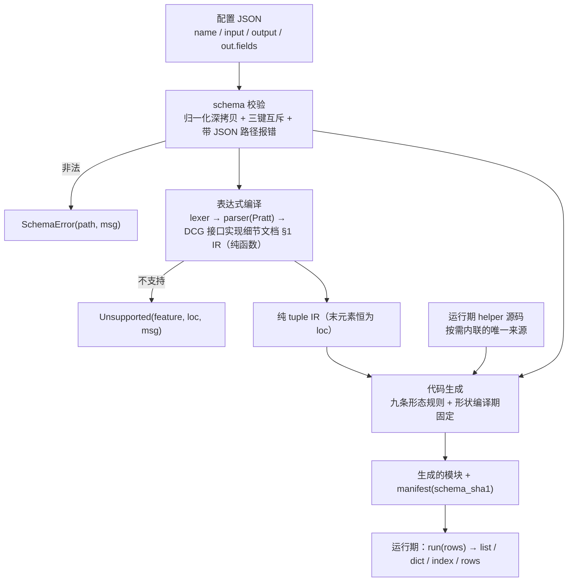

# DCG 整体设计方案与架构文档

> **读者**：项目技术负责人
> **定位**：本文是 DCG 的整体设计与架构基线，**所有实现必须按本文的设计与架构执行**；接口细节见 `DCG 接口实现细节文档.md`。
> **范围**：本文只讲**设计与架构**——为什么这样设计、各层怎么分工、产物长什么样、边界在哪里。

---

## 0. 一页速览

| 问题 | 答案 |
|---|---|
| DCG 是什么 | 运行时代码生成器：用 JSON schema + JSONata 子集描述“怎么转”，build 期编译成固化的 Python 模块 `gen/<name>.py`，运行期直接运行，无解释器开销 |
| 交付物是什么 | `gen/<name>.py`：纯 Python、除运行期 helper 模块外零依赖、可读可 diff、逐字节可复现 |
| 输入是什么 | 一份 schema：`name` + 输出结构（形状 / 嵌套字段）+ `out.fields`（取值 / 计算 / 对齐规则） |
| 运行期目标 | 向手写代码看齐：运行期无解释器、无表达式求值、无 `isinstance` 分派，循环体只做裸取值与裸运算 |
| 性能策略 | 编译期能证明就把逻辑发成 Python 原生表达式（裸代码），证不出来才发 helper 守 undefined；helper 热路径先做精确类型判定（`v.__class__ is int`，等价于 EAFP 的最短路径）、把 `isinstance` 链与多余遍历降为兜底分支。策略见 §7.5（基于计时的基准已按用户裁决删除） |
| 依赖 | 整工程不依赖 `jsonata` 包：JSONata 语义由自研 lexer/parser/compiler 在编译期完成 |

---

## 1. 定位与目标

### 1.1 DCG 是什么

DCG 是一个运行时代码生成器：用 JSON schema + JSONata 子集描述“怎么转”，在 build 期编译成固化的 Python 模块 `gen/<name>.py`，运行期直接运行，无解释器开销。转换逻辑写在 schema 里（取值、路径、表达式、输出形态），产物只有一个入口 `run(rows)`。

```jsonc
{
  "name": "cap",
  "output": {"shape": "list", "before": null, "after": null},
  "out": {"type": "object", "fields": {
    "hourA": {"type": "int64", "value": "$.5.a.1"},
    "hourB": {"type": "int64", "value": "$.5.a.2"},
    "hourD": {"type": "str",   "expr": "$string($.5.a.1) & $string($.5.a.2)"},
    "hourE": {"type": "int64", "expr": "$.5.a.1 + $.5.a.2"}
  }}
}
```

同一份 schema 编译出的产物：

```python
def run(_d):
 _o=[]
 for R in _d:
  if R:
   _a=R[5]['a']
   _a1=_a[1]
   _a2=_a[2]
   _o.append([_a1,_a2,(str(_a1)+str(_a2)),(_a1+_a2)])
 return _o
```

### 1.2 解决什么问题

实际场景很少只是「用一个脚本处理一份数据」，更常见的情况是**数据种类多、来源杂、单份量大，需要统一加工后转成统一或异构格式**：

* **数据源多**：同源异构（同一系统内多种结构）与异源异构（不同系统的同类数据）并存，每接一类就多一份处理逻辑；
* **加工复杂**：取列之外还有计算、多步加工、字段重组，简单映射表达不了；
* **格式各异**：字段名、层级、输出形状各不相同；异构来源还要对齐到统一模型。传统做法每对一类数据或一个下游，就要再写一套转换代码并单独维护。

DCG 的做法是把加工与结构定义从代码搬到配置：一份 schema 声明取值与计算（简单加工用表达式，复杂加工用扩展算子）、目标结构（嵌套 `fields` 与输出形状）和异构对齐规则，编译期生成一份针对该配置定制、可读可评审的 Python 模块。

带来的效果：新增一类数据或一个下游格式＝改配置，不新写代码；调整逻辑＝改配置重新生成；产物形态统一，可 diff、可评审、可纳入变更管理。

**适用边界：**

* **DCG 做**：行级取值 / 计算 / 结构转换、自定义输出结构、异构输入到统一结构化模型的对齐、按配置生成可评审的定制模块；
* **DCG 不做**：数据接入与调度、跨源关联 / 合并、输入校验与错误隔离、分布式执行、文件与协议序列化；
* **最合适**：数据品种多、变更频繁、单份量大、每行逻辑浅到中等、需要产物入库评审与统一维护的场景。

---

## 2. 设计动机：为什么是「编译期直出代码」

### 2.1 设计基线：为什么不能停在「通用引擎逐行解释」

| # | 事实 | 对本设计的约束 |
|---|---|---|
| 1 | 纯 Python 的执行开销本身就接近手写，慢的不是「解释」这一步 | 目标直接锚定手写形态：编译期展开、运行期零解释 |
| 2 | 行级转换的开销大头是每行构造输出对象，不是表达式求值 | 输出形状必须在编译期固定，运行期不做容器判断 |
| 3 | 同一字段每行重复取一次，代价可观（1.33×） | 每个被引用的下标前缀在行首只取一次（§7.2 规则 1） |
| 4 | 换静态编译（Cython）只值 1.2× 上下，抵不上额外复杂度与输入形状要求 | Cython 降为可选产物形态，同源生成、不改语义 |
| 5 | 通用模板路线天生结构性冗余：中转变量、append 别名、只被再解包的容器、随机变量名 | 不用模板：schema 直接驱动代码生成，产物形态唯一、可 diff 可评审 |
| 6 | 若输出形状留到运行期判断，每行都要付一次分派 | shape / before / after 全部编译期常量 |
| 7 | 若每行靠前缀约定区分「列还是变量」，规则靠约定、报错难懂 | value / const / expr 三键互斥；嵌套必须显式 fields |

### 2.2 设计约束 → 对策

| 约束（来自 §2.1） | 本设计对策 |
|---|---|
| 第 1 条：纯 Python 与手写差距很小，瓶颈不在解释 | 目标直接锚定手写形态：编译期展开、运行期零解释 |
| 第 2 条：开销大头是输出构造 | 输出形状在编译期固定，运行期不做容器判断 |
| 第 3 条：字段重复访问代价可观 | 规则 1「全局行首解包」：每个前缀只取一次 |
| 第 4 条：静态编译只值 1.13–1.18× | Cython 降为可选产物形态，同源生成，不改语义 |
| 第 5 条：模板拼接带结构性冗余 | 整块不用模板：schema 直接驱动代码生成 |
| 第 6 条：运行期做形状判断 | 形状 / before / after 全部编译期常量 |
| 第 7 条：前缀语义 + 隐式嵌套特例 |  value / const / expr  三键互斥；嵌套必须显式  fields |
| 额外：产物要能自证来源 | 模块名 = schema.name，manifest 记 schema_sha1，冲突报错 |

---

## 3. 架构总览

### 3.1 单向依赖链路

```
配置校验（Schema） → IR → 代码生成（Generator） → 运行期 helper
                        ↑
                  表达式编译（JSONata）
```

* 配置校验层：只做 schema 校验与归一化，不依赖任何其它层。
* IR 层：节点定义 + 结构遍历，不依赖任何其它层。
* 表达式编译层：只依赖自身的词法/语法/路径/策略，产出 IR 常量。
* 代码生成层：依赖校验结果、IR、表达式编译与运行期 helper 的源码文本。
* 运行期 helper 层：不依赖任何其它层 —— 它既是运行期实现，又是生成码内联文本的唯一来源。
* 硬约束：依赖方向单向、无环；校验层 / IR 层 / 运行期 helper 层不得反向依赖代码生成层，由模块职责与评审约定把守。

### 3.2 数据流



一个字段的完整旅程：

```
out.fields["hourE"] = {"type":"int64", "expr":"hourA + hourB"}
      │
      ├─ schema 校验：三键恰好一个（expr）、type 合法 → 归一化
      ├─ 表达式编译("hourA + hourB")
      │     → ("bin","+",("field","hourA",(1,1)),("field","hourB",(1,9)),(1,7))
      ├─ codegen._Gen.emit → "hourA + hourB"（裸名走 defined 表）；
      │     若 type 声明为 int64 ⇒ 裸运算；若为 any ⇒ 退化成 `_ad(hourA,hourB)`
      └─ 产物：`_c([...,hourA + hourB])`（`_c=_o.append` 提到循环外）
```

### 3.3 为什么不用「通用模板 + AST 改写」

| 维度 | 通用引擎：模板 + `ast.NodeTransformer` | DCG：schema 直接驱动 emit | 为什么后者赢 |
|---|---|---|---|
| 中间表示 | Python 源码字符串 → AST → 改写 → `ast.unparse` → 源码 | IR tuple → 直接拼表达式字符串 | 少一次 parse + 一次 unparse，且产物**形态可预测** |
| 变量命名 | 运行期随机 10 字符 | `_` + 字段名，前缀记忆化 | 可 diff、可评审、逐字节可复现（`DCG 接口实现细节文档.md` §4.2 规则 8） |
| 形状 | 模板里带运行期判断（`tuple(doc.items())`） | 编译期常量（生成时定死） | 每行省掉容器类型判断 |
| 取值语义 | `$`/`#` 前缀闸门 | `value`/`const`/`expr` 三键互斥 | 消除「同一前缀被反复展开」→ 命中 1.33× |
| 冗余 | 中途变量、append 别名、空桩 | 九条形态规则 + 结构性约束 | 九条规则可逐条判定 |
| 不支持项的处置 | 运行期才炸 | build 期 `Unsupported`/`SchemaError`（带列号/JSON 路径） | 「编译期全量报错」 |

代价也如实记：产物不再「单文件自包含」—— 需要 helper 时首行是导入运行期 helper 模块的一行。这是用「哨兵与 helper 只有一份实现」换来的（见 §7.4）。

---

## 4. Schema 结构设计（输入 DSL）

Schema 是 DCG 唯一的输入：一份 JSON 同时声明「输出什么结构」和「每个值怎么来」。设计目标有三个：**能表达真实结构**（嵌套对象/数组、四种输出形态）、**能被机器确定性校验**（所有错误在 build 期以 JSON 路径定位）、**能被人类 diff 与评审**（纯 JSON，没有隐式规则）。

### 4.1 顶层四块

| 键 | 必填 | 作用 | 形态 |
|---|---|---|---|
| `name` | 是 | 产物模块名（同时也是产物名） | `[A-Za-z_][A-Za-z0-9_]*` |
| `input` | 否 | 行集合在输入数据里的路径 | `{"source": "$.a.b"}`，缺省 `$` 表示整份输入就是行集合 |
| `output` | 是 | 怎么产出 | `shape` / `before` / `after` / `trace` 四键（§4.2） |
| `out` | 是 | 输出长什么样 | 一个 `object` 节点，字段树见 §4.4 |

一份 schema 只对应一个产物、一个入口 `run(rows)`：输入是行集，输出由 `output.shape` 决定。

### 4.2 输出形态（`output`）

输出形态是**编译期常量**，不是运行期参数：

| 键 | 默认 | 取值 | 设计含义 |
|---|---|---|---|
| `shape` | `list` | `list` / `dict` / `index` / `rows` | 产物返回的形状：逐行 list、列式 dict、`{行下标: 行值}`、逐行 dict |
| `before` | `null` | 表达式 / `py{}` / `@函数名` | **数据级前处理**：输入定位后一次求值，入参是全量数据，返回值替换输入数据 |
| `after` | `null` | 表达式 / `@函数名` | **数据级后处理**：结果组装后一次求值，入参是全量结果，返回值替换返回值 |
| `trace` | `false` | bool | 调试产物开关，与正式产物分离，不污染热路径 |

各组合的可观察行为在 §8 给出；这里只强调一条：**形状不可运行期切换** —— 要两种输出就 build 两个产物。

### 4.3 取值三键与类型声明

每个字段（`FieldSpec`）用三键之一声明值从哪来，**恰好一个**：

| 键 | 形态 | 编译结果 | 适用 |
|---|---|---|---|
| `value` | `"$.a.b"` / `"$.5.a.1"` | 直接引用输入列的访问链，零额外开销 | 直接取值 |
| `const` | 任意 JSON 常量 | 内联常量 | 固定值 |
| `expr` | JSONata 子集 + 反引号内联 Python | 编译成定制表达式 | 计算/加工/结构重组 |

与三键配套的声明：

* `type`：**必填**，八选一：`int64` / `int32` / `float64` / `str` / `bool` / `list` / `object` / `any`。`type` 是**声明**不是转换：声明越具体，生成码越能省掉类型判断（§7.2 规则 4）。
* `optional`：默认为 `false`；为 `true` 时值可能是 undefined，产物生成一次守卫（undefined → `None`）。
* `default`：可选；字段算出 undefined 时替换成该 JSON 常量（`0`、`""`、`null`、`[]` 等），产物固化成一次 `_df(<expr>, <default>)`。`default` 必须与 `type` 相容，且不能与 `fields` 同用；设了 `default` 就不再生成 `optional` 的 `None` 分支。
* 嵌套形态由 `type` 决定（具名对象 / 位置行），见 §4.4；数组不声明元素，直接用 `value`/`expr` 给出。

### 4.4 嵌套结构

嵌套**必须显式声明**，且只有 `fields` 一个键，没有隐式特例：

* **具名对象**：`"type": "object"` + `"fields": {字段名: FieldSpec, ...}`（`fields` 必填，空对象报错）→ 运行期是带键的 dict；
* **位置行**：`"type": "list"` + `"fields": {字段名: FieldSpec, ...}` → 运行期是按字段声明顺序的 list（undefined 落成 `None` 以保住位置），用来承接「行本身就是位置 list」的文档结构，如 `{"doc": [[...], ...]}`；
* **数组不声明元素**：列表值由 `value` / `expr` 直接给出（`{"type":"list","value":"$.tags"}`），DCG 不逐元素重建数组；
* **fields**: 只能配 `type:"object"` 或 `type:"list"`；不带 `fields` 的列表字段必须用 `value` / `expr` 给出来源（只写 `{"type":"list"}` 会报 `SchemaError: value/const/expr 必须恰好提供一个`）；
* 嵌套深度不限，同一套 `fields` 规则递归适用。

显式声明的代价是要多写一层，换来的是编译期能完全确定产物形态：生成器不需要在运行期猜「这是 list 还是 dict」。

### 4.5 声明顺序与计算顺序

**字段的声明顺序只决定输出结构，不决定计算顺序。**

* **输出按声明顺序**：`list` 形状按字段声明顺序取值；`dict` 形状按声明顺序建键；嵌套 `object` 按内层声明顺序。行数据的键顺序不影响输出顺序。
* **计算按依赖关系**：字段之间通过表达式里的字段引用（裸名、`$字段名`、动态下标段里的字段名）构成依赖；生成器在 build 期建立依赖图，按依赖先后计算，与声明顺序无关。
* **允许任意声明顺序**：后声明的字段可以被先声明的字段引用（前向引用合法）。例如 `hourX` 声明在 `hour` 前面，只要 `hourX` 引用 `hour`，计算时先算 `hour`，输出仍按声明顺序排列。
* **依赖必须无环**：环在 build 期报 `SchemaError`（给出环上的字段链）；引用不存在的字段同样在 build 期报错。
* **每个字段最多算一次**：被多个字段引用时复用同一局部绑定，不重复求值；未被引用的字段照常输出。
* **作用域**：每个 `fields` 是一层独立作用域；内层嵌套字段可以引用外层字段，同层兄弟可以按裸名互相引用；内层同名字段遮蔽外层（就近优先）；外层不能引用内层字段名。
* **确定性**：同一依赖层次内按声明顺序计算；输出始终按声明顺序组装。

#### 4.5.1 依赖来源

| 写法 | 是否构成依赖 | 计算时拿到的值 |
|---|---|---|
| 裸名 `hour`、`$hour` | 是 | 该字段的计算结果 |
| 动态下标段里的字段名 `$.a[hour]` | 是（依赖 `hour`） | 该字段的计算结果作为下标 |
| 普通路径 `$.a`、`$.5.a` | 否 | 原始行（行首解包） |
| 函数字面量体内的自由字段 `function($x){ hour + $x }` | 是 | 进入函数前绑定 |
| `py{}` 块、反引号段里的 `$.字段名` | 否（只校验已声明） | 原始行 |
| 反引号段里的裸名 `` `a + 1` `` | 是 | 该字段的计算结果 |
| 嵌套 `fields` 内同层兄弟裸名（如 `doc.hourE = "hourA + hourB"`） | 是（该嵌套作用域内） | 兄弟字段的计算结果 |

`$.字段名` 只做「必须是已声明字段」的校验，然后直接读原始行，**不记依赖边**；因此不会产生假环：`v = py{ $.a }` 与 `a = v + 1` 可以正常生成（块读的是行里的原始 `a`）。反引号段里的裸名才是字段引用，读该字段的计算结果、参与依赖图。

#### 4.5.2 建图

* **节点** = 某一层 `fields` 里的每个输出字段；**每层 `fields` 各自成图**（嵌套作用域，见 4.5.7），内层字段引用外层名字时，被引用的外层字段仍按顶层图的顺序先算。
* **边** = 「被引用字段 → 引用字段」，方向即求值先后；字段引用自己不算边，直接按环处理。
* 只保留已声明字段之间的边；引用未声明字段在生成该字段表达式时 build 期报 `SchemaError` 并列出可用字段名。
* 图在 `plan` 阶段一次建好，`body` 按它决定求值顺序。

#### 4.5.3 求值顺序（稳定拓扑排序）

Kahn 式的贪心拓扑排序，每轮取「依赖已全部算完」的字段：

1. 按**声明顺序**扫描剩余字段，收集本轮 `ready`（其依赖都已在完成集合里）；
2. 把 `ready` 按声明顺序整批加入完成集合；
3. 重复直到没有剩余字段。

同一层里「谁先就绪」按声明顺序 tie-break，所以同一 schema 的求值顺序**唯一确定**，产物逐字节可复现（规则 8 的前提）。不用任意拓扑序，是因为任意顺序会随实现细节漂移，破坏字节级复现。

#### 4.5.4 环检测与报错

某一轮 `ready` 为空但仍有字段未完成 → 依赖成环，build 期报：

```
SchemaError: out.fields: 字段依赖成环: a -> b -> a
```

报错给出环上的字段链（从剩余节点沿依赖回溯取一条闭合链），而不是只说「有环」。

#### 4.5.5 绑定与复用

* 被别的字段**按名引用**的字段：按计算顺序先算，并落成局部变量（如 `a=R['x']+1`），引用处直接用这个名字；
* 只被引用一次的字段：可以在使用处内联，不落局部；
* 没有被任何字段引用的字段：只在组装输出行时内联；
* 每个字段最多求值一次（共享的局部绑定只有一份）；
* 行首解包顺序跟计算顺序走；输出行始终按声明顺序组装（按 `fields` 声明序取各字段值）。

#### 4.5.6 与函数字面量、py{} 的关系

函数字面量体内的自由字段按普通字段引用进依赖图，在进入函数前绑定；函数参数遮蔽同名字段，不算引用。`py{}` 与反引号段的 `$.` 链读原始行，因此不进依赖图、不影响计算顺序，只校验字段名已声明；反引号段里的裸名是真正的字段引用（见 4.5.1）。

#### 4.5.7 嵌套作用域

每个 `fields` 是一层独立作用域，规则与编程语言的词法作用域同构：

* **同层兄弟可以裸名互引**：`doc.fields.hourE = "hourA + hourB"` 里的 `hourA` / `hourB` 指同一层的字段；前向引用合法，成环在 build 期报 `SchemaError`，路径写到该层：`out.fields.doc.fields: 字段依赖成环: a -> b -> a`。
* **就近优先**：名字先在当前层找，找不到逐层向外，最后落到顶层字段；内层同名字段**遮蔽**外层。
* **外层不能引用内层名字**：内层字段名只在内层可见。
* **每层各自拓扑排序**：被兄弟引用的字段在本层先算一次并落成局部绑定，组装仍按本层声明顺序（输出结构不变）。
* **`py{}` / 反引号 `$.` 链看不到兄弟名字**：块内只读原始行；要拿同层字段的计算结果，用裸名表达式而不是 `py{}`。

### 4.6 硬规则与报错

两条硬规则（全部在 **build 期**触发，不允许漏到运行期）：

1. **裸字符串不是路径**：`"a"` 这种值必须报 `SchemaError`；路径只能以 `$` 开头（允许数值下标），或走 `const`。不存在「靠前缀猜语义」的第三态。
2. **嵌套必须显式**：嵌套结构只能用 `fields` 声明——`type:"object"` 是具名对象，`type:"list"` 是位置行；数组由 `value`/`expr` 直接给出，schema 里不逐元素重建（没有 `items` 这个键，写了即未知键报错）。list 里可以放 dict，默认原样输出；要把 dict 内部的字段展开成结构化字段，必须在 schema 里写出来，不能靠「数据里出现 dict」自动推导。

报错形态统一：`SchemaError(path, msg)`，`path` 是 JSON 路径（如 `out.fields.sum`），`str(e)` 形如 `out.fields.sum: value/const/expr 必须恰好提供一个（给了 2 个）`。路径定位是这个设计的关键 —— 配置写错时，用户先看到的是「哪个字段的哪个键错了」。

### 4.7 为什么是 JSON，而不是另一种 DSL

* **零解析成本**：JSON 是 Python 内置能力，schema 不需要第二套词法/语法；
* **可比较、可 diff、可评审**：schema 天然是数据，能纳入同一条变更与评审链路（对比 YAML 的隐式类型与缩进敏感）；
* **与表达式层同源**：`expr` 里的 JSONata 是 JSON 世界的数据语言，schema 用 JSON 不会引入两套「对象/数组」语义；
* **契约可冻结**：schema 的形状能被逐条写死（§4.6 的两条硬规则就是冻结面），YAML / 自定义 DSL 很难做到同等级别的冻结。

### 4.8 扩展点边界

* **唯一扩展点**是 `expr` 里的**反引号内联 Python**（§6.3）：复杂算子用它承接，而不是给 schema 增加新语法；
* 表达式层还支持**函数注册**（`Registry`）：注册后 `$myfn(...)` 可被编译成调用，但注册表只影响表达式层，**不改变 schema 结构**；
* schema 本身**不开放**「生成器代码注入」：配置只能声明值、结构与输出形态，不能改生成逻辑；这是「配置驱动」与「任意代码执行」的边界（反引号是唯一例外，且明确是任意 Python 执行，不是沙箱）；
* **三个扩展点的完整规范**（能扩展什么 / 不能扩展什么、`Registry` 用法、内联 Python 与数据级外部函数的边界、新增内置算子必须一次改齐的六处、undefined 硬约束、命名与产物纪律、三条红线）见 **`JSONata 语法.md` §13「扩展内置算子的规范」**。本节只给边界结论，规范与流程以该章为准；改引擎前先读 §13.10 的只读确定性事实表。

## 5. IR 设计

IR 共 **41 个符号**（16 个节点常量 + 3 个算子集合 + 16 个构造器 + 6 个结构工具）。

### 5.1 节点表（DCG 接口实现细节文档 §1）

| 节点 | 形态 | 说明 |
|---|---|---|
| `lit` | `("lit", value, loc)` | Python 常量字面量 |
| `field` | `("field", name, loc)` | 裸标识符就是字段（`hourA + hourB` 的命脉） |
| `index` | `("index", base, idx, loc)` | `base[idx]`；`$.5.a.1` 编成常量下标链，不是 `field` |
| `root` | `("root", loc)` | `$` 展开为行对象本身 |
| `var` | `("var", name, loc)` | JSONata 变量 `$v`（`name` 不含 `$`） |
| `unary` | `("unary", op, operand, loc)` | `op ∈ {"-","+","not"}` |
| `bin` | `("bin", op, left, right, loc)` | `op` 见 §5.3 |
| `cond` | `("cond", test, then, orelse, loc)` | 三元 `? :` |
| `call` | `("call", fname, [args...], loc)` | `fname` 含 `$`（如 `"$uppercase"`） |
| `rfunc` | `("rfunc", qualname, [args...], loc)` | 用户注册函数，`qualname` 形如 `"pkg.mod.fn"` |
| `array` | `("array", [子节点...], loc)` | 数组字面量 |
| `object` | `("object", [(key, val_ir), ...], loc)` | 对象字面量，保序 |
| `py` | `("py", source_str, [free_field_names...], loc)` | 反引号段，按设计不透明 |
| `pyblock` | `("pyblock", stmts_source, [free_field_names...], loc)` | `py{}` 多语句块，编译期定稿为一个辅助函数体 |
| `range` | `("range", lo, hi, loc)` | 区间；policy 在 build 期必须拒绝 |
| `lambda` | `("lambda", [params], body, loc)` | 函数字面量 `function($x){...}`；自本设计起可达，编译成 Python 函数（§6.5） |

`range` 虽然入表但**永远不会出现在 IR 里**：`..` 在表达式编译期就抛 `Unsupported`，它是**契约的完整性声明**，不是可达节点。`lambda` 不同：函数字面量 `function($x){...}` 自本设计起可达，编成 `lambda` 节点后由代码生成器编译成 Python 函数（§6.5）。

### 5.2 「末元素恒为 loc」与「纯 tuple」

* **末元素恒为 `loc`**：`loc = (line, col)` 或 `None`。工具函数 `loc_of(node)` 只在最后一项是 2-tuple 时返回它。好处是：任何节点都能报出**列号**，`Unsupported`/`SchemaError` 的定位不需要额外传参，AST 遍历不需要 visitor。
* **纯 tuple，不是 class**（DCG 接口实现细节文档 §1 明确列出四条理由）：
  1. **便于比较**：`compile_expr("a+b") == compile_expr("a+b")` 直接成立，对比与 snapshot 无需自定义 `__eq__`；
  2. **可哈希**：可以放进 set/dict 做去重、公共子表达式识别；
  3. **零构造开销**：tuple 字面量比对象实例化便宜，节点构造发生在编译期热路径上；
  4. **snapshot 友好**：`("index", ("root", (1,1)), ("lit", 5, (1,2)), (1,2))` 直接可读可 diff。

实测：`compile_expr("$.a")` → `('index', ('root', (1, 1)), ('lit', 'a', (1, 2)), (1, 2))`，`loc` 在最后一项。

### 5.3 `bin` 各算符的 undefined 传播规则

| op | 含义 | undefined 传播 | 运行期 helper |
|---|---|---|---|
| `+` `-` `*` `/` `%` | 算术 | 传播；`null` 参与算术是错误 | `_ad` `_sb` `_ml` `_dv` `_md` |
| `&` | 字符串拼接 | 不传播，undefined 当空串 | `_cc` |
| `=` `!=` | 相等 | 任一侧 undefined → `False` | `_eq` `_ne` |
| `<` `<=` `>` `>=` | 大小 | 任一侧 undefined → undefined | `_lt` `_le` `_gt` `_ge` |
| `and` `or` | 逻辑 | 按 JSONata 真值；undefined 参与运算 | `_and` `_or` |
| `in` | 成员 | 与 `=` 同族（任一侧 undefined → `False`） | `_in` |

这张表在 IR 层实现为 `BIN_OPS`（op → (含义, undefined 家族)），构造器 `bin_(op, left, right, loc)` 对非法 `op` 直接 `ValueError`。运行期对每条 undefined 规则都有专用函数（不分派表！）—— 理由见 §7.2 规则 5。

### 5.4 结构工具

`kind(node)` / `loc_of` / `children`（按节点类型给出子节点）/ `walk`（DFS）/ `is_const`（字面量、全常量数组/对象、常量一元/二元）/ `key_path`（把 `field`/`index` 链折成 key path，如 `$.5.a.1` → `(5,"a",1)`，要求 `index` 的 `idx` 是 `lit` 且值为 `int`/`str`）。`key_path` 是「常量链」判定的单一实现，生成器的命名与常量链折叠都依赖它。

---

## 6. 表达式层设计（JSONata + 反引号内联 Python）

### 6.1 三层结构

| 层 | 职责 | 产物 | 要点 |
|---|---|---|---|
| 词法 | 正则扫描 TOKEN | `[(kind, value, col), ...]` | 反引号段是词法边界：段内容原样捕获到下一个未转义反引号，段内不解析 JSONata（JSONata 从不使用 `` ` ``，零歧义）。`py{...}` 多语句块整体扫描 |
| 语法 | Pratt 解析器（BP 表按 JSONata 1.8） | 语法树 | 调用/下标/路径统一在中缀循环的后缀位置处理；只在 prefix 处理会让 `$not(miss)`、`a[0]` 报「多余内容」 |
| 编译 | 纯函数 `compile_expr(src, *, loc_base=(1,1), registry=None)` | DCG 接口实现细节文档 §1 的纯 tuple IR | 同输入同输出，不读任何全局 `MODE` |

Pratt 结合力（越小越松）：`or 10` · `and 20` · 比较/`in` 30 · `& 40` · `+ - 50` · `* / % 60` · 一元 `- + not` 70 · 后缀 `.` `[` `(` **90** · `..` 45 · 三元 `? :` 5。JSONata 的 `` ` `` 段由 lexer 先切走，所以 `str($.5.a.1) + str(hourB)` 整段是一个 `py` 节点。

表达式层对外导出 21 个符号，其中DCG 接口实现细节文档 §5 要求的三个必须在：`compile_expr` / `Unsupported` / `Registry`。

### 6.2 能力边界：四类函数与永久拒绝

设计原则：**绝不静默降级** —— 任何不在支持范围里的调用、任何永久拒绝的构造，都必须抛 `Unsupported`。

**A 类｜行内函数（逐行可编译，直接发射运行期 helper）**

* 字符串（19）：`$string $uppercase $lowercase $trim $pad $contains $split $join $substring $substringBefore $substringAfter $replace $length $base64encode $base64decode $encodeUrlComponent $decodeUrlComponent $formatNumber $formatBase`
* 数值（10）：`$number $abs $floor $ceil $round $sqrt $power $sum $min $max`
* 布尔/其他（4）：`$boolean $not $exists $type`
* 数组与对象（13）：`$count $append $average $reverse $sort $distinct $merge $keys $values $lookup $spread $single $indexOf`

A 类的实参只要**逐行可求值**即可：字面量、字段取值、动态下标、数组/对象字面量都行。`$sum([$.5.a.1, $.a.c])` 与 `$sum($.items)` 同属这一类——DCG 逐行求值，这一行里的数组就是普通值，不需要跨行状态。**不再区分「仅限字面量数组」**。

**B 类｜高阶函数（需要函数字面量，§6.5）**

`$map $filter $reduce $each $sift`，以及带比较器的 `$sort(array, function)`；`$position()` 只在 B 类函数体内有意义（序列上下文）。函数字面量 `function($x){...}` 编成 Python 函数，函数体仍是逐行表达式，自由字段进依赖图。

**C 类｜非确定函数（支持，但结果不可复现，§6.6）**

`$now $millis $random $shuffle`：产物代码固定，运行期从注入的时钟/随机源取值。

**永久拒绝**

* `$eval`：运行期求值任意表达式 = 运行期解释器 + 注入面，违反「运行期无解释器」。
* 语法构造：`a..b` 区间、正则字面量 `/.../`、位置绑定 `#`、join 绑定 `@`、变换操作符 `~>` / `|...|`、Sort `^`、Reduce `{k:v}` 路径阶段、分组聚合 `{..}`。

**裸名调用别名 `BARE_CALL_ALIASES`（6 个）**：`str→$string`、`int→$number`、`float→$number`、`bool→$boolean`、`len→$length`、`abs→$abs`。真实生产 schema 的 ext 写的是 `str($.x)` 而不是 `$string($.x)`；只有这张表里的裸名可被调用，表外的 `a(...)` 仍按「只有 `$` 函数可以被调用」拒绝。

**先判归属、再 emit 实参**：这是原型踩过的坑 —— `$map(xs, $string)` 必须按 `$map` 自己的规则判定（实参须是函数字面量），而不是被实参里的 `$string` 抢答成 `$string 需要 ctx 绑定`。拒绝判定的设计说明明确记了这条。

### 6.3 反引号内联 Python（唯一扩展点）

反引号承接「字段级自定义表达式」这一能力（见 §10）。词法层原样捕获段内容，段解析步骤做两件事：

1. `ast.parse(src, mode="eval")` 校验（**必须是单个 Python 表达式**）；
2. 找出段内的 `$.` 字段链与裸名，登记进 `free_field_names`（链文本，不含前导 `$.`）。

文档里把 `expr` 表达式与反引号内联 Python 统称**扩展算子**：简单加工走 `expr`，复杂加工走反引号（单表达式）或 `py{}`（多语句块）。**扩展算子的完整规范（含 `Registry` 注册、数据级 `@pkg.mod.fn`、新增算子的六步流程、undefined 硬约束与三条红线）见 `JSONata 语法.md` §13「扩展内置算子的规范」**；本节只描述反引号/`py{}` 这一条路径的实现细节。

实测锚点（已核对；`py{}` 块由多语句块编译处理）：

```
analyze_py_segment('$.a + 1')                     -> ('$.a + 1', ['a'])
analyze_py_segment('$.5.a.1')                     -> ('$.5.a.1', ['5.a.1'])
analyze_py_segment('$.data')                      -> ('$.data', ['data'])
analyze_py_segment('$.data.ID')                   -> ('$.data.ID', ['data.ID'])
analyze_py_segment('$.data[\'AIRPORTIATA\']')     -> (..., ['data'])      # 动态键不经链解析
analyze_py_segment('str($.5.a.1) + str(hourB)')   -> (..., ['5.a.1', 'hourB'])
analyze_py_segment("'hourB' + str($.5.a.1)")      -> (..., ['5.a.1'])     # 字符串字面量内的裸名不登记
```

**三条硬规则**

1. **`$` 是唯一的字段/变量入口。** 反引号内容不暴露裸字段名，否则 `int`/`str`/`math` 与字段名静默撞车。`$.x` → 生成局部名；`$` 单独 = 当前行；`$v` = JSONata 变量。
2. **段内必须是 Python 表达式**（`ast.parse(seg,"eval")`），不能声明新名字、不能 `import`。拒绝样例与实际报错：
   * `` `import os` `` → `Unsupported: 第 1 列: 反引号段 Python 语法错误 不可逐行编译（invalid syntax（段内偏移 1）—— 必须是单个 Python 表达式）`
   * `` `a=1` `` → 同上（段内偏移 2）
3. **build 期报错带字符偏移**（上例的「段内偏移 N」），不留到运行期 `SyntaxError`。

`py{}` 多语句块额外做三件事：把语句序列定稿为辅助函数体、把块内局部名重命名为 `__jx*` 前缀避免与字段撞车、校验恰好一个 `return`。codegen 把它发成 `run()` **之外**的 `def _pyN(...)`，调用处传已解包字段（禁止 lambda/IIFE，见 `DCG 接口实现细节文档.md` §1）。

**边界（`DCG 接口实现细节文档.md` §6 如实声明）**：反引号 = **任意 Python 执行，不是沙箱**；build 期不执行代码，只 `ast.parse` 校验；真正的沙箱需要进程级手段。`PY_SAFE_MODULES`（25 个）只约束**裸模块名**（`math re json decimal datetime itertools ...`），**不约束内置函数** —— 实测 `` `open(x)` `` 被接受为 `('py', 'open(x)', ['x'], (1, 1))`。这是能力，也是风险，必须在 README 里如实写明。

`__jx` 是表达式层保留给生成器的占位符/别名命名空间（前缀 `__jx`，占位符 `__jx_f`），用户段里出现即报错。

### 6.4 不支持的结构与理由

**以下构造永久拒绝**：

| 拒绝项 | 理由 | 异常 |
|---|---|---|
| `$eval(...)` | 运行期求值任意表达式 = 运行期解释器入口，且是注入面 | `Unsupported` |
| `a..b` 区间 | 需要序列语义（生成器/迭代器），逐行编译无对应形态 | `Unsupported` |
| 正则字面量 `/.../flags` | 正则编译有状态、会引入隐藏缓存 | `Unsupported` |
| `~>`、`\|...\|`、`^`、`#`、`@`、`{k:v}`、`{..}` | 变换/排序/绑定/分组都是整批语义 | `Unsupported` |

函数字面量、行内数组函数、高阶函数与非确定函数**不在拒绝之列**，见 §6.2 / §6.5 / §6.6。

**明确不做**：自创第二套 DSL · 运行期解释 JSONata · 运行期按参数切换形状 · 静默降级 · 语言层沙箱。

### 6.5 函数字面量与高阶函数

JSONata 的函数字面量写作 `function($x){ <表达式> }`，**只能**作 `$map` / `$filter` / `$reduce` / `$each` / `$sift` / `$sort` 的实参；放到别的位置（例如直接当字段表达式）→ build 期 `SchemaError`。

* **编译期**：函数字面量编成 `("lambda", [参数...], body, loc)`；代码生成器把它编译成一个 Python 函数（表达式体）；回调按固定两位置参数调用，少写的参数用 `_i0`/`_i1` 补齐，例如 `function($x){ $x*2 }` → `lambda x,_i1:_ml(x,2)`。
* **函数体是单条表达式**：可用行内函数、字段取值、常量与运算符；允许内含 `py{}` 块（与普通字段一样编译成 run() 之外的辅助函数）。
* **函数体内的 `py{}`**：块内不能引用回调参数（只存在于表达式层），只能读原始行 的 `$.字段链`；块编译成 run() 之外的辅助函数，每元素调用一次。
* **自由字段**：函数体引用的字段按依赖图在进入函数前绑定（与普通字段引用同一套规则）；函数参数遮蔽同名字段。
* **求值**：`$map` / `$filter` / `$sort` 对行内数组逐元素调用；`$reduce` 带初值折叠；`$each` 按对象键值对回调；`$sift` 过滤对象键。全部发生在行内，不需要整批状态。
* **语义基准**：与 JSONata 1.8 对齐（空数组、`undefined` 元素、比较器返回值约定、`$position` 语义）。

### 6.6 非确定函数与可复现性

`$now()`（ISO 8601 UTC 毫秒时间戳）、`$millis()`（epoch 毫秒）、`$random()`（`[0,1)` 浮点）、`$shuffle(array)`（洗牌）由运行期 helper 提供，产物里只出现 helper 调用。

* **产物仍可复现**：生成代码是确定的，同一 schema 逐字节一致；非确定只发生在运行结果。
* **结果不可复现**：同一产物两次运行结果可能不同。使用 C 类函数的切片，证据里必须标注「输出含非确定值」，并用注入的固定时钟/随机源重跑一次作为复跑证据。
* **注入接口**：运行期 helper 从模块级可替换的时钟/随机源取值（测试与证据重跑用固定源）；不引入环境变量这类隐式全局开关，避免产物行为随宿主环境静默变化。
* **决定论的边界**：`$eval` 不在 C 类，永久拒绝（§6.4）。

### 6.7 为什么不依赖 `jsonata` 包

整个工程不依赖 `jsonata` 包。JSONata 语义完全由仓库内的 lexer/parser/compiler 实现，编译期把表达式翻译成 IR；运行期没有解释器，也没有第三方表达式库。

这样做的取舍：

* 语义覆盖是有界子集（§6.2 白名单 + §6.4 拒绝清单），不是完整 JSONata；越界一律 `Unsupported`，绝不静默降级；
* 语义基准来自官方 JSONata 1.8 规范，反引号内联 Python 是唯一扩展点；
* 需要核对语义边界时，以 `DCG 接口实现细节文档.md` §3 与本文 §6.2 / §6.4 为准。

---

## 7. 代码生成策略

### 7.1 生成器内部结构

生成器分五步完成一次生成：plan（建立字段依赖图、确定计算顺序、行首解包顺序与前缀命名）→ emit（IR → Python 表达式源码）→ body（生成循环体）→ module（组装模块、按需 import）→ finish（生成返回形态）。各步职责：

| 阶段 | 作用 |
|---|---|
| 校验与指纹 | canonical JSON → sha1；模块名 = `schema.name`；禁止 random |
| 常量链折叠 | 把 `index` 常量链折回 `root`，得到段元组；非常量链返回 `None` |
| 生成状态 | 单次生成的全部状态：fields/shape/before/after/src/helpers/rfuncs/head/pre/paths |
| 依赖分析 | 从每个字段的表达式里收集字段引用（裸名、`$字段名`、动态下标段里的字段名）建依赖图；按依赖做稳定拓扑排序（每轮按声明序取就绪字段，顺序唯一确定）；环与未声明引用在 build 期报 `SchemaError` |
| 命名与解包 | 前缀只取一次的记忆化命名（规则 1）+ 按计算顺序的行首解包：被引用字段先算并绑定一次 |
| 表达式生成 | IR → Python 表达式源码；`&` 与裸运算有快路径 |
| 裸名校验 | 裸名查 `defined` 表，查不到 → build 期 `SchemaError` 并列出可用字段名（绝不留到运行期 `NameError`） |
| 反引号段 | `$.` 链替换为生成局部名、裸名查 `defined`；`py{}` 块发成 `run()` 外的辅助函数 |
| 取值分派 | const / value / expr / fields |
| 组装与收尾 | 生成循环体、组装模块（含按需 import 行）、生成返回形态 |

`generate(schema, *, cython=False, inline_optional=True)` 内部**只调用一次 `compile()`**（规则 6），且返回前已证明产物可编译 —— 产物就是它返回的字符串，「看起来可用」== 「能编译」。

### 7.2 九条形态规则

DCG 接口实现细节文档 §4.2 收口了九条（字符数只是代理指标，规则本身才是）。这里只给一句话概述，
每条规则的**判定条件、生成形态、报错口径与实测数据**见 `DCG 接口实现细节文档.md` §4.2 与本文 §7.5：

| # | 规则 | 一句话 |
|---|---|---|
| 1 | 下标前缀只取一次 | 同一前缀在行首绑定一次，后续复用局部名 |
| 2 | 零恒等赋值、零中转变量 | 不搬数据；唯一豁免是输出容器的方法绑定 `_c=_o.append` |
| 3 | 输出形状编译期固定 | 形状在 build 期定死，运行期无容器判断 |
| 4 | 无冗余类型转换 | `type` 是声明不是转换；要转换必须显式写 |
| 5 | 无 `isinstance` 分派链 | 每个运算符一个专用 helper；类型可证时直接发裸运算符 |
| 6 | 每次 build 只 `compile` 一次 | 无空桩、无第二份源码混进交付物 |
| 7 | 守卫只对付 `optional` | 只有 `optional: true` 才生成 undefined 判断，且恰好一次 |
| 8 | 变量名确定性、1–3 字符 | 命名只由声明顺序与链结构决定，禁止 random，保证逐字节可复现 |
| 9 | Cython 模式同源 | 恒等于纯 Python 产物 + 每局部一行 `cdef object`，不改语义 |

**与计算顺序的关系**：字段按依赖图求值（§4.5），被其它字段引用的字段按拓扑序先算并绑定；
只被引用一次的字段在使用处内联。前缀记忆化与求值顺序无关 —— 同一前缀不论被谁、在哪一步使用，
始终只取一次；输出始终按声明序组装，计算顺序不影响结果结构。

**内联纪律**：helper 按需内联并只带传递依赖；产物只在真的用到 helper 时才发导入行
（CAP 与 M0 两个样例连一行 import 都不需要）；产物不写 docstring，来源由 `build()` 的 manifest 记录。

### 7.3 产物形态

以下结构由上述 schema 生成。

**CAP 样例**：整模块 **144** 字符 / 9 行（字符数仅作参考，预算已取消，见 §7.5）。

```python
def run(_d):
 _o=[]
 _c=_o.append
 for R in _d:
  if R:
   _a=R[5]['a']
   _a1=_a[1]
   _a2=_a[2]
   _c([_a1,_a2,(str(_a1)+str(_a2)),(_a1+_a2)])
 return _o
```

**M0 样例**：整模块 **198** 字符 / 10 行。

```python
def run(_d):
 _d=_d['index']
 _o=[]
 _c=_o.append
 for R in _d:
  if R:
   _a=R[5]['a']
   _a1=_a[1]
   _a2=_a[2]
   _c([_a,_a1,_a2,R[2],str(_a1) + str(_a2),(_a1+_a2),(_a2+_a1),(_a[2]+123)])
 return _o
```

**字段互相引用时**：被引用字段的求值提前到计算顺序前段，输出仍按声明序。例如字段 `b` 声明在 `a` 前、`b = $a * 2`，会先算 `_a` 再算 `_b`，但 append 里仍是 `[_b,_a]`；上面两个样例的字段互不依赖，所以看不出顺序差异。

**其它形状的尾部**（同一行字面量，只换结尾）：

| shape | `return` 形态 |
|---|---|
| `list` | `return _o` |
| `dict` | `return{k:[r[i]for r in _o]for i,k in enumerate([...字段名...])}` |
| `index` | `return{i:r for i,r in enumerate(_o)}` |
| `rows` | `return[{k:r[i]for i,k in enumerate([...字段名...])}for r in _o]` |

嵌套对象按 `type` 发不同 helper：`type:"object"` + `fields` 发 `_ob([(字段名, 值), ...])`（具名对象）；`type:"list"` + `fields` 发 `_rl([按声明序的值, ...])`（位置行，undefined 落 `None`）。这只影响该层嵌套的表示，不改变 `shape` 的返回形态。

### 7.4 运行期 helper 与 undefined 哨兵

运行期 helper 是 undefined 语义的**唯一实现处**，同时是生成码的内联来源：

* **undefined 用单例表示**：一个空 `__slots__` 的哨兵类、一个模块级单例，判定用身份比较（`is`），不用值比较；
* **84 个 helper**：算术/比较/逻辑/字符串/数值/数组/类型；生成码内联文本由 helper 源码派生，与实现同源，不存在"手抄漏项"的漂移空间；
* **math helper**: 用到 math 的 helper 走一张固定集合（本快照 = `{"_fl","_ce","_sq"}`）→ 用到才生成 `import math`；
* **产物不自建哨兵**：产物需要 helper 时首行导入运行期 helper 模块（显式导出 94 个名字，含全部下划线 helper 与哨兵），哨兵直接用模块里那**一个**单例，短名 `_U`。
  为什么不用整数字面量：CPython 对小整数做缓存，值比较会被身份比较劫持（`0 is 0` 为真），合法值会静默变成 undefined；且产物会抛 `SyntaxWarning: "is" with 'int' literal`。故哨兵只可能是运行期单例，产物里不出现整数字面量哨兵。
* **产物的 undefined **六条语义**（共 6 条）**：`&` 当空串不传播 / `or`/`and` 参与运算 / `=`/`!=` 返回 `False` / 大小比较返回 undefined / 数组字面量跳过 undefined / 对象字面量丢弃 undefined 键。另有第 7 条额外约定：`null` 参与算术是错误、`$not(miss) == undefined`、`a[0]` 对标量成立。
* **helper 签名只留一种调用形态**：`_ob` 过去写成 `_ob(*args, **kw)`（既接 `(k, v)` 对，也接关键字参数），但产物从第一天起只发 `_ob([(字段名, 值), ...])` 一种形态（`dcg/codegen.py` 的两处发射点），关键字分支是从未执行的死代码。单参化后 2 / 3 / 4 键从 403 / 448 / 493 ns 降到 157 / 182 / 252 ns（本机 · 同进程 · 200k 次 min-of-7）。结论：helper 的参数形态以产物的实际调用为准，不为「理论上更通用的写法」付运行期代价；新增 helper 时同样只需支持 codegen 真正会发的那一种形态。
* **自包含性的取舍（已裁决）**：产物导入运行期 helper 模块即不再是单文件自包含产物 —— 这是用「哨兵唯一一份」换来的。DCG 接口实现细节文档 §4.4 的"自包含"因此解释为不依赖第三方包，而非"不依赖 DCG 自身"。若要单文件交付，需要另立 `embed` 模式的产物（当前不在范围内）。

---


### 7.5 性能优化策略：编译期证明内联 + helper 热路径 EAFP

性能不是靠某一条规则，而是两条互补的策略：**能证明的放到编译期决定产物形态，证明不了的把开销放到 helper 里，并让 helper 的正常路径尽量短。**

**策略一：编译期证明 → 直接发 Python 原生表达式（裸代码）。**
证明分三级，只有证明成立才内联：

| 证明级别 | 条件 | 例子 |
|---|---|---|
| ① 字面量 | 值是编译期常量 | `1 + 2` → `(1+2)`；`[1,2,3]` → `[1,2,3]` |
| ② 声明类型 | 输出字段 `optional` 非真且声明了具体 `type`，且以裸名 / `$字段名` 引用 | `hA + hB`（hA、hB 声明 int64）→ `(hA+hB)` |
| ③ 操作数级证明 | 与目标字段类型无关，只看操作数本身可证 | `$.a` 不可证 → helper；`1 + hA` 可证 → 裸 |

在此之上，以下形态会直接发裸代码或内建等价：

| 类目 | 内联形态 |
|---|---|
| 算术 / 一元 / 拼接 | `+ - * / %`、`-x`/`+x`、`&` → 裸运算符 |
| 比较 / 逻辑 / 条件 | `= != < <= > >=`（同类型可证）、`and`/`or`（两侧真值可证）、`in`（右侧同类型字面量数组）、`x if c else y`（条件真值可证） |
| 数组 / 对象字面量 | 元素（值）全部可证非 undefined → `[a,b]` / `{'k':a}`；否则 `_ar` / `_ob` 跳过 undefined |
| 字符串 | `$uppercase/$lowercase/$trim` → `.upper()/.lower()/.strip()`；`$length`→`len()`；`$contains`→`in`；`$split`→`.split()`；`$substring`→切片；`$substringBefore/After`→`.partition()`；`$replace`→`.replace()`；`$pad`→`.ljust()`；`$string`（数值可证）→`str()` |
| 数值 | `$abs`→`abs()`；`$floor/$ceil/$sqrt`→`math.*`（`$sqrt` 仅可证非负）；`$round`（1 参）→`round()`；`$power`→`a**b` |
| 数组函数 | `$count`→`len()`；`$sum/$max/$min/$average`（元素可证为数值；空数组仅 `$sum`）；`$reverse`→`([...])[::-1]`；`$sort`（同类型字面量数组）→`sorted()` |
| 布尔 | `$boolean`→`bool()`；`$not`→`not` |

**策略二：helper 热路径 EAFP（Easier to Ask Forgiveness than Permission）。**
- 正常路径先做最可能的操作，异常再兜底：`_ix_get` 直接 `a[i]`，`IndexError`/`KeyError` → undefined；`TypeError` 时容器返回 undefined、标量返回自身。
- 类型判断用 class 身份（`v.__class__ is int`）替代 `isinstance` 链，`bool` 由 class 身份自然排除。
- 字符串 / 数值 helper 先试内建方法，`AttributeError` / `TypeError` / `ValueError` 再映射为 undefined。
- 语义不降级：`null` 参与算术仍报错、除零仍 undefined、负数 `$sqrt` 仍 undefined、缺键/越界仍 undefined、`1 = true` 仍为 `false`。异常路径变慢是有意取舍——正常路径才是批量数据的热路径。

**边界（不为了内联牺牲语义）：**
- **读值形态**：`value` 路径读值按目标类型分支——required 且声明具体 `type` 时裸读（`R['a']`、`R['a']['b']`，缺键即 `KeyError`）；`type: "any"` 时走 `_ix_get` 安全链（缺键 → undefined）。表达式里的单段路径 `$.x` 同样走 `_ix_get`（契约 §4.4 的 `miss` 语义），多段链与位置索引链仍发裸链（缺键 = `KeyError`）；同一路径被多处引用时行首绑定一次。
- 动态下标 `$.a[$i]` / `$.a[b]`：required 字段内联为裸下标（越界/类型不符 = 真实异常）；optional/default 字段走 `_ix_get`，把越界/类型不符落成 undefined 再交给守卫或默认值。
- `optional: true`、`type: "any"`、类型不可证的实参、可能返回 undefined 的中间值 → 一律 helper。
- 不为微优化牺牲可读性：helper 不把源码内联进产物，只按需 import。

## 8. 输出形态

输出形态全部是**编译期常量**：

| 字段 | 取值 | 行为 |
|---|---|---|
| `output.shape` | `list` / `dict` / `index` / `rows` | 四选一，编译期固定。`index` = `{行下标: 行值}` |
| `output.before` | JSONata 表达式 / `py{}` / `@函数名` / `null` | **数据级前处理**：输入定位后一次求值，入参是全量数据，返回值替换输入数据 |
| `output.after` | JSONata 表达式 / `@函数名` / `null` | **数据级后处理**：结果组装后一次求值，入参是全量结果，返回值替换返回值 |
| `output.trace` | `true` / `false` | 调试开关（走独立产物，不污染热路径） |

`before` / `after` 的两种写法：`"= <JSONata 表达式>"`（`=` 可省，整批求值一次）与`"@pkg.mod.fn"`（按名 import 一次后整批调用一次）。表达式里的裸 `$` 就是那份整体数据本身。
`before` 额外支持 `py{}` 多语句块（`let` / `return`）。
**钩子是数据级的**：`before` / `after` 各只求值一次，不逐行。

行为示例（字段只有一个 `x`）：

| schema | `run(rows)` 返回 |
|---|---|
| `shape=list` | `[[1], [2]]` —— 每行是 **list** |
| `shape=dict` | `{'x': [1, 2]}` 列式 |
| `shape=index` | `{0: [1], 1: [2]}` 行下标为 int |
| `shape=rows` | `[{'x': 1}, {'x': 2}]` 逐行 dict，键序 = 声明序 |
| `shape=list, before="= `[r for r in $ if r[0] > 1]`"` | 只剩首元素 > 1 的行 |
| `shape=list, single=true` | `SchemaError: output.single: "single" 不存在…` |

**边界情形（`DCG 接口实现细节文档.md` §4.1）**：

1. **undefined 键的处置是编译期常量**：`optional: true` 生成守卫；设了 `default` 的字段固化成一次 `_df(<expr>, <default>)`；必然存在的字段零判断。
2. **求值顺序固定为 `before` → 行循环 → `shape` 组装 → `after`**：`before` / `after` 各只求值一次，不进循环。
3. **形状不可运行期切换**：要 list 与 dict 两种输出就 build 两个产物。

---

## 9. 公开 API

### 9.1 顶层公开面 —— 8 个符号（与DCG 接口实现细节文档 §5 完全一致）

```python
__all__ = ["validate", "SchemaError", "generate", "build", "gen_name",
           "compile_expr", "Unsupported", "Registry"]
```

真实签名（`inspect.signature` 实测）：

| 符号 | 签名 | 说明 |
|---|---|---|
| `validate` | `validate(schema)` | 校验 + 归一化深拷贝；返回 `name/input{source}/output{shape,before,after,trace}/out{type:"object",fields}` |
| `SchemaError` | `SchemaError(path, msg)` | `ValueError` 子类，携带 `.path`（如 `out.fields.sum`）与 `.msg`；`str(e)` = `"{path}: {msg}"` |
| `generate` | `generate(schema: dict, *, cython: bool = False, inline_optional: bool = True) -> str` | schema → 完整模块源码；确定性 |
| `build` | `build(schema: dict, out_dir: str, *, name: str \| None = None, overwrite: bool = False) -> dict` | 写 `<out_dir>/gen/<name>.py`；已存在且内容不同 + `overwrite=False` → `SchemaError`；返回 manifest `{name, schema_sha1, artifact, lines, chars, cython}` |
| `gen_name` | `gen_name(schema: dict) -> str` | 确定性模块名 = `schema["name"]` |
| `compile_expr` | `compile_expr(src: str, *, loc_base=(1, 1), registry=None) -> tuple` | JSONata → IR；纯函数；不支持 → `Unsupported` |
| `Unsupported` | `Unsupported(feature: str, loc=None, msg: str \| None = None)` | `str(e)` 形如 `第 12 列: 正则字面量 不可逐行编译（契约 §3.5 要求拒绝）`；多行时 `第 N 行第 M 列: ...`；有 `.col` 属性 |
| `Registry` | `Registry()`，`fn(name: str, callable) -> None`、`get(name: str)` | 用户函数注册表；注册后 `$myfn(...)` 编成 `("rfunc", "pkg.mod.fn", ...)` |

### 9.2 次级公开面与入口

* 生成器公开面：`generate` / `build` / `gen_name` / `canonical_json` / `schema_sha1`，另有 `load(path, mod_name=None)` 与生成器 CLI（参数 `schema` / `-o --out`（默认 `.`）/ `--overwrite` / `--stdout`，打印 name/schema_sha1/artifact/lines/chars）。
* 构建入口（`<schema.json> -o <outdir>`）：只把参数转给生成器 —— 工程里没有第二份生成逻辑。
* 表达式层公开面：21 个符号 —— `compile_expr compile_ast Unsupported Registry default_registry analyze_py_segment compile_py_block parse_expr lex JxSyntaxError ROW_FUNCS HIGHER_ORDER NONDETERMINISTIC parse_path parse_chain parse_path_chain split_chain chain_ir FIELD_REF count_symbolic RESERVED_PREFIX`。
* schema 层公开面：`SchemaError validate parse_value_path value_source is_optional TYPES SHAPES NAME_RE FNAME_RE`。`TYPES = ("int64","int32","float64","str","bool","list","object","any")`，`SHAPES = ("list","dict","index","rows")`。
* IR 层：41 个符号（16 节点常量 + `KINDS/UNARY_OPS/BIN_OPS` + 16 构造器 + `kind/loc_of/children/walk/is_const/key_path`）。
* 策略表：`Unsupported ROW_FUNCS HIGHER_ORDER NONDETERMINISTIC STRUCTURAL BARE_CALL_ALIASES is_row_func rejection_reason`。

### 9.3 Schema 结构速查

Schema 的顶层四块、输出形态、取值三键、嵌套规则与硬规则见 §4（本文件不再重复）。

---

## 10. 关键设计决策与理由

| # | 决策 | 理由（依据） | 被否决的替代方案 |
|---|---|---|---|
| 1 | 编译一次 → 落盘可读 `.py` | 用户约束「生成环境只会编译一次」；产物要能提交/diff/评审 | 运行期直接用 `compile()` 到内存（无法评审） |
| 2 | 整工程不依赖 `jsonata` 包 | 用户要求；表达式在编译期翻成 IR，运行期无解释器 | 运行期用 `jsonata` 解释表达式：慢 52–75× |
| 3 | 不用 `Template` + `Engine`/`NodeTransformer` | 通用链路的中间表示是 Python 源码字符串，随机命名 + 中途变量，产物不可评审；`ast.unparse` 后形态不可控 | 保留通用引擎、只做运行期分支优化（与「编译一次、产物可评审」冲突） |
| 4 | 只优化运行期，编译期不计 | 同上「编译一次」 | 优化 build 时间（收益不可见） |
| 5 | IR 用纯 tuple、末元素恒为 `loc` | DCG 接口实现细节文档 §1 四条理由：可比较、可哈希、零构造开销、snapshot 友好；列号随节点携带，报错无需 visitor | dataclass/类层次（比较与快照都要额外代码，构造更贵） |
| 6 | 常量下标链用 `index` 而不是 `field` | `$.5.a.1` 与 JSONata 路径共用一套解析结果（路径解析为唯一权威）；`$.5.a.1` 是 M0/CAP 命脉 | 把 `$.x` 编成 `field(x)`（两套语义，且会与裸名撞车） |
| 7 | 裸标识符 = 字段 | `hourA + hourB`、`hour[2] + 123` 是真实 schema 的 ext 写法；未声明裸名在 build 期报错并列出可用字段 | 「裸标识符一律不是字段」 |
| 8 | `type` 是声明不是转换 | 无条件 `int()` 每次调用 +50ns，浪费 ≤5% 预算；转换应由表达式层显式表达 | 无条件插 `int(...)`/`float(...)` |
| 9 | 输出形状编译期固定 | 每行重新判断容器类型会把分派成本乘上行数；index 形态还可能因漏 import 在运行期撞 `NameError` | 运行期按参数切换形状（每行一次判断） |
| 10 | 模块名 = `schema.name`，来源靠 `schema_sha1` | 人类可读、可 diff（DCG 接口实现细节文档 §4.1 命名裁决）；sha1 校验保证「同名不同 schema」不静默陈旧化 | 随机模块名（不可复现） |
| 11 | 反引号段 = 唯一扩展、词法隔离 | JSONata 从不使用 `` ` ``，零歧义；一个扩展点取代「字段级模板语法 + 前缀双语义」 | 自创第二套 DSL；语言层沙箱（需进程级手段，做不到就如实声明） |
| 12 | 不支持的构造一律 `Unsupported`，绝不静默降级 | 静默降级会把「错值」藏到生产数据里；DCG 接口实现细节文档 §3.5 要求逐条必抛 | 退回逐行近似实现（结果错误但静默） |
| 13 | 动态下标 required 内联、optional/default 用 `_ix_get`；`_ix` 明确留给 `$indexOf` | DCG 接口实现细节文档 §3.6：`_ix` 与 `_ix_get` 差一字符、语义完全不同，是命名歧义；动态下标必须 undefined 安全 | 把动态下标伪装成 `("call","$ix",...)`（节点表不完备，且容易被误路由到 `_ix`） |
| 14 | 反引号段的字段链与 JSONata 路径共用同一套路径解析 | 最初段解析只认 `$.ident`，`analyze_py_segment('str($.5.a.1) + str(hourB)')` 直接 `Unsupported` → M0/CAP 跑不起来 | 两套解析（必然漂移） |
| 15 | `free_field_names` 登记段内裸名与单段链 | CAP 的真实 ext 是 `str($.5.a.1) + str(hourB)`，`hourB` 是本 schema 的字段（声明位置不限）；成员资格检查只能落在生成器（表达式层是纯函数、没有 schema） | 段内裸名一律报错（CAP 编不出来） |
| 16 | undefined 哨兵用运行期单例，不自建字面量 | 整数字面量会被小整数缓存劫持，把合法 0 判成 undefined（静默错值）；单例体积由运行期 helper 模块承担 | 产物自建 `_U`（要么错，要么膨胀） |
| 17 | 产物取 helper 走运行期 helper 模块的显式导入，按需才发 | 默认产物零 import；helper 与哨兵只有一份实现，不会漂移 | 每个产物内联 helper 源码（产物膨胀且多份实现漂移） |

---

## 11. 能力边界与不支持项

| 不支持 | 为什么 | 会抛什么 |
|---|---|---|
| `$eval`、`a..b`、正则 `/../`、`#`、`@`、`^`、`~>`、`\|...\|`、`{k:v}`、`{..}` | 运行期解释器入口 / 整批绑定、排序、变换语义（§6.4） | `Unsupported`（带列号） |
| 反引号段内多语句、`import`、赋值（单反引号段） | DCG 接口实现细节文档要求段内是单个 Python 表达式；多语句请用 `py{...}` | `Unsupported`：`反引号段 Python 语法错误 不可逐行编译（invalid syntax（段内偏移 N）—— 必须是单个 Python 表达式）` |
| 反引号内容的安全隔离 | 反引号 = 任意 Python 执行，不是沙箱；build 期不执行代码，只 `ast.parse` | 不抛 —— 这是能力也是风险；`PY_SAFE_MODULES` 只约束裸模块名，`open(x)` 这类内置调用会被接受 |
| 一篇「异构多段文档」由一个 schema 表达 | 一个产物只发一种行列表；多段文档需多个产物 + 一层组装 | 不抛（是形态限制） |
| `shape` 运行期切换 | 形状是编译期常量 | 需要两种输出就 build 两个产物 |
| `output.before` 写布尔 | 不再是开关，而是数据级转换钩子 | `SchemaError: output.before: before 不接受布尔值…（§4.2）` |
| 裸字符串当路径 | `"a"` 永远不是路径 | `SchemaError: value 必须是 "$" 开头的路径…（v2 里裸字符串不是路径）` |
| schema 里出现设计外的键（如 `struct`/`describe`/`_field`/`ext`/`items`/`row`） | 这些键不进入本设计，一律是未知键 | `SchemaError: <path>: 未知键: …` |
| 运行期 `NameError` 兜底 | 裸名/反引号裸名必须在 build 期校验 | `SchemaError: out.fields: 裸名 'foo' 不是已取值的字段；本次 schema 已声明: [...]` |

---
