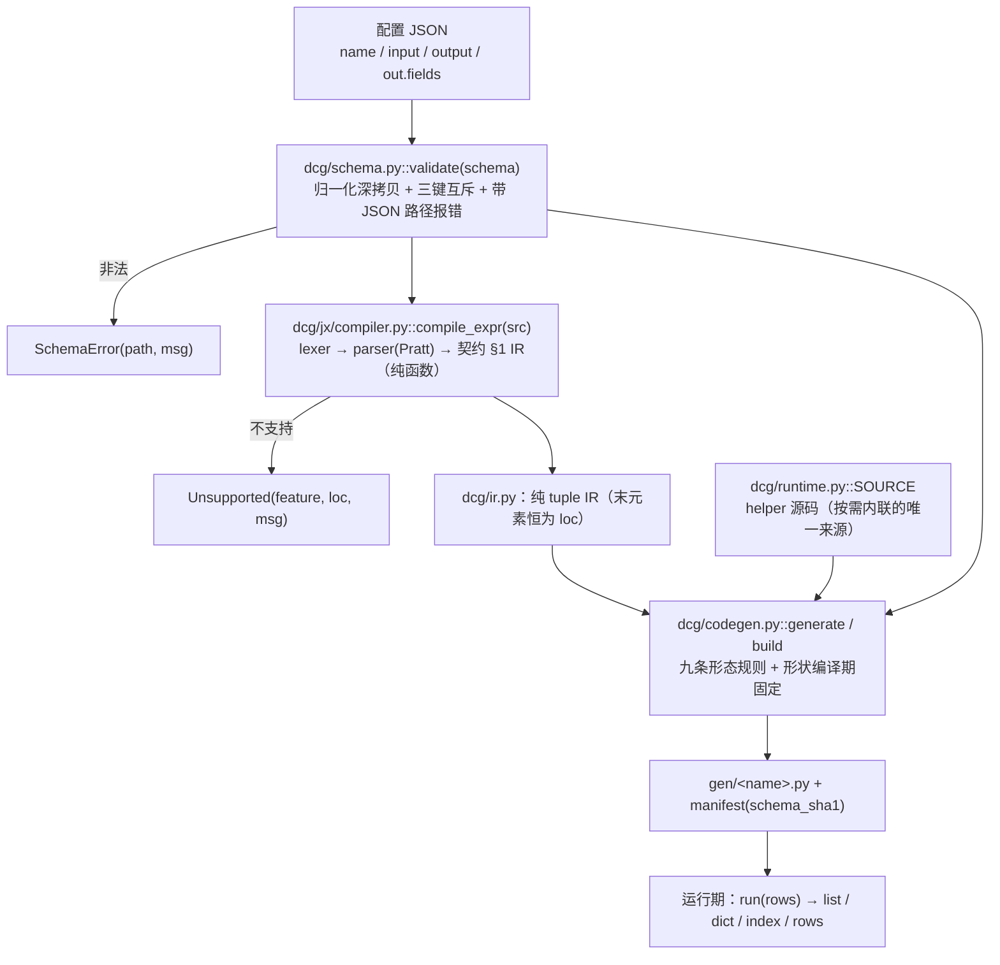

# DCG 整体设计方案与架构文档

> **读者**：项目技术负责人
> **事实来源（唯一）**：`CONTRACT.md`（接口契约，**CANONICAL —— 与本文冲突时以 `CONTRACT.md` 为准**）与 `dcg/` 下的真实源码。
> **口径声明**：本文所有行号、函数签名、集合大小、实测数字都在同一份源码快照（SHA1 见附录 A）上核对过。凡实现与契约不一致之处，在 §12 与 `CONTRACT.md` §8 逐条列出，不做美化。

---

## 0. 一页速览

| 问题 | 答案 |
|---|---|
| DCG 是什么 | 把 JSON 配置**编译**成定制 Python 函数的**运行时代码生成器**（编译一次 → 落盘可读 `.py`） |
| 交付物是什么 | `gen/<name>.py`：纯 Python、零运行期依赖（除 `dcg.runtime`）、可读可 diff、逐字节可复现 |
| 运行期目标 | 比值口径 **v2/hand ≤ 1.05×**（当前 **1.000**，`confidence=RESOLVED`，`noise_floor=0.0114`） |
| 字符预算 | CAP **149/180**、M0 **195/210**（整模块口径，`CONTRACT.md` §4.2） |
| 依赖 | 整工程**不依赖 `jsonata` 包**；一致性基线以冻结 JSON 形式进仓库 |
| 当前验收状态 | `python evidence/accept.py` → **16 PASS / 0 FAIL / 0 SKIP**；`pytest tests/` → **696 passed** |
| 最大的已知落差 | `CONTRACT.md` §8：`value` 路径空段静默吞掉（O-1）、`post`/`trace` 未接线（O-2）、`validate()` 不是完整闸门（O-7）、无 `shape="document"`（O-8） |

---

## 1. 定位与目标

### 1.1 DCG 是什么

DCG 是一个**运行时代码生成器**：输入一份 JSON 配置（schema，含字段取值与表达式），输出一份**为该配置量身定制**的 Python 模块源码，模块里只有一个入口 `run(rows)`。

```jsonc
{
  "name": "flight",
  "output": {"shape": "list", "single": false, "filter": true, "post": null, "trace": false},
  "out": {"type": "object", "fields": {
    "hour":  {"type": "list",  "value": "$.5.a"},
    "hourA": {"type": "int64", "value": "$.5.a.1"},
    "hourD": {"type": "str",   "expr": "`str($.5.a.1) + str(hourB)`"},
    "hourE": {"type": "int64", "expr": "hourA + hourB"}
  }}
}
```

编译产物长这样（CAP 负载真实实跑结果，149 字符，见 §6.3）：

```python
def run(_d):
 _o=[]
 for R in _d:
  if R:
   _a=R[5]['a']
   _a1=_a[1]
   _a2=_a[2]
   _o.append([_a1,_a2,(str(_a1)+str(_a2)),(_a1+_a2)])
 return _o
```

### 1.2 解决什么问题

业务方每天要跑大量「取列 + 少量算术/字符串加工」的行式转换（民航 ACDM 航班动态报文是仓内唯一完整真实示例，`examples/flight.json` 是它的 v2 形态）。这类转换有三个特征：

* **配置是数据**，种类多、改得勤，但每个配置每天要跑几百万行；
* 每行的处理逻辑**极浅**（下标、算术、拼接），真正的成本在行容器与输出对象的构造；
* 产物需要**可评审、可 diff、可提交**，不能是一团运行期生成的匿名函数。

DCG 的答案是：**不做通用引擎，直接生成最终代码**。编译期把所有能定的东西（形状、过滤、类型、变量名、表达式）全部定死，运行期只留一条最直的循环。

### 1.3 十条拍板决策

| # | 决策 | 依据 |
|---|---|---|
| D1 | 不做向后兼容层，配置形状可以自由重新设计 | 迁移由一次性工具（`dcg/migrate.py`）承担 |
| D2 | 只优化运行期，编译期开销不计 | 「生成环境只会编译一次」 |
| D3 | 产物即交付物：编译一次 → 落盘可读 `.py`，可提交/diff | 同上 |
| D4 | 整工程不依赖 `jsonata` 包；一致性基线以冻结 JSON 进仓库 | 用户要求 |
| D5 | 不保留字段级「表达式模板」语法，能力由反引号内联 Python 承接 | 推论自 D6 |
| D6 | 符号层只保留 JSONata 一套语义，反引号段是唯一扩展 | 消除 `$` 双语义 |
| D7 | 不用字符串模板 + AST 改写，改为 schema 直接驱动 emit | D2/D3 推论 |
| D8 | 输出形态升格为生成器选项，**编译期固定形状** | 用户决策 |
| D9 | 默认零运行期依赖（helper 可选内联），不设 `compact` 模式 | 「编译一次」的正确形态 |
| D10 | 冻结 50 例一致性证据进仓库，`jsonata` 包不存在时回归基线仍在 | D4 |

---

## 2. 设计动机：为什么是「编译期直出代码」

### 2.1 早期通用引擎的实测结论（这些数字直接决定了 v2 的形态）

M0 基线环境：Python 3.13.3 / Cython 3.1.1 / Windows amd64，200k 行 × 8 字段，预热后取 3 次最小值。行形状 `(code:str, a:int, b:int, c:int, d:int, payload:{'a':[4]})`。

**D-1｜通用引擎已接近纯 Python 手写极限。**
早期引擎运行期 **0.480 µs/行 · 2,083,896 行/秒**，手写参照（只解包一次 payload）**0.457 µs/行** → 只慢 5%。而且它已经做对了「payload 只取一次」。**结论：纯 Python 代码生成的性能空间 ≤5%。** 这决定了 v2 的全部性能工作只能是**形态**工作，不能指望「换种实现语言」或「再省几条字节码」。

**D-2｜真正的成本在输出对象构造，约占 78%，且不可由 codegen 消除。**
微分解：不构造输出只算 = 0.235 µs/行，只构造输出 = 0.288 µs/行，Cython 不构造输出 = 0.090 µs/行。只要还产出 Python 的 list/dict，这笔钱必须付 —— v2 不该把力气花在「再省几个字节码」上，而该花在「不要多构造一层」。

**D-3｜字段重复访问是唯一「既缩短代码又提性能」的改动，1.33×。**
变体 A（`_a = r[5]['a']` 只取一次）0.457 vs 变体 B（每个字段重写 `r[5]['a']`）**0.608 = 1.33×**。这条直接变成 v2 的规则 1。

**D-4｜Cython 的真实增益只有 1.13–1.18×，不是宣传口径。**
py row-object 0.472（1.00×）；cy row-object list 行 **0.419 = 1.13×**；cy row-object tuple 行 **0.401 = 1.18×**；拿满 **1.66×** 必须换成**类型化列输入**（cy typed columns 0.284，py typed columns 甚至只有 0.602 = 0.78×，比纯 Python 还慢）。**结论：不得盲信 Cython** —— 所以 v2 只把它做成「同源 + `cdef` 声明」的形态选项，不改变语义、不参与默认承诺。

**D-5｜早期每次 parse 至少编译两次（含一份 118 字符空桩）。**
一次 118 字符的 `datas = None; buffer_x = None; return buffer_x` 空桩，一次真正的 445 字符产物。这是 D2「编译期不计成本」下唯一仍要删的东西 —— 因为它同时污染了产物形态。

**D-6｜输出形态是运行期算出来的。**
`protocol=False` 实测走 `tuple(doc.items())`，即**每行**都在运行期重新判断容器类型；index 形态的模板用了 `itertools.chain` 却从未 import → 实测 `NameError`。

**D-7｜模板 + AST 改写留下的结构性冗余。**
独立验证在早期产物上判 **rule3 FAIL 4 处**（`datas` 中转 / `buffer_x` 中转 / `append` 别名 / 只被再解包的容器）、**rule8 FAIL**（随机 10 字符变量名）。产物不可评审、不可 diff，与 D3 直接冲突。

**D-8｜配置形状靠字符串前缀决定语义，且嵌套有特例。**
`$`/`#` 前缀闸门决定「这是列还是变量」；「list 里出现 dict 就当嵌套」是隐式特例。顺序一乱就报裸 `KeyError: 'name'`。

**D-9｜无缓存、无来源校验。**
每次 parse 都重编译，产物不记录 schema 指纹，「同一模块名下 schema 变了」无法察觉。

### 2.2 设计约束 → v2 对策

| 约束（来自 §2.1） | v2 对策 | 落点 |
|---|---|---|
| D-1 纯 Python 空间 ≤5% | 把目标钉在「达到手写极限」，主判定用比值 ≤1.05× | `CONTRACT.md` §7 |
| D-2 输出构造占大头 | 形状编译期固定，消灭运行期容器判断 | `dcg/codegen.py::finish`（`:864`） |
| D-3 字段重复访问 1.33× | 规则 1「全局行首解包」：每个前缀只取一次 | `_Gen.bind_name`（`dcg/codegen.py:263`） |
| D-4 Cython 只有 1.13–1.18× | Cython 降级为可选形态：同源 + `cdef object`，不改语义 | `generate(cython=)`（`:910`） |
| D-5 空桩 + 两次 compile | 规则 6：每次 build 只 `compile` 一次，零恒等语句 | `_generate_norm`（`:899`） |
| D-6 运行期形状 | 形状 / single / filter 全部编译期常量 | `_Gen.__init__`（`:176`）、`finish()` |
| D-7 模板与 AST 改写 | 整块不用：schema 直接驱动 emit | `dcg/codegen.py::_Gen.emit`（`:307`） |
| D-8 前缀语义 + 嵌套特例 | `value`/`const`/`expr` 三键互斥；嵌套必须显式 `fields`/`items` | `dcg/schema.py::_norm_field`（`:120`） |
| D-9 无校验 | 模块名 = `schema.name`，manifest 记 `schema_sha1`，冲突报错 | `schema_sha1`（`dcg/codegen.py:138`） |

---

## 3. 架构总览

### 3.1 单向依赖链路

```
schema.py  →  ir.py  →  codegen.py  →  runtime.py
                  ↑
            jx/compiler.py
```

* `dcg/schema.py`：不 import 任何同级模块。
* `dcg/ir.py`：节点定义 + 结构遍历，不 import 同级模块。
* `dcg/jx/compiler.py`：只 import `dcg/jx/*`（lexer/parser/paths/policy），产出 `dcg/ir.py` 的 tuple 常量。
* `dcg/codegen.py`：`from . import ir as _ir`、`from .jx import ...`、`from .runtime import SOURCE, SOURCE_NEEDS_MATH`、`from .schema import SchemaError, validate`。
* `dcg/runtime.py`：**不 import 任何兄弟模块**（它既是运行期 helper 的唯一实现，又是生成码的**内联文本来源** `SOURCE`）。
* 硬约束：`schema.py` / `ir.py` / `runtime.py` 中禁止出现 `from .codegen`；`evidence/accept.py::g_no_reverse_import` 每次运行都从源码重算（不缓存判断）。

### 3.2 数据流



一个字段的完整旅程：

```
out.fields["hourE"] = {"type":"int64", "expr":"hourA + hourB"}
      │
      ├─ schema.py 校验：三键恰好一个（expr）、type 合法 → 归一化
      ├─ jx.compile_expr("hourA + hourB")
      │     → ("bin","+",("field","hourA",(1,1)),("field","hourB",(1,9)),(1,7))
      ├─ codegen._Gen.emit → "hourA + hourB"（裸名走 defined 表）；
      │     若 type 声明为 int64 ⇒ 裸运算；若为 any ⇒ 退化成 `_ad(hourA,hourB)`
      └─ 产物：`_o.append([...,hourA + hourB])`
```

### 3.3 为什么不用「通用模板 + AST 改写」

| 维度 | 通用引擎：模板 + `ast.NodeTransformer` | DCG：schema 直接驱动 emit | 为什么后者赢 |
|---|---|---|---|
| 中间表示 | Python 源码字符串 → AST → 改写 → `ast.unparse` → 源码 | IR tuple → 直接拼表达式字符串 | 少一次 parse + 一次 unparse，且产物**形态可预测** |
| 变量命名 | 运行期随机 10 字符 | `_` + 字段名，前缀记忆化 | 可 diff、可评审、逐字节可复现（`CONTRACT.md` §4.2 规则 8） |
| 形状 | 模板里带运行期判断（`tuple(doc.items())`） | 编译期常量（`finish()`） | 每行省掉容器类型判断 |
| 取值语义 | `$`/`#` 前缀闸门 | `value`/`const`/`expr` 三键互斥 | 消除「同一前缀被反复展开」→ 命中 1.33× |
| 冗余 | 中途变量、append 别名、空桩 | 九条形态规则 + 结构性断言 | `accept.py::g_zero_redundancy` 可机器判定 |
| 不支持项的处置 | 运行期才炸 | build 期 `Unsupported`/`SchemaError`（带列号/JSON 路径） | 「编译期全量报错」 |

代价也如实记：产物不再「单文件自包含」—— 需要 helper 时首行是 `from dcg.runtime import *`。这是用「哨兵与 helper 只有一份实现」换来的（见 §6.5）。

### 3.4 目录现状

```
dcg/                                    4650 行 / 14 文件
  __init__.py    18 行   公开面（8 个符号）
  schema.py     293 行   校验 + 三键互斥 + 位置报错 + value 路径解析
  ir.py         207 行   IR 定义 + 结构遍历（41 个符号）
  codegen.py    984 行   生成器（性能主战场）
  runtime.py    535 行   helper 唯一实现 + 生成码内联源 SOURCE（48 个 helper）
  build.py       10 行   `python -m dcg.build` 入口（转发 codegen._main）
  migrate.py    905 行   旧版 describe → v2 schema 的一次性迁移工具（不在运行期）
  jx/
    __init__.py  53 行   re-export（20 个符号）
    lexer.py    242 行   正则 TOKEN（含反引号段/py{} 块扫描）
    parser.py   263 行   Pratt（BP 表按 JSONata 1.8）
    compiler.py 841 行   JSONata → IR（纯函数）
    policy.py   156 行   Unsupported + 白/黑名单
    paths.py     70 行   路径/链解析的**唯一权威**
    registry.py  73 行   函数注册表
tests/       3711 行 / 9 文件（696 个测试）
bench/       4007 行 / 28 文件 + frozen/conformance.json
evidence/    accept.py（777 行，16 道独立验收门）+ 探针输出快照
examples/    flight.json / flight_rows.json / flight_generated_*.{py,pyx} / adcm_v2.json / jx/（15 个 .jx 样例）
docs/        jsonata_syntax.md（由 tests/test_jx_examples.py 渲染并校验）
```

---

## 4. IR 设计

IR 定义在 `dcg/ir.py`，`__all__` 共 **41 个符号**（15 个节点常量 + 3 个算子集合 + 13 个构造器 + 结构工具）。

### 4.1 节点表（契约 §1，与 `dcg/ir.py` 一致）

| 节点 | 形态 | 说明 |
|---|---|---|
| `lit` | `("lit", value, loc)` | Python 常量字面量 |
| `field` | `("field", name, loc)` | **裸标识符就是字段**（`hourA + hourB` 的命脉） |
| `index` | `("index", base, idx, loc)` | `base[idx]`；`$.5.a.1` 编成常量下标链，**不是** `field` |
| `root` | `("root", loc)` | `$` 展开为行对象本身 |
| `var` | `("var", name, loc)` | JSONata 变量 `$v`（`name` 不含 `$`） |
| `unary` | `("unary", op, operand, loc)` | `op ∈ {"-","+","not"}` |
| `bin` | `("bin", op, left, right, loc)` | `op` 见 §4.3 |
| `cond` | `("cond", test, then, orelse, loc)` | 三元 `? :` |
| `call` | `("call", fname, [args...], loc)` | `fname` 含 `$`（如 `"$uppercase"`） |
| `rfunc` | `("rfunc", qualname, [args...], loc)` | 用户注册函数，`qualname` 形如 `"pkg.mod.fn"` |
| `array` | `("array", [items...], loc)` | 数组字面量 |
| `object` | `("object", [(key, val_ir), ...], loc)` | 对象字面量，**保序** |
| `py` | `("py", source_str, [free_field_names...], loc)` | 反引号段，按设计**不透明** |
| `pyblock` | `("pyblock", stmts_source, [free_field_names...], loc)` | `py{}` 多语句块，编译期定稿为一个辅助函数体 |
| `range` | `("range", lo, hi, loc)` | 区间；policy 在 build 期必须拒绝 |
| `lambda` | `("lambda", [params], body, loc)` | 高阶字面量；policy 在 build 期必须拒绝 |

`range` / `lambda` 虽然入表，但**实测永远不会出现在 IR 里**：`..` 与 `function(){}` 在 `dcg/jx/compiler.py` 编译期就抛 `Unsupported`。它们是**契约的完整性声明**，不是可达节点。

### 4.2 「末元素恒为 loc」与「纯 tuple」

* **末元素恒为 `loc`**：`loc = (line, col)` 或 `None`。工具函数 `loc_of(node)` 只在最后一项是 2-tuple 时返回它。好处是：任何节点都能报出**列号**，`Unsupported`/`SchemaError` 的定位不需要额外传参，AST 遍历不需要 visitor。
* **纯 tuple，不是 class**（契约 §1 明确列出四条理由）：
  1. **便于比较**：`compile_expr("a+b") == compile_expr("a+b")` 直接成立，测试与 snapshot 无需自定义 `__eq__`；
  2. **可哈希**：可以放进 set/dict 做去重、公共子表达式识别；
  3. **零构造开销**：tuple 字面量比对象实例化便宜，节点构造发生在编译期热路径上；
  4. **snapshot 友好**：`("index", ("root", (1,1)), ("lit", 5, (1,2)), (1,2))` 直接可读可 diff。

实测：`compile_expr("$.a")` → `('index', ('root', (1, 1)), ('lit', 'a', (1, 2)), (1, 2))`，`loc` 在最后一项。

### 4.3 `bin` 各算符的 undefined 传播规则

| op | 含义 | undefined 传播 | 运行期 helper |
|---|---|---|---|
| `+` `-` `*` `/` `%` | 算术 | **传播**；`null` 参与算术是**错误** | `_ad` `_sb` `_ml` `_dv` `_md` |
| `&` | 字符串拼接 | **不传播**，undefined 当空串 | `_cc` |
| `=` `!=` | 相等 | 任一侧 undefined → `False` | `_eq` `_ne` |
| `<` `<=` `>` `>=` | 大小 | 任一侧 undefined → **undefined** | `_lt` `_le` `_gt` `_ge` |
| `and` `or` | 逻辑 | 按 JSONata 真值；undefined **参与运算** | `_and` `_or` |
| `in` | 成员 | 与 `=` 同族（任一侧 undefined → `False`） | `_in` |

`ir.py` 里这张表就是 `BIN_OPS`（`:33`，op → (含义, undefined 家族)），构造器 `bin_(op, left, right, loc)` 对非法 `op` 直接 `ValueError`。运行期 `dcg/runtime.py` 对每条规则都有**专用函数**（不分派表！）—— 理由见 §6.2 规则 5。

### 4.4 结构工具

`kind(node)`（`:122`）/ `loc_of`（`:126`）/ `children`（`:133`，按节点类型给出子节点）/ `walk`（`:157`，DFS）/ `is_const`（`:166`，字面量、全常量数组/对象、常量一元/二元）/ `key_path`（`:182`，把 `field`/`index` 链折成 key path，如 `$.5.a.1` → `(5,"a",1)`，要求 `index` 的 `idx` 是 `lit` 且值为 `int`/`str`）。`key_path` 是「常量链」判定的单一实现，`_Gen.bind_name` 与 `_chain` 都依赖它。

---

## 5. 表达式层设计（JSONata + 反引号内联 Python）

### 5.1 三层结构

| 层 | 文件 | 产物 | 要点 |
|---|---|---|---|
| 词法 | `dcg/jx/lexer.py`（`TOKEN` `:54`） | `[(kind, value, col), ...]` | 反引号段是**词法边界**：段内容原样捕获到下一个未转义反引号，段内不解析 JSONata（JSONata 从不使用 `` ` ``，零歧义）。`py{...}` 多语句块由 `_scan_py_block`（`:83`）整体扫描 |
| 语法 | `dcg/jx/parser.py`（`Parser` `:63`，`BP` `:29`） | 语法树 | Pratt；**调用/下标/路径统一在中缀循环的后缀位置处理**（早期只在 prefix 处理导致 `$not(miss)`、`a[0]` 报「多余内容」） |
| 编译 | `dcg/jx/compiler.py`（`compile_expr` `:828`） | 契约 §1 的纯 tuple IR | `compile_expr(src, *, loc_base=(1,1), registry=None)` 是**纯函数**：同输入同输出，不读任何全局 `MODE` |

Pratt 结合力（越小越松）：`or 10` · `and 20` · 比较/`in` 30 · `& 40` · `+ - 50` · `* / % 60` · 一元 `- + not` 70 · 后缀 `.` `[` `(` **90** · `..` 45 · 三元 `? :` 5。JSONata 的 `` ` `` 段由 lexer 先切走，所以 `str($.5.a.1) + str(hourB)` 整段是一个 `py` 节点。

`dcg/jx/__init__.py` 导出 20 个符号，其中契约 §5 要求的三个必须在：`compile_expr` / `Unsupported` / `Registry`。

### 5.2 能力边界：A / B / C 三层（`dcg/jx/policy.py`）

原则写在 `policy.py` 顶部：**绝不静默降级** —— 任何不在白名单里的调用、任何黑名单里的构造，都必须抛 `Unsupported`。

**A 层｜逐行可编译白名单 `ROW_FUNCS`（38 个，`policy.py:66`）**

* 字符串（19）：`$string $uppercase $lowercase $trim $pad $contains $split $join $substring $substringBefore $substringAfter $replace $length $base64encode $base64decode $encodeUrlComponent $decodeUrlComponent $formatNumber $formatBase`
* 数值（10）：`$number $abs $floor $ceil $round $sqrt $power $sum $min $max`
* 布尔/其他（4）：`$boolean $not $exists $type`
* 数组（5）：`$count $append $reverse $sort $distinct`

**B 层｜「在 A 层名单里，但仅限字面量数组实参」`LITERAL_ARRAY_ONLY`（7 个，`:101`）**

`$sum $max $min $append $reverse $sort $distinct` —— 它们在契约 §3.4 与 §3.5 **同时出现**，这不是笔误而是契约本身的设计：`$sum([1,2,3])` 可以逐行编译（常量折叠），`$sum(xs)` 必须拒绝。实现上 `rejection_reason()`（`:144`）只判**函数身份**，实参形状由编译层判。

（实测交集：`ROW_FUNCS ∩ BATCH_ONLY = {$distinct,$max,$min,$reverse,$sort,$sum}`，另加只出现在 §3.4 的 `$append`，合起来正好 7 个。`$count` **不**受字面量限制 —— 冻结基线里 core 例 `$count(xs)` 要求它对运行期数组成立。）

**C 层｜必须整批/非确定/结构性拒绝（一律 `Unsupported`）**

* `BATCH_ONLY`（20，`:87`）：`$sum $max $min $average $sort $reverse $distinct $shuffle $reduce $each $sift $keys $values $lookup $merge $spread $map $filter $single $position`
* `NONDETERMINISTIC`（4，`:96`）：`$now $millis $random $eval`
* `STRUCTURAL`（10 类，`:118`）：`a..b` 区间 / 正则字面量 / `function(){}` 高阶字面量 / 位置绑定 `#` / join 绑定 `@` / Sort `^` / 变换操作符 `~>`、`|...|` / Reduce `{k:v}` 路径阶段 / 分组聚合 `{..}` / **深路径 `a.b`**

**裸名调用别名 `BARE_CALL_ALIASES`（6 个，`:108`）**：`str→$string`、`int→$number`、`float→$number`、`bool→$boolean`、`len→$length`、`abs→$abs`。真实生产 schema 的 ext 写的是 `str($.x)` 而不是 `$string($.x)`；只有这张表里的裸名可被调用，表外的 `a(...)` 仍按「只有 `$` 函数可以被调用」拒绝。

**先判归属、再 emit 实参**：这是原型踩过的坑 —— `$map(xs, $string)` 必须报 `$map 不可逐行编译`，而不是被实参里的 `$string` 抢答成 `$string 需要 ctx 绑定`。`policy.py::rejection_reason` 的 docstring 明确记了这条。

### 5.3 反引号内联 Python（唯一扩展点）

反引号承接「字段级自定义表达式」这一能力（D5/D6）。词法层原样捕获段内容，`dcg/jx/compiler.py::analyze_py_segment`（`:122`）做两件事：

1. `ast.parse(src, mode="eval")` 校验（**必须是单个 Python 表达式**）；
2. 找出段内的 `$.` 字段链与裸名，登记进 `free_field_names`（链文本，不含前导 `$.`）。

实测锚点（已核对，`py{}` 块由 `compile_py_block` `:451` 处理）：

```
analyze_py_segment('$.a + 1')                     -> ('$.a + 1', ['a'])
analyze_py_segment('$.5.a.1')                     -> ('$.5.a.1', ['5.a.1'])
analyze_py_segment('$.data')                      -> ('$.data', ['data'])
analyze_py_segment('$.data.ID')                   -> ('$.data.ID', ['data.ID'])
analyze_py_segment('$.data[\'AIRPORTIATA\']')     -> (..., ['data'])      # 动态键不经链解析
analyze_py_segment('str($.5.a.1) + str(hourB)')   -> (..., ['5.a.1', 'hourB'])
analyze_py_segment("'hourB' + str($.5.a.1)")      -> (..., ['5.a.1'])     # 字符串字面量内的裸名不登记
```

**三条硬规则**

1. **`$` 是唯一的字段/变量入口。** 反引号内容不暴露裸字段名，否则 `int`/`str`/`math` 与字段名静默撞车。`$.x` → 生成局部名；`$` 单独 = 当前行；`$v` = JSONata 变量。
2. **段内必须是 Python 表达式**（`ast.parse(seg,"eval")`），不能声明新名字、不能 `import`。实测违反样例与报错：
   * `` `import os` `` → `Unsupported: 第 1 列: 反引号段 Python 语法错误 不可逐行编译（invalid syntax，偏移 1），请检查是否单个 Python 表达式`
   * `` `a=1` `` → 同上（偏移 2）
3. **build 期报错带字符偏移**（上例的「偏移 N」），不留到运行期 `SyntaxError`。

`py{}` 多语句块（`compile_py_block` `:451`）额外做三件事：把语句序列定稿为辅助函数体、把块内局部名重命名为 `__jx*` 前缀避免与字段撞车、校验恰好一个 `return`。codegen 把它发成 `run()` **之外**的 `def _pyN(...)`，调用处传已解包字段（禁止 lambda/IIFE，见 `CONTRACT.md` §1）。

**边界（`CONTRACT.md` §6 如实声明）**：反引号 = **任意 Python 执行，不是沙箱**；build 期不执行代码，只 `ast.parse` 校验；真正的沙箱需要进程级手段。`PY_SAFE_MODULES`（25 个）只约束**裸模块名**（`math re json decimal datetime itertools ...`），**不约束内置函数** —— 实测 `` `open(x)` `` 被接受为 `('py', 'open(x)', ['x'], (1, 1))`。这是能力，也是风险，必须在 README 里如实写明。

`__jx` 是 jx 保留给 codegen 占位符/别名的命名空间（`RESERVED_PREFIX = "__jx"`，`:69`；占位符 `_PY_PLACEHOLDER = "__jx_f"`，`:70`），用户段里出现即报错。

### 5.4 为什么拒绝 `..` / 正则 / `function(){}` 等

| 拒绝项 | 理由 | 异常 |
|---|---|---|
| `a..b` 区间 | 需要序列语义（生成器/迭代器），逐行编译无对应形态 | `Unsupported`（`STRUCTURAL["range"]`） |
| 正则字面量 `/.../flags` | 契约 §3.5 明确要求拒绝；正则编译有状态、会引入隐藏缓存 | `Unsupported` |
| `function(){}` 高阶字面量 | 需整体求值；逐行编译会退化成运行期解释器 | `Unsupported` |
| `~>`、`\|...\|`、`^`、`#`、`@`、`{k:v}`、`{..}` | 变换/排序/绑定/分组都是整批语义 | `Unsupported` |
| `$map/$filter/$reduce/$each/$sift/...` | 需要整批数据 | `Unsupported`（`BATCH_ONLY`） |
| `$now/$millis/$random/$eval` | 非确定：同一行不同时刻结果不同，且 `$eval` 是运行期解释器入口 | `Unsupported`（`NONDETERMINISTIC`） |
| 深路径 `$.a.b` | 不支持 JSONata 逐行走访；多层结构用嵌套 `fields` 表达 | `Unsupported`（实测：`深路径 [a,b] 不可逐行编译（v2 不支持 JSONata 逐行走访（契约 §6.1），请用嵌套 fields）`） |

判据（契约 §6.1）：**从 `root` 起，链条中出现 ≥2 个「符号段」即拒绝**。`$.5.a.1`（符号段只有 `a`）允许；`$.a.b`、`$.5.a.1.b` 拒绝。数值段（`$.5.a` 的 `5`）不计入。实测 `compile_expr("$.a.b")`、`("$.5.a.1.b")` 均抛 `Unsupported`（该拒绝**已实现**，不再是待修项）。

**明确不做**：自创第二套 DSL · 运行期解释 JSONata · 运行期按参数切换形状 · 静默降级 · 语言层沙箱。

### 5.5 `jsonata` 包的角色（重要澄清）

**整个工程不依赖 `jsonata` 包。** 它只在最初一次性求值时被用来生成冻结基线 `bench/frozen/conformance.json`；求值脚本不随仓库发布，也不再需要：

* 50 例（core 26 + edge 24）+ 3 条 `refused`，期望值由官方 `jsonata-python 0.7.0` 求出后**固化进仓库**；
* `undef_marker = "__undef__"`；其中 7 例 `expect.value == null` 且带 `null_or_undefined: true` —— 官方探针在 Python 侧把 undefined 与 null 都归一为 `None`，断言时做**归一化比较**，不要把二者当不同结果；
* `expect.error` 的 2 例（`null + 1`、`a + null`）是**正确行为**：JSONata 里 null 参与算术是**错误**而不是 undefined，实现也必须抛；
* 测试侧 `tests/test_jx_conformance.py` **必须读取该文件**，不得复制粘贴用例（否则漂移）；`jsonata` 包只允许出现在 `tests/` 且用 `pytest.importorskip("jsonata")` 保护的**交叉复核**里（缺包即跳过，不算失败），`tests/test_jx_policy.py` 还静态断言 `dcg/` 里不出现 `import jsonata`。

因此 D4/D10 成立：即使 `jsonata` 包不存在，回归基线仍在仓库里。

---

## 6. 代码生成策略（性能着力点）

### 6.1 生成器内部结构（`dcg/codegen.py`）

| 部件 | 位置 | 作用 |
|---|---|---|
| `canonical_json` / `schema_sha1` | `:132` / `:138` | `sort_keys=True, separators=(",",":"), ensure_ascii=False, allow_nan=False` → sha1 十六进制 |
| `gen_name` | `:142` | 确定性模块名 = `schema["name"]`；禁止 random |
| `_chain` | `:154` | 把 `index` 常量链折回 `root`，得到段元组；非常量链返回 `None` |
| `class _Gen` | `:173` | 单次生成的全部状态：fields/shape/single/filter/src/helpers/rfuncs/head/pre/paths |
| `bind_name` / `plan` | `:263` / `:231` | **前缀只取一次**的记忆化命名（规则 1 的实现）+ 行首解包顺序 |
| `emit` / `bin` | `:307` / `:363` | IR → Python 表达式源码；`bin` 里有 `&` 与裸运算的快路径 |
| `field_name` | `:503` | 裸名查 `defined` 表，查不到 → **build 期** `SchemaError` 并列出可用字段名（绝不留到运行期 `NameError`） |
| `pyseg` / `pyblock` | `:555` / `:591` | 反引号段：`$.` 链替换为生成局部名、裸名查 `defined`；`py{}` 块发成 `run()` 外的辅助函数 |
| `field_value` | `:676` | 取值分派（const/value/expr/fields/items） |
| `body` / `module` / `finish` | `:737` / `:780` / `:864` | 生成循环体、组装模块（含按需 import 行）、生成返回形态 |
| `generate` / `build` / `load` / `_main` | `:910` / `:917` / `:952` / `:963` | 公开面 + CLI |

`generate(schema, *, cython=False, inline_optional=True)` 内部**只调用 `compile(src, "<dcg-generated>", "exec")` 一次**（规则 6），且返回前已证明产物可编译 —— 产物就是它返回的字符串，「看起来可用」== 「能编译」。

### 6.2 九条形态规则：逐条「为什么这样生成更快」

契约 §4.2 收口了九条（字符数只是代理指标，规则本身才是）：

**规则 1｜每个被引用的下标前缀在行首只取一次。**
`bind_name` 记忆化：`$.5.a.1` 先给 `R[5]` 命名 `_a`，再给 `_a[1]` 命名 `_a1`，再给 `_a[2]` 命名 `_a2`；任何字段复用同一前缀时**直接返回已有名字**。
*为什么更快*：这是 M0 实测唯一「既缩短代码又提性能」的改动（变体 A 0.457 vs 变体 B 0.608 = **1.33×**）。省掉的是每字段一次 dict/str 下标查找。

**规则 2｜零恒等赋值、零「只为 return 而生的中转变量」。**
不生成 `datas = datas`，不生成 `_buf = {'doc': []}; _doc = _buf['doc']`，不生成 `append` 别名。
*为什么更快*：早期引擎每次 parse 会**多编译一份 118 字符空桩**，这是纯浪费；运行期上，每个中转变量都是一次 LOAD/STORE，在 200k 行 × 8 字段的规模上被放大 160 万次。

**规则 3｜输出形状编译期固定，无运行期判断。**
`shape=list` → 直接列表构造；`dict` → `{字段名: [每行值]}` 列式字面量；`index` → `{行下标: [行值]}`；`rows` → `[{字段名: 值}, ...]` 逐行 dict（旧版 `protocol: False` 的对等物，2026-10-17 新增）。
*为什么更快*：旧版 `protocol=False` 走 `tuple(doc.items())`，**每行**重新判断容器类型；index 路径还因为 `itertools.chain` 从未 import 而 `NameError`。v2 把这次判断从「每行」搬到「每次 build」。

**规则 4｜无冗余类型转换（`type` 是声明，不是转换）。**
`type=int64` **不**插入 `int(...)`；需要转换就在 `expr` 里显式写 `` `int($.x)` ``。另有一条快路径：`$string(a) & $string(b)` 直接生成 `_S(a) + _S(b)`，不再套一层 `_cc(...)`。
*为什么更快*：无条件 `int()` 每次调用 +50ns，属于 ≤5% 预算里不该浪费的部分。

**规则 5｜无 `isinstance` 分派链；每个运算符一个专用 helper。**
运行期对每个 op 有专用实现（`_ad _sb _ml _dv _md _cc _eq _ne _lt _le _gt _ge _and _or _in`），没有「按 opcode 分发」的表。产出物里禁止出现 `isinstance(`（`accept.py` 的零冗余门会扫），运行期用 `type(v) in _NN`（`_NN = (int,float)`）这类鸭子判定。
*为什么更快*：M0 实测**派发脚手架占守卫成本 89%**；专用函数后守卫净成本仅 1.28×（纯守卫）/ 2.09×（含 null 检查）—— 所以守卫只付在真正 `optional: true` 的字段上。

**规则 6｜每次 build 只 `compile` 一次，无空桩。**
`generate()` 里 `compile()` 恰好一次（`accept.py::g_zero_redundancy` 结构性统计），且 `generate()` 自身会先验证产物可编译（`g_generate_selfcheck`）。
*为什么更快*：构建期本身在「编译一次」的场景下不重要，重要的是一次编译意味着**产物形态唯一**、无第二份垃圾源码混进交付物。

**规则 7｜`optional: true` 才生成守卫，且恰好一次 undefined 判断。**
内联形态 `X=None if _t is _U else _t`（`dcg/codegen.py:753-754`）；必然存在的字段零判断。
*为什么更快*：守卫是真金白银（1.28–2.09×），只在语义真的需要 undefined 容忍时付。

**规则 8｜变量名确定性、可读、1–3 字符。**
由字段声明顺序与链结构决定（`_a`、`_a1`、`_a2`），禁止 random。
*为什么更快*：不更快，但**可 diff 可评审**是 D3 的硬要求；且 `_` 前缀命名空间由 `_check_reserved`（`:891`）把守，不会与用户字段撞车。

**规则 9｜Cython 模式：同源、只加声明、不改语义。**
`cython=True` 的产物恒等于「纯 Python 产物 + 每局部一行 `cdef object`」，有测试逐行固定。
*为什么这样设计*：Cython 的真实增益只有 1.13–1.18×（D-4），必须是可选项而不是默认承诺。

**附：内联纪律。** helper 按需内联并只带传递依赖（`needs`/`order_helpers` 按 `_DEPS` 拉传递依赖后拓扑排序）；产物只在真的用到 helper 时才发 `from dcg.runtime import *`（CAP/M0 连一行 import 都不需要）。产物**不写 docstring**（见 `CONTRACT.md` §8 O-5）。

### 6.3 真实产物（`dcg.codegen.generate(...)` 实跑，非手写）

**CAP**（4 字段，`filter=true`，`input.source="rows"`）：整模块 **149** 字符。

> **本节代码块是快照，会随实现漂移。** 以 `python -c "import sys;sys.path.insert(0,'evidence');import accept as A;print(A._src(A.CAP))"` 的实跑为准；字符数由 `evidence/accept.py::g_char_budget` 每次复核。

```python
def run(_d):
 _o=[]
 for R in _d:
  if R:
   _a=R[5]['a']
   _a1=_a[1]
   _a2=_a[2]
   _o.append([_a1,_a2,(str(_a1)+str(_a2)),(_a1+_a2)])
 return _o
```

**M0**（8 字段，`filter=true`，`input.source="index"`）：整模块 **195** 字符。

```python
def run(_d):
 _d=_d['index']
 _o=[]
 for R in _d:
  if R:
   _a=R[5]['a']
   _a1=_a[1]
   _a2=_a[2]
   _o.append([_a,_a1,_a2,R[2],str(_a1) + str(_a2),(_a1+_a2),(_a2+_a1),(_a[2]+123)])
 return _o
```

可以逐条对照规则：

* 规则 1：`R[5]`、`R[2]` 各只出现一次，`_a1`/`_a2` 被多个字段复用（`(_a2+_a1)` 完全没有重新下标）；
* 规则 2：没有「只为 return 的中转」，没有 `append` 别名；
* 规则 3：形状没有运行期判断；`input.source=index` 的 `_d=_d['index']` 也在行外只做一次；
* 规则 4：`int64` 字段没有插入 `int(...)`；`hourD` 的 `str(...)` 是**用户自己**在反引号段里写的；
* 规则 5：算术走裸运算（类型声明可证安全 ⇒ 内联），没有 isinstance 分派；
* 规则 6：确定性 —— `generate(M0) == generate(M0)` 实测 `True`；
* 反引号段：`str($.5.a.1) + str(hourB)` 里的 `$.5.a.1` 被替换成生成局部名 `_a1`，裸名 `hourB` 命中本 schema 已声明字段；
* `hour[2]`（动态下标）走 undefined 安全形式 `_ix_get(_a,2)` 的等价位（此负载中 `_a[2]` 静态可证后直接内联）—— 注意**不是** `_ix`（`_ix` 是 `$indexOf`，两者只差一个字符，契约 §3.6 专门为这个命名歧义留了记录）。

**其它形状的尾部**（同一行字面量，`finish()` 只换结尾，`:864`）：

| shape | `return` 形态 |
|---|---|
| `list` | `return _o`（`single` 时 `return _o and _o[0]`） |
| `dict` | `return{k:[r[i]for r in _o]for i,k in enumerate([...字段名...])}` |
| `index` | `return{i:r for i,r in enumerate(_o)}` |
| `rows` | `return[{k:r[i]for i,k in enumerate([...字段名...])}for r in _o]`（`single` 时 `return _o and {k:_o[0][i]...}`） |

### 6.4 字符预算的真实账

| 工作负载 | 旧版冻结产物 | 契约目标 | 当前实跑（整模块） |
|---|---|---|---|
| CAP | 445 字符 | ≤180 | **149**（余量 31） |
| M0 | 537 字符 | ≤210 | **195**（余量 15） |

维护说明：产物仍在被压缩，引用本表前请以 `python evidence/accept.py` 的 `char budget` 门实测为准；门会在超预算时报 FAIL，不要以本节文字为准。

### 6.5 运行期 helper 与 undefined 哨兵

`dcg/runtime.py` 是 undefined 语义的**唯一实现处**，同时是生成码的内联来源：

* `class _Undef: __slots__ = ()`（`:24`），`UNDEF = _Undef()`（`:34`），`is_u(v)`（`:40`）身份比较；
* `HELPERS`（`:473`）48 个 helper：算术/比较/逻辑/字符串/数值/数组/类型；`SOURCE`（`:510`）**由源码派生**，同样是 48 项（不再手抄 —— 手抄正是旧版漏掉 `_m` 的原因）；
* `SOURCE_NEEDS_MATH = frozenset(n for n,t in SOURCE.items() if "math" in t)`（`:516`，本快照 = `{"_fl","_ce","_sq"}`）→ 用到才生成 `import math as _m`；
* `SOURCE_PRELUDE = ""`（`:524`）：**产物不再自建哨兵**。产物需要 helper 时首行是 `from dcg.runtime import *`（`__all__` `:531` 显式导出 56 个名字，含全部下划线 helper 与 `_U`），哨兵直接用模块里那**一个** `UNDEF` 单例，短名 `_U = UNDEF`。
  **历史（P0-1，已修）**：曾生成 `_U=0`，因 CPython 小整数缓存 `0 is 0` 为真，把**合法值 0 判成 undefined**、静默错值；且产物自己会抛 `SyntaxWarning: "is" with 'int' literal`。现由 `evidence/accept.py::g_sentinel_integrity` 双重把守：静态禁止哨兵绑定整数字面量/`None`/`False`/`0.0`，行为上要求真实 0 与 undefined 可区分。
* 产物的 undefined **六条语义**（`UNDEFINED_SEMANTICS` `:485`，共 6 条）：`&` 当空串不传播 / `or`/`and` 参与运算 / `=`/`!=` 返回 `False` / 大小比较返回 undefined / 数组字面量跳过 undefined / 对象字面量丢弃 undefined 键。另有第 7 条额外约定：`null` 参与算术是错误、`$not(miss) == undefined`、`a[0]` 对标量成立。
* **自包含性的取舍（已裁决）**：产物 `import dcg.runtime` 即不再是单文件自包含产物 —— 这是用「哨兵唯一一份」换来的。契约 §4.4 的"自包含"因此解释为**不依赖第三方包**，而非"不依赖 dcg 自身"。若要单文件交付，需要另立 `embed` 模式的产物（当前不在范围内）。

---

## 7. 输出形态

旧引擎的五个正交维度（`protocol` / `single` / `filter` / `func` / `debug` + 坏掉的 `index`）在 v2 里全部**升格为编译期常量**：

| 旧维度 | v2 字段 | v2 行为（实跑） |
|---|---|---|
| `protocol` | `output.shape` | `list` / `dict` / `index` / `rows` 四选一，编译期固定 |
| `single` | `output.single` | `true` 时 `list` 返回单行本身、`rows` 返回首个行 dict；与 `dict`/`index` 组合 → `SchemaError` |
| `filter` | `output.filter` | 默认 `true`；**逐行**`if R:` 判 falsy（行内，编译期决定是否发这行） |
| `func` | `output.post` | 整批后处理函数名（**当前被忽略**，见 `CONTRACT.md` §8 O-2） |
| `debug` | `output.trace` | 调试开关（**当前被忽略**，同上） |
| `index` | `output.shape="index"` | `{行下标: 行值}`；有测试覆盖 |

实跑结果：

| schema | `run(rows)` 返回 |
|---|---|
| `shape=list, single=false` | `[[1], [2]]` —— 每行是 **list** |
| `shape=list, single=true` | `[1]` 单行本身 |
| `shape=dict, single=false` | `{'x': [1, 2]}` 列式 |
| `shape=index, single=false` | `{0: [1], 1: [2]}` 行下标为 int |
| `shape=rows, single=false` | `[{'x': 1}, {'x': 2}]` 逐行 dict，键序 = 声明序 |
| `shape=rows, single=true` | `{'x': 1}` 首行 dict |
| `shape=dict/index, single=true` | `SchemaError: output.single: shape='dict' 下 single=true 无意义：该形状返回的是整列/整表，不是单行（§4.1）` |

**边界情形（`CONTRACT.md` §4.1）**：

1. **undefined 键的处置是编译期常量**：`optional: true` 才生成守卫，必然存在的字段零判断。
2. **`filter` 与 `single` 顺序固定**：先 filter 后 single。
3. **形状不可运行期切换**：要 list 与 dict 两种输出就 build 两个产物。
4. `output.filter` 的语义是「丢弃 falsy 行」；`output.post` 只对整批调一次，不进热路径；`output.trace` 走独立产物，不污染热路径（两者**尚未接线**，见 O-2）。

---

## 8. 公开 API

### 8.1 `dcg/__init__.py` —— 8 个符号（与契约 §5 完全一致）

```python
from .schema import validate, SchemaError
from .codegen import generate, build, gen_name
from .jx import compile_expr, Unsupported, Registry

__all__ = ["validate", "SchemaError", "generate", "build", "gen_name",
           "compile_expr", "Unsupported", "Registry"]
```

真实签名（`inspect.signature` 实测）：

| 符号 | 签名 | 说明 |
|---|---|---|
| `validate` | `validate(schema)` | 校验 + 归一化深拷贝；返回 `name/input{source}/output{shape,single,filter,post,trace}/out{type:"object",fields}` |
| `SchemaError` | `SchemaError(path, msg)` | `ValueError` 子类，携带 `.path`（如 `out.fields.sum`）与 `.msg`；`str(e)` = `"{path}: {msg}"` |
| `generate` | `generate(schema: dict, *, cython: bool = False, inline_optional: bool = True) -> str` | schema → 完整模块源码；确定性 |
| `build` | `build(schema: dict, out_dir: str, *, name: str \| None = None, overwrite: bool = False) -> dict` | 写 `<out_dir>/gen/<name>.py`；已存在且内容不同 + `overwrite=False` → `SchemaError`；返回 manifest `{name, schema_sha1, artifact, lines, chars, cython}` |
| `gen_name` | `gen_name(schema: dict) -> str` | 确定性模块名 = `schema["name"]` |
| `compile_expr` | `compile_expr(src: str, *, loc_base=(1, 1), registry=None) -> tuple` | JSONata → IR；纯函数；不支持 → `Unsupported` |
| `Unsupported` | `Unsupported(feature: str, loc=None, msg: str \| None = None)` | `str(e)` 形如 `第 12 列: $sum 不可逐行编译（需整批数据求值）`；多行时 `第 N 行第 M 列: ...`；有 `.col` 属性 |
| `Registry` | `Registry()`，`fn(name: str, callable) -> None`、`get(name: str)` | 用户函数注册表（`dcg/jx/registry.py:19`）；注册后 `$myfn(...)` 编成 `("rfunc", "pkg.mod.fn", ...)` |

### 8.2 次级公开面与入口

* `dcg/codegen.py`：`__all__ = ["generate","build","gen_name","canonical_json","schema_sha1"]`（`:53`），另有 `load(path, mod_name=None)`（`:952`）与 CLI `python -m dcg.codegen`（参数 `schema` / `-o --out`（默认 `.`）/ `--overwrite` / `--stdout`，打印 name/schema_sha1/artifact/lines/chars）。
* `dcg/build.py`：`python -m dcg.build <schema.json> -o <outdir>` 的入口，只 `from .codegen import _main` 并转发 —— 保证 `dcg/` 里没有第二份生成逻辑。
* `dcg/migrate.py`：**旧版 describe → v2 schema** 的一次性迁移器（`python -m dcg.migrate <旧版导出文件> -o out.json [--report r.md] [--name N] [--check] [--build-dir D] [--overwrite] [--quiet]`），逐项报告 `mapped / derived / manual / unsupported / info`，绝不静默丢弃。它**不属于运行期公开面**，也不在 `dcg/__init__.py` 里导出。`examples/flight_migration_report.json` 是它的真实输出样例。
* `dcg/jx/__init__.py`：20 个符号 —— `compile_expr compile_ast Unsupported Registry default_registry analyze_py_segment compile_py_block parse_expr lex JxSyntaxError ROW_FUNCS BATCH_ONLY parse_path parse_chain parse_path_chain split_chain chain_ir FIELD_REF count_symbolic RESERVED_PREFIX`。
* `dcg/schema.py`：`__all__ = ["SchemaError","validate","parse_value_path","value_source","is_optional","TYPES","SHAPES","NAME_RE","FNAME_RE"]`。`TYPES = ("int64","int32","float64","str","bool","list","object","any")`，`SHAPES = ("list","dict","index","rows")`。
* `dcg/ir.py`：41 个符号（15 节点常量 + `KINDS/UNARY_OPS/BIN_OPS` + 13 构造器 + `kind/loc_of/children/walk/is_const/key_path`）。
* `dcg/jx/policy.py`：`Unsupported ROW_FUNCS BATCH_ONLY NONDETERMINISTIC LITERAL_ARRAY_ONLY BARE_CALL_ALIASES is_row_func rejection_reason`（`STRUCTURAL` 是模块级 dict，不在 `__all__`）。

### 8.3 Schema 的取值三键与硬规则

三键 `value` / `const` / `expr` **恰好出现一个**（实测报错：`SchemaError out.fields.a: value/const/expr 必须恰好提供一个（一个都没给）`）。硬规则三条（契约 §2）：`"a"` 这种裸字符串**永远不是路径**（实测：`value 必须是 "$" 开头的路径，如 "$.a.b"；收到 'a'（v2 里裸字符串不是路径）`）；嵌套必须显式 `fields`/`items`（`items`/`fields` 为必填，空 `fields` 报错）；非法旧形状报带 JSON 路径的 `SchemaError` 而不是裸 `KeyError`（`schema.py:128/197/244` 对 `{name,alias,ext}` 这类旧版字段形状给出提示「疑似旧版字段形状；请用 `python -m dcg.migrate` 迁移」）。

---

## 9. 关键设计决策与理由

| # | 决策 | 理由（依据） | 被否决的替代方案 |
|---|---|---|---|
| 1 | 编译一次 → 落盘可读 `.py`（D3） | 用户约束「生成环境只会编译一次」；产物要能提交/diff/评审 | 运行期直接用 `compile()` 到内存（无法评审，早期引擎形态） |
| 2 | 整工程不依赖 `jsonata` 包（D4/D10） | 用户要求；50 例基线冻结进仓库后回归不依赖外部包 | 运行期用 `jsonata` 解释表达式：**慢 52–75×** |
| 3 | 不用 `Template` + `Engine`/`NodeTransformer`（D7） | 通用链路的中间表示是 Python 源码字符串，随机命名 + 中途变量，产物不可评审；`ast.unparse` 后形态不可控 | 保留通用引擎、只做运行期分支优化（与 D2/D3 冲突） |
| 4 | 只优化运行期，编译期不计（D2） | 同上「编译一次」 | 优化 build 时间（收益不可见） |
| 5 | IR 用**纯 tuple**、末元素恒为 `loc` | 契约 §1 四条理由：可比较、可哈希、零构造开销、snapshot 友好；列号随节点携带，报错无需 visitor | dataclass/类层次（比较与快照都要额外代码，构造更贵） |
| 6 | 常量下标链用 `index` 而不是 `field` | `$.5.a.1` 与 JSONata 路径共用一套解析结果（`dcg/jx/paths.py` 为唯一权威）；`$.5.a.1` 是 M0/CAP 命脉 | 把 `$.x` 编成 `field(x)`（两套语义，且会与裸名撞车） |
| 7 | **裸标识符 = 字段** | 实测 `hourA + hourB`、`hour[2] + 123` 是真实 schema 的 ext 写法；未声明裸名在 build 期报错并列出可用字段 | 「裸标识符一律不是字段」（旧措辞，已废弃） |
| 8 | `type` 是**声明**不是**转换** | 无条件 `int()` 每次调用 +50ns，浪费 ≤5% 预算；转换应由表达式层显式表达 | 无条件插 `int(...)`/`float(...)` |
| 9 | 输出形状编译期固定（D8） | 旧版 `protocol=False` 每行走 `tuple(doc.items())` 重新判断容器；index 路径 `chain` 未 import → `NameError` | 运行期按参数切换形状（每行一次判断） |
| 10 | 模块名 = `schema.name`，来源靠 `schema_sha1` | 人类可读、可 diff（契约 §4.1 命名裁决）；sha1 校验保证「同名不同 schema」不静默陈旧化 | 随机模块名（不可复现，rule8 FAIL） |
| 11 | 反引号段 = 唯一扩展、词法隔离 | JSONata 从不使用 `` ` ``，零歧义；一个扩展点取代旧版字段级模板语法 + `$`/`#` 双语义 | 自创第二套 DSL；语言层沙箱（需进程级手段，做不到就如实声明） |
| 12 | 整批语义一律 `Unsupported`，绝不静默降级 | 静默降级会把「错值」藏到生产数据里；契约 §3.5 要求逐条必抛 | 退回逐行近似实现（结果错误但静默） |
| 13 | 动态下标用 `_ix_get`；`_ix` 明确留给 `$indexOf` | 契约 §3.6：`_ix` 与 `_ix_get` 差一字符、语义完全不同，是命名歧义；动态下标必须 undefined 安全 | 把动态下标伪装成 `("call","$ix",...)`（节点表不完备，且容易被误路由到 `_ix`） |
| 14 | 反引号段的字段链与 JSONata 路径**共用** `dcg/jx/paths.py` | 最初段解析只认 `$.ident`，`analyze_py_segment('str($.5.a.1) + str(hourB)')` 直接 `Unsupported` → M0/CAP 跑不起来 | 两套解析（必然漂移） |
| 15 | `free_field_names` 登记段内**裸名**与**单段链** | CAP 的真实 ext 是 `str($.5.a.1) + str(hourB)`，`hourB` 是本 schema 先声明的字段；成员资格检查只能落在 codegen（jx 是纯函数、没有 schema） | 段内裸名一律报错（CAP 编不出来） |
| 16 | undefined 哨兵用运行期**单例**，不自建字面量 | 字面量 `_U=0` 曾因小整数缓存把合法 0 判成 undefined（静默错值）；单例体积由 `from dcg.runtime import *` 承担，不进字符预算 | 产物自建 `_U`（要么错，要么吃字符预算） |
| 17 | 产物取 helper 走 `from dcg.runtime import *`，按需才发 | 默认产物零 import；helper 与哨兵只有一份实现，不会漂移 | 每个产物内联 helper 源码（产物膨胀且多份实现漂移） |

---

## 10. 能力边界与不支持项（诚实清单）

| 不支持 | 为什么 | 会抛什么 |
|---|---|---|
| 深路径 `$.a.b`、`$.5.a.1.b`（≥2 个符号段） | 不做 JSONata 逐行走访；多层结构用嵌套 `fields` 表达 | `Unsupported`：`深路径 [a,b] 不可逐行编译（v2 不支持 JSONata 逐行走访（契约 §6.1），请用嵌套 fields）` |
| `$sum/$map/$filter/$reduce/$each/$sift/$keys/$values/$lookup/$merge/$spread/$single/$position/$shuffle/$average` 等 | 需要整批数据求值，逐行编译语义不同 | `Unsupported`：`第 N 列: $sum 不可逐行编译（需整批数据求值）` |
| `$sum([1,2,3])` 之外的 `$sum/$max/$min/$append/$reverse/$sort/$distinct` | 只在**实参全是字面量数组**时可逐行编译 | `Unsupported`（否则） |
| `$now/$millis/$random/$eval` | 非确定；`$eval` 是运行期解释器入口 | `Unsupported`：`非确定求值` |
| `a..b`、正则 `/../`、`function(){}`、`#`、`@`、`^`、`~>`、`\|...\|`、`{k:v}`、`{..}` | 整批/绑定/排序/变换语义，契约 §3.5 要求拒绝 | `Unsupported`（带列号） |
| 反引号段内多语句、`import`、赋值（单反引号段） | 契约要求段内是单个 Python 表达式；多语句请用 `py{...}` | `Unsupported`：`反引号段 Python 语法错误 不可逐行编译（invalid syntax，偏移 N），请检查是否单个 Python 表达式` |
| 反引号内容的安全隔离 | **反引号 = 任意 Python 执行，不是沙箱**；build 期不执行代码，只 `ast.parse` | 不抛 —— 这是能力也是风险；`PY_SAFE_MODULES` 只约束裸模块名，实测 `` `open(x)` `` 被接受 |
| 一篇「异构多段文档」由一个 schema 表达 | 一个产物只发一种行列表；多段文档需多个产物 + 一层组装 | 不抛（是形态限制）；`CONTRACT.md` §8 O-8 |
| `shape` 运行期切换 | 形状是编译期常量 | 需要两种输出就 build 两个产物 |
| `dict`/`index` + `single=true` | 该形状返回整列/整表，`single` 无意义 | `SchemaError: output.single: shape='dict' 下 single=true 无意义…（§4.1）` |
| 裸字符串当路径 | `"a"` 永远不是路径 | `SchemaError: value 必须是 "$" 开头的路径…（v2 里裸字符串不是路径）` |
| 旧版 `struct`/`describe`/`_field`/`ext` 形状 | D1 不做兼容层 | `SchemaError`，带「疑似旧版字段形状；请用 `python -m dcg.migrate` 迁移」提示 |
| 运行期 `NameError` 兜底 | 裸名/反引号裸名必须在 **build 期**校验 | `SchemaError: out.fields: 裸名 'foo' 不是已取值的字段；本次 schema 已声明: [...]` |
| `output.post` / `output.trace` 的实际效果 | 字段被接受但产物零代码（未接线） | 不抛，但**无效果**；`CONTRACT.md` §8 O-2 |

---

## 11. 测试与验收策略

### 11.1 测试矩阵（9 文件 / 696 测试 / 3711 行）

| 文件 | 测试数 | 覆盖 |
|---|---|---|
| `tests/test_codegen_snapshot.py` | 96 | 零恒等赋值、零多余中转、字节级可复现、规则逐条断言 |
| `tests/test_e2e_flight.py` | 66 | 民航 ACDM 端到端（真实 9 字段 schema）、形状、构建、错误路径、动态下标、`py{}` |
| `tests/test_jx_conformance.py` | 57 | 50 例冻结证据（有 `jsonata` 时额外交叉复核） |
| `tests/test_jx_examples.py` | 221 | `examples/jx/*.jx` 可执行样例 + **渲染并校验** `docs/jsonata_syntax.md` |
| `tests/test_jx_policy.py` | 100 | `Unsupported` 清单逐条必抛 + 「`dcg/` 不 import jsonata」 |
| `tests/test_jx_py.py` | 28 | 反引号：表达式/未定义名/裸名拒绝/偏移 |
| `tests/test_jx_py_block.py` | 42 | `py{}` 多语句块：重命名、单 return、辅助函数 |
| `tests/test_schema.py` | 60 | 合法/非法形状、三键互斥、位置报错、`rows` 形状 |
| `tests/test_sentinel_integrity.py` | 26 | 哨兵不可与真实 0/None 混淆 |

`bench/`（28 文件）承担性能与探针：`bench_row.py`（唯一测量实现 `measure_cpu`/`measure_interleaved_cpu`）、`codegen_rules.py`（九条规则判定）、`_workload.py`（CAP/M0 的唯一定义）、`row_v2.py`（效率门 harness）、`probe_*.py`（契约 §8 各落差的复现探针）、`frozen/conformance.json`。

### 11.2 冻结基线（回归不依赖外部包）

* `bench/frozen/conformance.json`：50 例（core 26 + edge 24）+ 3 条 `refused`，期望值由官方 `jsonata-python 0.7.0` 一次性求出后固化；`undef_marker="__undef__"`；7 例 `null_or_undefined: true` 做归一化比较；2 例 `expect.error`（`null + 1`、`a + null`）必须抛错。
* `examples/flight_rows.json` + `tests/test_e2e_flight.py::TestFrozenRowEquivalence`：真实 9 字段 schema 的行级冻结等价。
* `evidence/`：各探针输出快照（`v2_contract8_gaps.txt`、`v2_schema_error_paths.txt`、`v2_deferred_errors.txt`、`noise_floor.json`、`row_v2.json`、`accept_final.txt` …）。

### 11.3 独立验收门 `evidence/accept.py`（777 行 / 16 门）

设计原则（写在文件头）：**只读检查 + 独立执行，不信任实现自述**；三态裁决 `PASS/FAIL/SKIP`，**SKIP 永远不算 PASS**（`ACCEPTABLE_SKIPS` 只登记"harness 真缺席"这一种情形）；异常打印完整 traceback，禁止 `except Exception: pass`；「未就绪」（`NotReady`：`NotImplementedError`/`AttributeError`/缺符号）与「违反契约」分开报告。

16 道门：`g_codegen_symbols`、`g_generate_exists`、`g_determinism`、`g_gen_src_compiles_clean`、`g_gen_src_parses`（产物不得在 lambda 里赋值 —— 曾经真实产生过 `return((lambda R:_R5=R[5], ...)...)` 的 `SyntaxError`）、`g_generate_selfcheck`、`g_zero_redundancy`、`g_char_budget`、`g_no_reverse_import`、`g_schema_errors`、`g_conformance`（编译 50/50、拒绝 3/3）、`g_shape_semantics`（list/dict/index/rows 四形状 + 独立 oracle）、`g_sentinel_integrity`、`g_input_layout`（`rows` 与 `index` 两种输入布局）、`g_import_surface`、`g_runtime_promises`（比值口径效率门）。

### 11.4 当前实测结果

```
GATES: 16 PASS / 0 FAIL / 0 SKIP  (total 16)
  char budget:   whole-module CAP=149/180, M0=195/210
  efficiency:    v2_over_hand=1.0 <= 1.05 (confidence=RESOLVED, noise_floor=0.01136, k=8, reps=7)
pytest tests/ :  696 passed
```

### 11.5 性能测量方法学（钉死，禁止改动；契约 §7.1）

* 同机、同数据、**同进程**；`gc.collect()` 后计时；
* 主指标 `µs/行`、行/秒；必须报**比值**（产物/手写参照），禁止跨会话绝对值相减 ——
  同一批代码的绝对值实测漂移 **+22%**；
* **wall-clock 在本机没有 5% 分辨率**：常驻 5–9 个并发 python 进程，同一函数交替 15 轮自身
  spread 39–97%。因此主口径改为 **CPU 时间**（`time.process_time()`）：K=8 批量化摊销
  Windows ~15.6 ms 粒度、变体 interleaved、min-of-reps（reps=7）、≥3 block 的 A/A 噪声底；
* 判决规则：`margin = |ratio - 1.05|`；block 符号不一致 → `INCONCLUSIVE`；`margin < noise_floor`
  → `WITHIN_NOISE`；否则 `RESOLVED`。`WITHIN_NOISE`/`INCONCLUSIVE` **不算通过**（门判 FAIL）；
* 只报 ≥3% 的效应量。已撤回的两条结论：`_ap=_o.append` 预绑定（实测效应 0）、输出列表预分配
  （实测更慢 1.05–1.07×）；
* pytest 陷阱：模块级 `pytest.skip(allow_module_level=True)` 会产生 **exit 5**（"no tests
  collected"），与「测试文件损坏」不可区分 → 一律改用 `@pytest.mark.skipif`。
  `evidence/pytest_gate_trap/` 就是这个陷阱的证据。

---

## 12. 文档与实现的不一致清单（诚实清单）

> 契约是 CANONICAL：下列每一条都以**契约**为正确性基准。完整清单与现状见 `CONTRACT.md` §8；本节只列与本文有关的：

| # | 位置 | 契约/文档怎么说 | 实现实际是什么 | 影响 |
|---|---|---|---|---|
| ① | `CONTRACT.md` §4.1 | 「docstring 必须记录 `schema_sha1`」 | 产物正文**没有 docstring**（`def run(_d):` 开头，`"sha1" in generate(...) == False`）；来源由 `build()` 的 manifest 记录 | O-5；产物不能自证来源，但 `build()` 能 |
| ② | `CONTRACT.md` §6.1（曾写"未执行该拒绝"） | 深路径应拒绝 | **已执行**：`compile_expr("$.a.b")`/`("$.5.a.1.b")` 均抛 `Unsupported` | 契约正文已同步为"已执行" |
| ③ | `CONTRACT.md` §3.7（曾写"段内数字段 Unsupported"） | 段内 `$.5.a.1` 必须能编译 | **已修**：`analyze_py_segment('$.5.a.1')` → `['5.a.1']`；单段链 `$.data` 也不再被误判为裸名 | 契约正文与本文已同步为"已修" |
| ④ | `CONTRACT.md` §8 O-1 | `value` 路径必须拒绝空段 | 仍接受 `$..a` 并静默等价于 `$.a` | 🔴 静默错值，未修 |
| ⑤ | `CONTRACT.md` §8 O-2 | `post`/`trace` 是一等输出形态字段 | schema 收键，产物**零代码**（`bytes` 与不带时逐字节相同） | 🟠 静默无效，未修 |
| ⑥ | `CONTRACT.md` §8 O-7 | `validate()` 应是完整闸门 | 整批函数/反引号语法错通过 `validate`，到 `generate` 才拒 | 🟠 静默放行，未修（`items`/`fields` 必填已修） |
| ⑦ | `CONTRACT.md` §8 O-8 | — | 没有 `shape="document"`：多段异构文档要多个产物 + 组装 | 🟡 迁移形态限制 |

**没有发现冲突的项**（已逐一核对一致）：`dcg/__init__.py` 的 8 个符号与签名、`Unsupported` 的构造与 `str(e)` 形态、`SchemaError` 的 `.path`/`.msg` 与文案、`compile_expr` 的纯函数性与 `loc_base`、`ROW_FUNCS`/`BATCH_ONLY`/`NONDETERMINISTIC` 的名单与计数（38/20/4）、`LITERAL_ARRAY_ONLY` 的重叠处置（7）、`BARE_CALL_ALIASES`（6）、`STRUCTURAL`（10 类）、反引号段的三条硬规则与偏移报错、`analyze_py_segment` 的实测锚点、`bin` 的 undefined 传播表（6 类）、undefined 六条语义、`_ix`/`_ix_get` 的路由、四形状语义（list/dict/index/rows）与 `dict/index + single` 的 `SchemaError`、`schema.name` 名前缀校验、`HELPERS`/`SOURCE` 各 48 项与 `SOURCE_NEEDS_MATH`、六条零冗余与字符预算（149/195）、16 道验收门全绿。

---

## 附录 A｜事实来源快照（SHA1 前 12 位，2026-10-17）

| 文件 | SHA1 | 文件 | SHA1 |
|---|---|---|---|
| `dcg/__init__.py` | `712B4F4A5863` | `dcg/jx/lexer.py` | `CAD8E86872F6` |
| `dcg/schema.py` | `2A2BC9880CFB` | `dcg/jx/parser.py` | `BFCCED2ACE8E` |
| `dcg/ir.py` | `1C9F537A400D` | `dcg/jx/compiler.py` | `E516185DF2C3` |
| `dcg/runtime.py` | `CD760A6FBA57` | `dcg/jx/policy.py` | `E26CCD1D4079` |
| `dcg/codegen.py` | `A4A3D4794457` | `dcg/jx/paths.py` | `0A0AC756D888` |
| `dcg/build.py` | `79EC43214916` | `dcg/jx/registry.py` | `FDDCABA55646` |
| `dcg/migrate.py` | `397141C5B14A` | `dcg/jx/__init__.py` | `86E242FD2630` |
| `tests/test_codegen_snapshot.py` | `D8543F82B9D5` | `CONTRACT.md` | `44E8847E29A0` |

（本表为 2026-10-17 冻结快照；代码或 `CONTRACT.md` 再改动时请一并更新本表。`CONTRACT.md` 的 sha1 排除了它自身的这次更新——即上表值对应的是本段写入**之前**的 `CONTRACT.md`。）

## 附录 B｜行号速查（仅 `dcg/`）

`dcg/schema.py:14/16 NAME_RE/FNAME_RE` · `:18 TYPES` · `:19 SHAPES` · `:34 SchemaError` · `:43 _err` · `:55 parse_value_path` · `:110 _check_type` · `:120 _norm_field` · `:180 _check_fname` · `:187 validate` · `:275 value_source` · `:288 is_optional` · `:292 __all__`
`dcg/ir.py:27 KINDS` · `:30 UNARY_OPS` · `:33 BIN_OPS` · `:47-117` 构造器 · `:122 kind` · `:126 loc_of` · `:133 children` · `:157 walk` · `:166 is_const` · `:182 key_path` · `:200 __all__`
`dcg/runtime.py:24 _Undef` · `:34 UNDEF` · `:40 is_u` · `:115 _cc` · `:311 _ix`（= `$indexOf`） · `:427 _ix_get` · `:473 HELPERS` · `:485 UNDEFINED_SEMANTICS` · `:510 SOURCE` · `:516 SOURCE_NEEDS_MATH` · `:524 SOURCE_PRELUDE` · `:531 __all__`
`dcg/codegen.py:53 __all__` · `:58 _RUNTIME_IMPORT` · `:62 _DEPS` · `:75 _FN` · `:85 _OPS` · `:99 _RESERVED` · `:115 _TRIVIAL` · `:132 canonical_json` · `:138 schema_sha1` · `:142 gen_name` · `:154 _chain` · `:173 _Gen` · `:176 __init__` · `:231 plan` · `:263 bind_name` · `:307 emit` · `:363 bin` · `:503 field_name` · `:555 pyseg` · `:591 pyblock` · `:676 field_value` · `:737 body` · `:780 module` · `:864 finish` · `:891 _check_reserved` · `:899 _generate_norm` · `:910 generate` · `:917 build` · `:952 load` · `:963 _main`
`dcg/jx/compiler.py:38 __all__` · `:55 PY_SAFE_MODULES` · `:69 RESERVED_PREFIX` · `:70 _PY_PLACEHOLDER` · `:80 split_chain` · `:97 parse_path_chain` · `:117 chain_ir` · `:122 analyze_py_segment` · `:451 compile_py_block` · `:597 _describe` · `:619 _emit` · `:742 _flatten` · `:784 _apply_segs` · `:795 _chain` · `:823 compile_ast` · `:828 compile_expr`
`dcg/jx/policy.py:32 Unsupported` · `:66 ROW_FUNCS` · `:87 BATCH_ONLY` · `:96 NONDETERMINISTIC` · `:101 LITERAL_ARRAY_ONLY` · `:108 BARE_CALL_ALIASES` · `:118 STRUCTURAL` · `:139 is_row_func` · `:144 rejection_reason`
`dcg/jx/paths.py:26 parse_chain` · `:45 parse_path` · `:60 count_symbolic` · `:68 chain_text`
`dcg/jx/lexer.py:22 __all__` · `:32 JxSyntaxError` · `:54 TOKEN` · `:83 _scan_py_block` · `:133 _tokenize` · `:232 lex_tokens` · `:237 lex`
`dcg/jx/parser.py:26 __all__` · `:29 BP` · `:63 Parser` · `:256 parse` · `:261 parse_expr`
`dcg/jx/registry.py:16 __all__` · `:19 Registry`
`dcg/jx/__init__.py:13-29` re-export 与 `__all__`
`dcg/build.py:7` 转发 `codegen._main` · `dcg/migrate.py:604 migrate_describe` · `:830 main`
