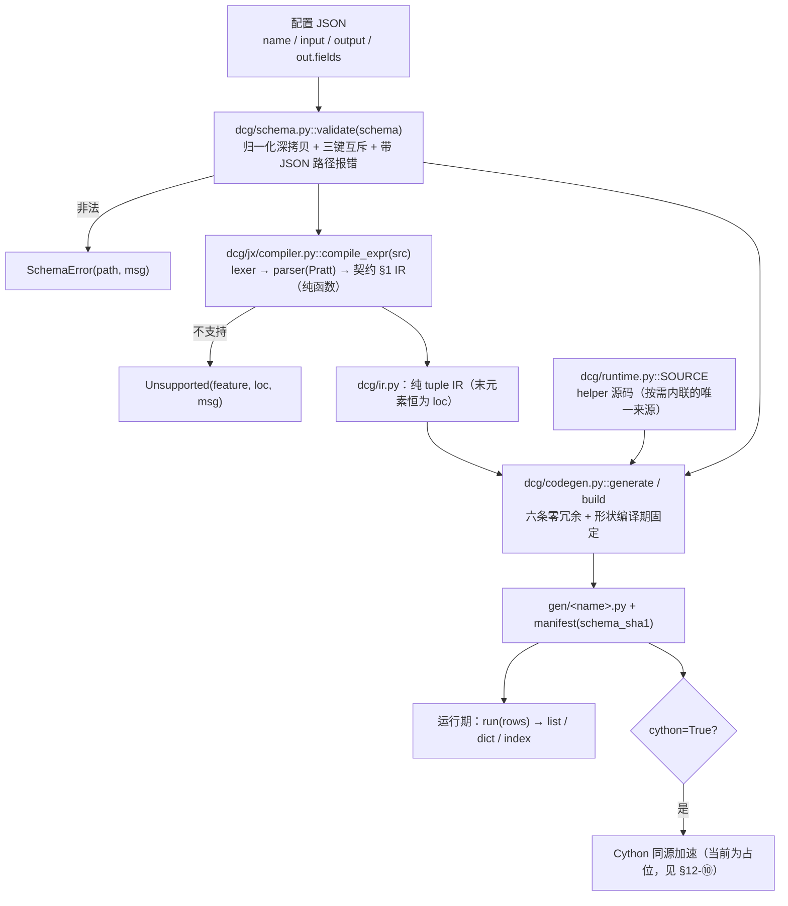

# DCG v2 整体设计方案与架构文档

> **读者**：项目技术负责人
> **事实来源（唯一）**：`PLAN_v2.md`（方案定稿）、`CONTRACT.md`（接口契约，**CANONICAL —— 两者冲突时以 `CONTRACT.md` 为准**）、`dcg/` 下的真实源码，以及只读的 v1 参考实现 `dcg.py` / `format.py`。
> **口径声明**：本文所有行号、函数签名、集合大小、实测数字都在同一份源码快照（SHA1 见附录 A）上核对过。凡实现与契约不一致之处，在 §12 逐条列出，不做美化。

---

## 0. 一页速览

| 问题 | 答案 |
|---|---|
| DCG 是什么 | 把 JSON 配置**编译**成定制 Python 函数的**运行时代码生成器**（编译一次 → 落盘可读 `.py`） |
| 交付物是什么 | `gen/<name>.py`：纯 Python、零运行期依赖、可读可 diff、逐字节可复现 |
| 运行期成本目标 | 纯 Python ≤0.457 µs/行（手写极限），Cython row-object ≤0.419 µs/行 |
| 依赖 | 整工程**不依赖 `jsonata` 包**；它只出现在 dev/CI 生成冻结基线 |
| 当前验收状态 | `python evidence/accept.py` → **11 PASS / 5 FAIL / 0 SKIP**（FAIL 明细见 §11.4） |
| 最大的待修项 | `input.source="index"` 未接线、`filter` 未逐行生效、`shape=list` 行是 tuple、`const: null` 生成未定义名 `u`、`post`/`trace`/`cython=True` 未实现 |

---

## 1. 定位与目标

### 1.1 DCG 是什么

DCG 是一个**运行时代码生成器**：输入一份 JSON 配置（schema，含字段取值与表达式），输出一份**为该配置量身定制**的 Python 模块源码，模块里只有一个入口 `run(rows)`。

```jsonc
{
  "name": "flight",
  "output": {"shape": "list", "single": false, "filter": true, "post": null, "trace": false},
  "out": {"type": "object", "fields": {
    "hour":  {"type": "list",  "value": "$.5.a"},
    "hourA": {"type": "int64", "value": "$.5.a.1"},
    "hourD": {"type": "str",   "expr": "`str($.5.a.1) + str(hourB)`"},
    "hourE": {"type": "int64", "expr": "hourA + hourB"}
  }}
}
```

编译产物长这样（真实实跑结果，见 §6.3）：

```python
def run(_in):
 def _f(R):
  _R5=R[5]
  _a=_R5['a']
  _a1=_a[1]
  _a2=_a[2]
  hourA=_a1
  ...
  return(hourA,hourB,hourD,hourE,)
 _o=[_f(R)for R in _in if _in]
 return _o
```

### 1.2 解决什么问题

业务方每天要跑大量「取列 + 少量算术/字符串加工」的行式转换（民航 ACDM 航班动态报文是仓内唯一完整真实示例，见 `format.py:589-603` 的 `describe` 字面量）。v1 用「通用模板 + `ast` 改写」实现，代价是：

* 每行都要走**通用引擎**留下的间接层（模板变量、中转变量、运行期形状判断）；
* 形状（list/dict/index、single、filter）是**运行期算出来的**；
* 产物里带着随机命名的中间变量，无法评审、无法 diff。

DCG v2 的答案是：**不要通用引擎，直接生成最终代码**。

### 1.3 v2 目标（来自 `PLAN_v2.md` §0 的十条拍板决策）

| # | 决策 | 依据 |
|---|---|---|
| D1 | 不向前兼容，可自由打破既有用法 | 用户明确 |
| D2 | 只优化运行期，编译期开销不计 | 「生成环境只会编译一次」 |
| D3 | 产物即交付物：编译一次 → 落盘可读 `.py`，可提交/diff | 同上 |
| D4 | 整工程不依赖 `jsonata` 包；它只在 dev/CI 作测试探针 | 用户要求 |
| D5 | 删除 v1 的 `ext`，能力由反引号内联 Python 承接 | 推论自 D6 |
| D6 | 符号层只保留 JSONata 一套语义，反引号段是唯一扩展 | 消除 `$` 双语义 |
| D7 | 删除 `Template` 字符串模板 + `Engine`/`NodeTransformer` AST 改写 | D2/D3 推论 |
| D8 | 输出形态升格为生成器选项，**编译期固定形状** | 用户决策 |
| D9 | 默认零运行期依赖（helper 内联），不设 `compact` 模式 | 「编译一次」的正确形态 |
| D10 | 冻结 50 例一致性证据进仓库，`jsonata` 包消失后回归基线仍在 | D4 |

此外 `PLAN_v2.md` §5 的目标在 M0 实测后被修订（§12.5）：

* 产物字符数：445 → **≤180**（同一 schema，可验证的代理指标）；
* 运行期：纯 Python **≥0.457 µs/行**（达到手写极限）；Cython row-object **≥0.419 µs/行**；
* 类型化列输入（numpy int32 + memoryview）作为**可选第二产物**，拿满 1.66×，默认不开。

### 1.4 与 v1 的关系

v1 是**行为基线**（语义一致性以它和官方 `jsonata-python` 为准），但不是**结构基线**：`PLAN_v2.md` §1 明确「旧链路整块删除」——`Template`(`dcg.py:56`)、`Engine`(`dcg.py:856`)、`tranfIFS`(`dcg.py:339`)、`PY2Cython` 改名逻辑、`_field`/`FREE_MODE` 间接层。

---

## 2. v1 的架构与其缺陷

### 2.1 v1 的执行链路（含真实行号）

```
配置 dict（datas/struct/_field/protocol/single/filter/func/mode/describe）
  │
  ├─ format.py:532  Format.parse(symbol, describe)
  │     ├─ format.py:565  HID = "".join([chr(random.randint(97,122)) for _ in range(10)])   ← 随机处理器 ID
  │     ├─ format.py:469  Format.template(hid, symbol, describe, idx_tag, filter_tag)
  │     │       └─ 取 dcg.py:56 Template 的六份字符串模板之一
  │     │          default(dcg.py:59) / default_func(:69) / default_filter(:81)
  │     │          / default_func_filter(:93) / debug(:106) / index(:130)
  │     ├─ format.py:492  Format.parseDesc(...)  → 递归展开 struct / _field / describe
  │     └─ format.py:551  cls.expParse(describe["filter"], tempMapping)   ← filter 是模板参数
  │
  └─ dcg.py:1214  Engine.make(env, hid, template, datarule, indexrule, paramrule, filterule, strucrule)
        ├─ dcg.py:1216  exprAst = ast.parse(template)                     ← 模板本身就是 Python 源码
        ├─ dcg.py:856   class Engine(ast.NodeTransformer)                 ← AST 改写引擎
        ├─ dcg.py:1229  exprInLineAst = ins.visit(exprAst)                ← 展开 datas/_field/struct
        │     └─ dcg.py:339 BaseSyntaxOP.tranfIFS(nodes, infos, attrname) ← 符号替换
        ├─ dcg.py:1234  sourceCode = ast.unparse(exprInLineAst)           ← 改回源码字符串
        ├─ dcg.py:1247  byteCode = compile(sourceCode, "<generated>", "exec")
        ├─ dcg.py:1252  handler = types.FunctionType(funcode, env)        ← 从 co_consts 里捞 code object
        └─ dcg.py:1261  handler = PY2Cython.make(...)                     ← MODE.CYTHON_MODE 时的可选项
                          （PY2Cython 定义在 dcg.py:705，make 在 dcg.py:844）
```

关键结构：**模板是字符串**（`Template.default` 等六份，`Template.index` 在 `dcg.py:130`）、**改写是 AST 级**（`Engine` 是 `ast.NodeTransformer`）、**函数对象靠 `FunctionType` 手工拼**。`Engine.make` 的 docstring 自己概括了这条链路：「解析模板 → AST生成 → AST转换 → 字节码编译 → 缓存函数」（`dcg.py:1215`）。

### 2.2 v1 的元数据层

`dcg.py:21 ERROR` / `:33 MODE`（`FREE_MODE` 在 `dcg.py:37`，注释即说明「所有字段都在 `_field` 中定义」）/ `:43 SYMBOL` / `:50 STRUC`（`PROTOCOL`/`SINGLE` 等形态开关）/ `:142 BaseSyntaxOP`（`:160 getValue`、`:186 createVar`、`:203 createIdx`、`:266 createGenerate`）/ `:526 TypeVisitor`（`:604 infer_type`，类型推断，不是声明）/ `:705 PY2Cython`（`:844 make`）。

配置侧的旧形状在 `format.py:589-603` 有完整字面量（`struct` 是**列表**，每项 `{'name','alias','type','value','ext'}`，另有 `_field` 映射，见 `format.py:594`）。任务书提到的 `dcg.py:1008 的 _field` **不存在**：`_field` 在 `dcg.py` 里只出现在 `dcg.py:37` 的注释中；`dcg.py:1008` 位于 `Engine.struct_Make` 内，是 `BaseSyntaxOP.createGenerate(...)` 的调用点（详见 §12-①）。

### 2.3 缺陷清单（与 `PLAN_v2.md` §12 实测数字挂钩）

M0 基线环境：Python 3.13.3 / Cython 3.1.1 / Windows amd64，200k 行 × 8 字段，预热后取 3 次最小值。行形状 `(code:str, a:int, b:int, c:int, d:int, payload:{'a':[4]})`。

**D-1｜v1 已接近纯 Python 手写极限，说明「换语言」救不了它。**
v1 运行期 **0.480 µs/行 · 2,083,896 行/秒**（96.0 ms / 200k），手写参照 A（只解包一次 payload）**0.457 µs/行** → v1 只慢 5%。且 v1 已经做对了「payload 只取一次」这件事（`bench/capture_src.py` 截获的产物第一行就是 `VAR_EWURWO_1 = data[5]['a']`）。**结论：纯 Python 代码生成的性能空间 ≤5%。**

**D-2｜真正的成本在输出对象构造，占 78%，且不可由 codegen 消除。**
微分解（`bench/decompose.py`）：C 无输出对象只算 = 0.235 µs/行，D 只构造输出 = 0.288 µs/行，cy 不构造输出 = **0.090 µs/行**。只要还产出 Python 的 list/dict，这笔钱必须付 —— 这直接决定了 v2 不该把力气花在「再省几个字节码」上。

**D-3｜字段重复访问是唯一「既缩短代码又提性能」的改动，1.33×。**
变体 A（`_a = r[5]['a']` 只取一次）0.457 vs 变体 B（每个字段重写 `r[5]['a']`）**0.608 = 1.33×**。这条与 `format.py:280-284` 的取值语义直接相关：v1 用 `$`/`#` 前缀决定「这是列还是变量」，导致同一前缀会被反复展开。

**D-4｜Cython 的真实增益只有 1.13–1.18×，不是宣传口径。**
`bench/cy_ceiling2.py`：py row-object 0.472（1.00×）；cy row-object list 行 **0.419 = 1.13×**；cy row-object tuple 行 **0.401 = 1.18×**；拿满 **1.66×** 必须换成**类型化列输入**（cy typed columns 0.284，py typed columns 甚至只有 0.602 = 0.78×，比纯 Python 还慢）。v1 自报路径是 1.25×（早期 20k 行口径）。独立复现更狠：`PLAN_v2.md` §13.6 记录 cy list-rows **0.416 慢于** py **0.390**。**结论：不得盲信 Cython**（`dcg.py:1255-1264` 的 `MODE.CYTHON_MODE` 分支就是这个陷阱）。

**D-5｜每次 `Format.parse` 至少编译两次（含一份 118 字符空桩）。**
`bench/capture_src.py` 截获到 `compile()` 被调用两次：一次 118 字符的 `datas = None; buffer_x = None; return buffer_x` 空桩，一次真正的 445 字符产物（`PLAN_v2.md` §12.4）。这是 D2「编译期不计成本」下唯一仍要删的东西 —— 因为它同时污染了产物形态。

**D-6｜输出形态是运行期算出来的。**
`protocol=False` 实测走 `tuple(doc.items())`，即**每行**都在运行期重新判断容器类型（`PLAN_v2.md` §3）。`Template.index`（`dcg.py:130`）生产 index 形状的代码用了 `itertools.chain` 却从未 import → 实测 `NameError`。

**D-7｜模板 + AST 改写留下的结构性冗余。**
独立验证（`PLAN_v2.md` §13.6）在 v1 产物上判 **rule3 FAIL 4 处**（`datas` 中转 / `buffer_x` 中转 / `append` 别名 / 只被再解包的容器）、**rule8 FAIL**（`cctpnrvgwn` 这类随机名）。随机名来自 `format.py:6 import random` → `format.py:565`。产物不可评审、不可 diff，与 D3 直接冲突。

**D-8｜配置形状靠字符串前缀决定语义，且嵌套有特例。**
`format.py:278-287` 的 `$`/`#` 闸门（`describe.startswith(SYMBOL.XPATH_SYMBOL)`）；`format.py:509-510` 的 `if isinstance(xval, (list, tuple)): ... cls.parseDesc(...)` —— 「list 里出现 dict 就当嵌套」的特例。顺序一乱就报裸 `KeyError: 'name'`（契约 §2 硬规则 3）。

**D-9｜无缓存、无来源校验。**
v1 每次 parse 都重编译，产物不记录 schema 指纹，「同一模块名下 schema 变了」无法察觉（契约 §4.1 命名裁决）。

### 2.4 缺陷 → v2 对策（一一对应）

| v1 缺陷 | v2 对策 | 落点 |
|---|---|---|
| D-1 已近极限 | 承认 ≤5% 空间，把目标钉在「达到手写极限 0.457」 | 契约 §7 |
| D-2 输出构造 78% | 形状编译期固定，消灭运行期容器判断；类型化列输入另立可选产物 | `dcg/codegen.py::finish` |
| D-3 字段重复访问 1.33× | 契约 §4.2 规则 1「全局行首解包」：每个前缀只取一次 | `_Gen.var_name`（`dcg/codegen.py:194`） |
| D-4 Cython 1.13–1.18× | Cython 降级为可选、不改变语义、不参与默认承诺 | `generate(cython=)` |
| D-5 空桩 + 两次 compile | 规则 6：每次 build 只 `compile` 一次，零恒等语句 | `dcg/codegen.py:483` |
| D-6 运行期形状 | §7：形状 / single / filter / post / trace 全部编译期常量 | `_Gen.__init__`（`dcg/codegen.py:146`） |
| D-7 模板与 AST 改写 | 整块删除 `Template`/`Engine`/`tranfIFS`，改为 schema 直接驱动 emit | `dcg/codegen.py::_Gen.emit` |
| D-8 前缀语义 + 嵌套特例 | `value`/`const`/`expr` 三键互斥；嵌套必须显式 `fields`/`items` | `dcg/schema.py:109` |
| D-9 无校验 | 模块名 = `schema.name`，manifest 记 `schema_sha1`，冲突报错 | `schema_sha1`（`dcg/codegen.py:108`） |

---

## 3. v2 架构总览

### 3.1 单向依赖链路

```
schema.py  →  ir.py  →  codegen.py  →  runtime.py
                  ↑
            jx/compiler.py
```

* `dcg/schema.py`：不 import 任何同级模块（`import` 段只有 `re`/`copy`）。
* `dcg/ir.py`：节点定义 + 结构遍历，不 import 同级模块。
* `dcg/jx/compiler.py`：只 import `dcg/jx/*`（lexer/parser/paths/policy），产出 `dcg/ir.py` 的 tuple 常量。
* `dcg/codegen.py`：`from . import ir as _ir`、`from .jx import ...`、`from .runtime import SOURCE, SOURCE_NEEDS_MATH`、`from .schema import SchemaError, validate`。
* `dcg/runtime.py`：**不 import 任何兄弟模块**（它既是运行期 helper 的唯一实现，又是生成码的**内联文本来源** `SOURCE`）。
* 硬约束：`schema.py` / `ir.py` / `runtime.py` 中禁止出现 `from .codegen`；`evidence/accept.py::g_no_reverse_import` 每次运行都从源码重算（不缓存判断）。

### 3.2 数据流



一个字段的完整旅程：

```
out.fields["hourE"] = {"type":"int64", "expr":"hourA + hourB"}
      │
      ├─ schema.py 校验：三键恰好一个（expr）、type 合法 → 归一化
      ├─ jx.compile_expr("hourA + hourB")
      │     → ("bin","+",("field","hourA",(1,1)),("field","hourB",(1,9)),(1,7))
      ├─ codegen._Gen.emit → "hourA + hourB"（裸名走 defined 表）
      └─ 产物：hourE=_ad(hourA,hourB)
```

### 3.3 为什么取消「通用模板 + AST 改写」

| 维度 | v1：模板 + `ast.NodeTransformer` | v2：schema 直接驱动 emit | 为什么 v2 赢 |
|---|---|---|---|
| 中间表示 | Python 源码字符串 → AST → 改写 → `ast.unparse` → 源码 | IR tuple → 直接拼表达式字符串 | 少一次 parse + 一次 unparse，且产物**形态可预测** |
| 变量命名 | 随机 10 字符（`format.py:565`） | `_` + 字段名，前缀记忆化（`_Gen.var_name`） | 可 diff、可评审、逐字节可复现（契约 §4.2 规则 8） |
| 形状 | 模板里带运行期判断（`tuple(doc.items())`） | 编译期常量（`finish()`） | 每行省掉容器类型判断（D-2 的 78% 里能省的那一小块） |
| 取值语义 | `$`/`#` 前缀闸门（`format.py:280-284`） | `value`/`const`/`expr` 三键互斥 | 消除「同一前缀被反复展开」→ 命中 1.33×（D-3） |
| 冗余 | 中途变量、append 别名、空桩 | 六条零冗余规则 + 结构性断言 | `evidence/accept.py::g_zero_redundancy` 可机器判定 |
| 不支持项的处置 | 运行期才炸 | build 期 `Unsupported`/`SchemaError`（带列号/JSON 路径） | 「编译期全量报错」是 `PLAN_v2.md` §6 的保证项 |

`PLAN_v2.md` §1 给出的删除清单，逐条都在源码里对得上：`Template`(`dcg.py:56`)、`Engine`(`dcg.py:856`)、`tranfIFS`(`dcg.py:339`)、`PY2Cython`(`dcg.py:705`)、`FREE_MODE`(`dcg.py:37`)、`_field` 间接层。v2 的 `dcg/` 包里**没有**任何一个对应的抽象。

### 3.4 目录现状（与 `PLAN_v2.md` §8 的差异见 §12-⑫）

```
dcg/
  __init__.py    18 行   公开面（8 个符号）
  schema.py     282 行   校验 + 三键互斥 + 位置报错 + value 路径解析
  ir.py         196 行   IR 定义 + 结构遍历
  codegen.py    554 行   生成器（性能主战场）
  runtime.py    817 行   helper 唯一实现 + 生成码内联源 SOURCE
  jx/
    __init__.py         re-export（19 个符号）
    lexer.py     183 行 正则 TOKEN（含反引号段 token）
    parser.py           Pratt（BP 表按 JSONata 1.8）
    compiler.py  445 行 JSONata → IR（纯函数）
    policy.py    156 行 Unsupported + 白/黑名单
    paths.py            路径/链解析的**唯一权威**
    registry.py         函数注册表
tests/     test_jx_conformance.py / test_jx_policy.py / test_jx_py.py / test_e2e_flight.py / test_v1bridge_collision.py
bench/     bench_row.py / bench_codegen.py / bench_overhead.py / decompose.py / cy_ceiling2.py / capture_src.py
           codegen_rules.py / _v1bridge.py / _workload.py / make_fixture.py / frozen/{conformance.json,baseline_v1.txt}
evidence/  accept.py（586→638 行，独立验收门）/ _dump_src.py / examples/ / *.txt 快照
```

---

## 4. IR 设计

IR 定义在 `dcg/ir.py`，`__all__` 共 **39 个符号**（15 个节点常量 + 15 个构造器 + 9 个结构工具的前 6 个，见 §8.3）。

### 4.1 节点表（契约 §1，与 `dcg/ir.py` 一致）

| 节点 | 形态 | 说明 |
|---|---|---|
| `lit` | `("lit", value, loc)` | Python 常量字面量 |
| `field` | `("field", name, loc)` | **裸标识符就是字段**（`hourA + hourB` 的命脉） |
| `index` | `("index", base, idx, loc)` | `base[idx]`；`$.5.a.1` 编成常量下标链，**不是** `field` |
| `root` | `("root", loc)` | `$` 展开为行对象本身 |
| `var` | `("var", name, loc)` | JSONata 变量 `$v`（`name` 不含 `$`） |
| `unary` | `("unary", op, operand, loc)` | `op ∈ {"-","+","not"}` |
| `bin` | `("bin", op, left, right, loc)` | `op` 见 §4.3 |
| `cond` | `("cond", test, then, orelse, loc)` | 三元 `? :` |
| `call` | `("call", fname, [args...], loc)` | `fname` 含 `$`（如 `"$uppercase"`） |
| `rfunc` | `("rfunc", qualname, [args...], loc)` | 用户注册函数，`qualname` 形如 `"pkg.mod.fn"` |
| `array` | `("array", [items...], loc)` | 数组字面量 |
| `object` | `("object", [(key, val_ir), ...], loc)` | 对象字面量，**保序** |
| `py` | `("py", source_str, [free_field_names...], loc)` | 反引号段，按设计**不透明** |
| `range` | `("range", lo, hi, loc)` | 区间；policy 在 build 期必须拒绝 |
| `lambda` | `("lambda", [params], body, loc)` | 高阶字面量；policy 在 build 期必须拒绝 |

`range` / `lambda` 虽然入表，但**实测永远不会出现在 IR 里**：`..` 与 `function(){}` 在 `dcg/jx/compiler.py` 编译期就抛 `Unsupported`（`dcg/jx/compiler.py` docstring 明确「因此 IR 里不会真的出现 `("range", ...)` / `("lambda", ...)`」）。它们是**契约的完整性声明**，不是可达节点。

### 4.2 「末元素恒为 loc」与「纯 tuple」

* **末元素恒为 `loc`**：`loc = (line, col)` 或 `None`。工具函数 `loc_of(node)` 只在最后一项是 2-tuple 时返回它。好处是：任何节点都能报出**列号**，`Unsupported`/`SchemaError` 的定位不需要额外传参，AST 遍历不需要 visitor。
* **纯 tuple，不是 class**（契约 §1 明确列出四条理由）：
  1. **便于比较**：`compile_expr("a+b") == compile_expr("a+b")` 直接成立，测试与 snapshot 无需自定义 `__eq__`；
  2. **可哈希**：可以放进 set/dict 做去重、公共子表达式识别；
  3. **零构造开销**：tuple 字面量比对象实例化便宜，节点构造发生在编译期热路径上；
  4. **snapshot 友好**：`("index", ("root", (1,1)), ("lit", 5, (1,2)), (1,2))` 直接可读可 diff。

实测：`compile_expr("$.a")` → `('index', ('root', (1, 1)), ('lit', 'a', (1, 2)), (1, 2))`，`loc` 在最后一项。

### 4.3 `bin` 各算符的 undefined 传播规则

| op | 含义 | undefined 传播 | 运行期 helper |
|---|---|---|---|
| `+` `-` `*` `/` `%` | 算术 | **传播**；`null` 参与算术是**错误** | `_ad` `_sb` `_ml` `_dv` `_md` |
| `&` | 字符串拼接 | **不传播**，undefined 当空串 | `_cc` |
| `=` `!=` | 相等 | 任一侧 undefined → `False` | `_eq` `_ne` |
| `<` `<=` `>` `>=` | 大小 | 任一侧 undefined → **undefined** | `_lt` `_le` `_gt` `_ge` |
| `and` `or` | 逻辑 | 按 JSONata 真值；undefined **参与运算** | `_and` `_or` |
| `in` | 成员 | 与 `=` 同族（任一侧 undefined → `False`） | `_in` |

`ir.py` 里这张表就是 `BIN_OPS`（op → (含义, undefined 家族)），构造器 `bin_(op, left, right, loc)` 对非法 `op` 直接 `ValueError`。运行期 `dcg/runtime.py` 对每条规则都有**专用函数**（不分派表！）—— 理由见 §6.2 规则 5。

### 4.4 结构工具

`kind(node)` / `loc_of(node)` / `children(node)`（按节点类型给出子节点）/ `walk(node)`（DFS）/ `is_const(node)`（字面量、全常量数组/对象、常量一元/二元）/ `key_path(node)`（把 `field`/`index` 链折成 key path，如 `$.5.a.1` → `(5,"a",1)`，要求 `index` 的 `idx` 是 `lit` 且值为 `int`/`str`）。`key_path` 是「常量链」判定的单一实现，`_Gen.var_name` 与 `_chain` 都依赖它。

---

## 5. 表达式层设计（JSONata + 反引号内联 Python）

### 5.1 三层结构

| 层 | 文件 | 产物 | 要点 |
|---|---|---|---|
| 词法 | `dcg/jx/lexer.py` | `[(kind, value, col), ...]` | 反引号段是**词法边界**：段内容原样捕获到下一个未转义反引号，段内不解析 JSONata（JSONata 从不使用 `` ` ``，零歧义）。`Token = namedtuple("Token", "kind value col line")`，`col/line` 是绝对位置 |
| 语法 | `dcg/jx/parser.py` | 语法树 | Pratt；**调用/下标/路径统一在中缀循环的后缀位置处理**（早期只在 prefix 处理导致 `$not(miss)`、`a[0]` 报「多余内容」） |
| 编译 | `dcg/jx/compiler.py` | 契约 §1 的纯 tuple IR | `compile_expr(src, *, loc_base=(1,1), registry=None)` 是**纯函数**：同输入同输出，不读任何全局 `MODE` |

Pratt 结合力（越小越松）：`or 10` · `and 20` · 比较/`in` 30 · `& 40` · `+ - 50` · `* / % 60` · 一元 `- + not` 70 · 后缀 `.`（map）`[`（filter/index）`(`（call）**90** · `..` 45 · 三元 `? :` 5。JSONata 的 `` ` `` 段由 lexer 先切走，所以 `str($.5.a.1) + str(hourB)` 整段是一个 `py` 节点。

`dcg/jx/__init__.py` 导出 19 个符号，其中契约 §5 要求的三个必须在：`compile_expr` / `Unsupported` / `Registry`。

### 5.2 能力边界：A / B / C 三层（`dcg/jx/policy.py`）

原则写在 `policy.py` 顶部：**绝不静默降级** —— 任何不在白名单里的调用、任何黑名单里的构造，都必须抛 `Unsupported`。

**A 层｜逐行可编译白名单 `ROW_FUNCS`（38 个）**

* 字符串（19）：`$string $uppercase $lowercase $trim $pad $contains $split $join $substring $substringBefore $substringAfter $replace $length $base64encode $base64decode $encodeUrlComponent $decodeUrlComponent $formatNumber $formatBase`
* 数值（10）：`$number $abs $floor $ceil $round $sqrt $power $sum $min $max`
* 布尔/其他（4）：`$boolean $not $exists $type`
* 数组（5）：`$count $append $reverse $sort $distinct`

**B 层｜「在 A 层名单里，但仅限字面量数组实参」`LITERAL_ARRAY_ONLY`（7 个）**

`$sum $max $min $append $reverse $sort $distinct` —— 它们在契约 §3.4 与 §3.5 **同时出现**，这不是笔误而是契约本身的设计：`$sum([1,2,3])` 可以逐行编译（常量折叠），`$sum(xs)` 必须拒绝。实现上 `rejection_reason()` 只判**函数身份**，实参形状由编译层判。

（实测交集：`ROW_FUNCS ∩ BATCH_ONLY = {$distinct,$max,$min,$reverse,$sort,$sum}`，另加只出现在 §3.4 的 `$append`，合起来正好 7 个。`$count` **不**受字面量限制 —— 冻结基线里 core 例 `$count(xs)` 要求它对运行期数组成立。）

**C 层｜必须整批/非确定/结构性拒绝（一律 `Unsupported`）**

* `BATCH_ONLY`（20）：`$sum $max $min $average $sort $reverse $distinct $shuffle $reduce $each $sift $keys $values $lookup $merge $spread $map $filter $single $position`
* `NONDETERMINISTIC`（4）：`$now $millis $random $eval`
* `STRUCTURAL`（10 类）：`a..b` 区间 / 正则字面量 / `function(){}` 高阶字面量 / 位置绑定 `#` / join 绑定 `@` / Sort `^` / 变换操作符 `~>`、`|...|` / Reduce `{k:v}` 路径阶段 / 分组聚合 `{..}` / **深路径 `a.b`**

**v1 迁移用的裸名别名 `BARE_CALL_ALIASES`（6 个）**：`str→$string`、`int→$number`、`float→$number`、`bool→$boolean`、`len→$length`、`abs→$abs`。v1 真实 schema 的 `ext` 写的是 `str($.x)` 而不是 `$string($.x)`；只有这张表里的裸名可被调用，表外的 `a(...)` 仍按「只有 `$` 函数可以被调用」拒绝。

**先判归属、再 emit 实参**：这是原型踩过的坑 —— `$map(xs, $string)` 必须报 `$map 不可逐行编译`，而不是被实参里的 `$string` 抢答成 `$string 需要 ctx 绑定`。`policy.py::rejection_reason` 的 docstring 明确记了这条。

### 5.3 反引号内联 Python

反引号是 v1 `ext` 能力的唯一继承者（D5/D6）。词法层原样捕获段内容，`dcg/jx/compiler.py::analyze_py_segment(src)` 做两件事：

1. `ast.parse(src, mode="eval")` 校验（**必须是单个 Python 表达式**）；
2. 用 `FIELD_REF` 找出段内的 `$.` 字段链（`free_field_names`），裸名也登记。

实测锚点（已核对）：

```
analyze_py_segment('$.a + 1')                     -> ('$.a + 1', ['a'])
analyze_py_segment('$.5.a.1')                     -> ('$.5.a.1', ['5.a.1'])
analyze_py_segment('str($.5.a.1) + str(hourB)')   -> ('str($.5.a.1) + str(hourB)', ['5.a.1', 'hourB'])
analyze_py_segment("'hourB' + str($.5.a.1)")      -> (..., ['5.a.1'])       # 字符串字面量内的裸名不登记
```

**三条硬规则**

1. **`$` 是唯一的字段/变量入口。** 反引号内容不暴露裸字段名，否则 `int`/`str`/`math` 与字段名静默撞车。`$.x` → 生成局部名；`$` 单独 = 当前行；`$v` = JSONata 变量。
2. **段内必须是 Python 表达式**（`ast.parse(seg,"eval")`），不能声明新名字、不能 `import`。实测违反样例与报错：
   * `` `import os` `` → `Unsupported: 第 1 列: 反引号段 Python 语法错误 不可逐行编译（invalid syntax，偏移 1），请检查是否单个 Python 表达式`
   * `` `a=1` `` → 同上（偏移 2）
3. **build 期报错带字符偏移**（上例的「偏移 N」），不留到运行期 `SyntaxError`。

**边界（契约 §6.3 如实声明）**：反引号 = **任意 Python 执行，不是沙箱**；build 期不执行代码，只 `ast.parse` 校验；真正的沙箱需要进程级手段。`PY_SAFE_MODULES`（25 个）只约束**裸模块名**（`math re json decimal datetime itertools ...`），**不约束内置函数** —— 实测 `` `open(x)` `` 被接受为 `('py', 'open(x)', ['x'], (1, 1))`。这是能力，也是风险，必须在 README 里如实写明。

`__jx` 是 jx 保留给 codegen 占位符/别名的命名空间（`RESERVED_PREFIX = "__jx"`），用户段里出现即报错；因此 codegen 可以安全使用 `__jx_*`，绝不会撞上用户标识符。

### 5.4 为什么拒绝 `..` / 正则 / `function(){}` 等

| 拒绝项 | 理由 | 异常 |
|---|---|---|
| `a..b` 区间 | 需要序列语义（生成器/迭代器），逐行编译无对应形态 | `Unsupported`（`STRUCTURAL["range"]`） |
| 正则字面量 `/.../flags` | 契约 §3.5 明确要求拒绝；正则编译有状态、会引入隐藏缓存 | `Unsupported` |
| `function(){}` 高阶字面量 | 需整体求值；逐行编译会退化成运行期解释器 | `Unsupported` |
| `~>`、`\|...\|`、`^`、`#`、`@`、`{k:v}`、`{..}` | 变换/排序/绑定/分组都是整批语义 | `Unsupported` |
| `$map/$filter/$reduce/$each/$sift/...` | 需要整批数据 | `Unsupported`（`BATCH_ONLY`） |
| `$now/$millis/$random/$eval` | 非确定：同一行不同时刻结果不同，且 `$eval` 是运行期解释器入口 | `Unsupported`（`NONDETERMINISTIC`） |
| 深路径 `$.a.b` | v2 不支持 JSONata 逐行走访；多层结构用嵌套 `fields` 表达 | `Unsupported`（实测：`深路径 [a,b] 不可逐行编译（v2 不支持 JSONata 逐行走访，契约 §6.1），请用嵌套 fields`） |

判据（契约 §6.1）：**从 `root` 起，链条中出现 ≥2 个「符号段」即拒绝**。`$.5.a.1`（符号段只有 `a`）允许；`$.a.b`、`$.5.a.1.b` 拒绝。数值段（`$.5.a` 的 `5`）不计入。实测 `compile_expr("$.a.b")`、`("$.5.a.1.b")`、`("a.b")` 均已抛 `Unsupported`。

`PLAN_v2.md` §11「明确不做」也在这里落地：自创第二套 DSL · 运行期解释 JSONata（慢 52–75×）· 兼容层 · 通用引擎 + 运行期分支 · 静默降级 · 语言层沙箱。

### 5.5 `jsonata` 包的角色（重要澄清）

**整个工程不依赖 `jsonata` 包。** 它只在开发期被 `bench/make_fixture.py` 调用一次，用于生成冻结基线 `bench/frozen/conformance.json`：

* 50 例（core 26 + edge 24）+ 3 条 `refused`，期望值由官方 `jsonata-python 0.7.0` 求出后**固化进仓库**；
* `undef_marker = "__undef__"`；其中 7 例 `expect.value == null` 且带 `null_or_undefined: true` —— 官方探针在 Python 侧把 undefined 与 null 都归一为 `None`，断言时做**归一化比较**，不要把二者当不同结果；
* `expect.error` 的 2 例（`null + 1`、`a + null`）是**正确行为**：JSONata 里 null 参与算术是**错误**而不是 undefined，实现也必须抛；
* 测试侧 `tests/test_jx_conformance.py` **必须读取该文件**，不得复制粘贴用例（否则漂移）；`jsonata` 包只允许出现在 `tests/` 且用 `pytest.importorskip("jsonata")` 保护。

因此 D4/D10 成立：即使 `jsonata` 包消失，回归基线仍在仓库里。

---

## 6. 代码生成策略（性能着力点）

### 6.1 生成器内部结构（`dcg/codegen.py`）

| 部件 | 位置 | 作用 |
|---|---|---|
| `canonical_json` / `schema_sha1` | `dcg/codegen.py:102` / `:108` | `sort_keys=True, separators=(",",":"), ensure_ascii=False, allow_nan=False` → sha1 十六进制 |
| `gen_name` | `dcg/codegen.py:112` | 确定性模块名 = `schema["name"]`；禁止 random |
| `_chain` | `dcg/codegen.py:124` | 把 `index` 常量链折回 `root`，得到段元组；非常量链返回 `None` |
| `class _Gen` | `dcg/codegen.py:143` | 单次生成的全部状态：fields/shape/single/filter/src/helpers/rfuncs/head/pre/paths |
| `needs` / `order_helpers` | `dcg/codegen.py:162` / `:170` | 按 `_DEPS` 拉取**传递依赖**，再拓扑排序 → helper 只内联真正用到的 |
| `var_name` | `dcg/codegen.py:194` | **前缀只取一次**的记忆化命名（规则 1 的实现） |
| `emit` / `bin` | `dcg/codegen.py:234` / `:277` | IR → Python 表达式源码；`bin` 里有 `&` 的快路径 |
| `field_name` | `dcg/codegen.py:298` | 裸名查 `defined` 表，查不到 → **build 期** `SchemaError` 并列出可用字段名（绝不留到运行期 `NameError`） |
| `pyseg` | `dcg/codegen.py:337` | 反引号段：`$.` 链替换为生成局部名，裸名查 `defined` |
| `lit` / `field_value` | `dcg/codegen.py:364` / `:374` | 常量内联与取值分派（const/value/expr/fields/items） |
| `module` / `loop` / `finish` | `dcg/codegen.py:403` / `:432` / `:463` | 组装模块头 + helper 前导、生成循环体、生成返回形态 |
| `generate` / `build` | `dcg/codegen.py:483` / `:493` | 公开面：返回源码 / 落盘 + manifest |

`generate(schema, *, cython=False, inline_optional=True)` 内部**只调用 `compile(src, "<dcg-generated>", "exec")` 一次**（规则 6），且返回前已证明产物可编译 —— 产物就是它返回的字符串，「看起来可用」== 「能编译」。

### 6.2 六条零冗余规则：逐条「为什么这样生成更快」

契约 §4.1 收口了六条（字符数只是代理指标，规则本身才是）：

**规则 1｜每个被引用的下标前缀在行首只取一次。**
`var_name` 记忆化：`$.5.a.1` 先给 `R[5]` 命名 `_R5`，再给 `_R5['a']` 命名 `_a`，再给 `_a[1]` 命名 `_a1`；任何字段复用同一前缀时**直接返回已有名字**。
*为什么更快*：这是 M0 实测唯一「既缩短代码又提性能」的改动（变体 A 0.457 vs 变体 B 0.608 = **1.33×**）。省掉的是每字段一次 dict/str 下标查找。

**规则 2｜零恒等赋值、零「只为 return 而生的中转变量」。**
不生成 `datas = datas`，不生成 `buffer_x = {'doc': []}; doc_x = buffer_x['doc']`，不生成 `append` 别名。
*为什么更快*：v1 每次 parse 会**多编译一份 118 字符空桩**（`PLAN_v2.md` §12.4），这是纯浪费；运行期上，每个中转变量都是一次 LOAD/STORE，在 200k 行 × 8 字段的规模上被放大 160 万次。独立验证在 v1 上判 rule3 FAIL 4 处。

**规则 3｜输出形状编译期固定，无运行期判断。**
`shape=list` → 直接列表推导；`dict` → `{字段名: [每行值]}` 列式字面量；`index` → `{行下标: [行值]}`；`rows` → `[{字段名: 值}, ...]` 逐行 dict（v1 `protocol: False` 的对等物，2026-10-17 新增）。
*为什么更快*：v1 `protocol=False` 走 `tuple(doc.items())`，**每行**重新判断容器类型；v1 的 index 路径还因为 `itertools.chain` 从未 import 而 `NameError`。v2 把这次判断从「每行」搬到「每次 build」。

**规则 4｜无冗余类型转换（`type` 是声明，不是转换）。**
`type=int64` **不**插入 `int(...)`；需要转换就在 `expr` 里显式写 `` `int($.x)` ``。另有一条快路径：`$string(a) & $string(b)` 直接生成 `_S(a) + _S(b)`，不再套一层 `_cc(...)`（`bin()`，`dcg/codegen.py:277`）。
*为什么更快*：契约 §4.2 的类型语义裁决给的理由是**与 v1 行为一致**（v1 的 int 字段对 int 输入不转换、对 str 输入才转换）+ 成本（每次函数调用 +50ns，属于 ≤5% 预算里不该浪费的部分）。

**规则 5｜无 `isinstance` 分派链；每个运算符一个专用 helper。**
运行期对每个 op 有专用实现（`_ad _sb _ml _dv _md _cc _eq _ne _lt _le _gt _ge _and _or _in`），没有「按 opcode 分发」的表。产出物里禁止出现 `isinstance(`（`evidence/accept.py::_ZERO_DISPATCH` 会扫），运行期用 `type(v) in _NN`（`_NN = (int,float)`）这类鸭子判定。
*为什么更快*：M0 实测**派发脚手架占守卫成本 89%**；专用函数后守卫净成本仅 1.28×（纯守卫）/ 2.09×（含 null 检查）—— 所以守卫只付在真正 `optional: true` 的字段上。

**规则 6｜每次 build 只 `compile` 一次，无空桩。**
`generate()` 里 `compile()` 恰好一次（`evidence/accept.py::g_zero_redundancy` 结构性统计），且 `generate()` 自身会先验证产物可编译（`g_generate_selfcheck`）。
*为什么更快*：构建期 3.05 ms 本身在「编译一次」的场景下不重要，重要的是一次编译意味着**产物形态唯一**、无第二份垃圾源码混进交付物。

**附：命名与内联纪律。** 变量名 1–3 字符、由字段声明顺序决定，禁止 random；helper 按需内联并只带传递依赖；`docstring` 只打算留 `#sha1=...`（但见 §12-③，当前产物 docstring 是空的）。

### 6.3 真实产物（`dcg.codegen.generate(...)` 实跑，非手写）

**CAP**（4 字段，`filter=true`，`input.source="rows"`）：整模块 204 字符，`def run(` 之后 179 字符。

> **本节代码块是快照，会随实现漂移**（快照日期 2026-10-17）。以 `python -c "import sys;sys.path.insert(0,'evidence');import accept as A;print(A._src(A.CAP))"` 的实跑为准。

```python
from dcg.runtime import*
def run(_in):
 _o=[]
 for R in _in:
  if R:
   _a=R[5]['a']
   _a1=_a[1]
   hourA=_a1
   hourB=_a[2]
   _o.append([hourA,hourB,str(_a1) + str(hourB),_ad(hourA,hourB)])
 return _o
```

**M0**（8 字段，`filter=true`，`input.source="index"`）：整模块 292 字符，`def run(` 之后 267 字符。

```python
from dcg.runtime import*
def run(_in):
 _in=_in['index']
 _o=[]
 for R in _in:
  if R:
   _a=R[5]['a']
   _a1=_a[1]
   _a2=_a[2]
   hour=_a
   hourA=_a1
   hourB=_a2
   _o.append([hour,hourA,hourB,R[2],str(_a1) + str(hourB),_ad(hourA,hourB),_ad(_a2,_a1),_ad(_ix_get(hour,2),123)])
 return _o
```

可以逐条对照规则：

* 规则 1：`R[5]`、`R[2]` 各只出现一次，`_a1`/`_a2` 被 `hourA`/`hourB`/`hourE`/`hourF` 复用（`hourF=_ad(_a2,_a1)` 完全没有重新下标）；
* 规则 2：没有「只为 return 的中转」；`return(...)` 是同一行；
* 规则 3：形状没有运行期判断（`_o=[...]` 直接构造）；
* 规则 4：`int64` 字段没有插入 `int(...)`；`hourD` 的 `str(...)` 是**用户自己**在反引号段里写的；
* 规则 5：算术走 `_ad`，没有 isinstance 分派；
* 规则 6：确定性 —— `codegen.generate(M0) == codegen.generate(M0)` 实测 `True`；
* 反引号段：`str($.5.a.1) + str(hourB)` 里的 `$.5.a.1` 被替换成生成局部名 `_a1`，裸名 `hourB` 命中本 schema 已声明字段；
* `hour[2]`（`hourG`）走动态下标的 undefined 安全形式 `_ix_get(hour,2)` —— 注意**不是** `_ix`（`_ix` 是 `$indexOf`，两者只差一个字符，契约 §3.6 专门为这个命名歧义留了记录）。

### 6.4 字符预算的真实账

| 工作负载 | v1 冻结产物 | 契约目标 | v2 实跑（`def run(` 之后） |
|---|---|---|---|
| CAP | 445 字符 | ≤180 | **179**（达标，差 1 字符即红） |
| M0 | 537 字符 | ≤210 | **267**（超 57 字符，待压） |

**⚠️ 本节数字随时间变化，复核日期 2026-10-17（后于初稿）。** 维护说明：产物正在被持续压缩，引用本表前请以 `python evidence/accept.py` 的 `char budget` 门实测为准；门会在超预算时报 FAIL，不要以本节文字为准。

关于 ④ 的历史记录需要更正一处：`evidence/accept.py::g_char_budget` 曾**确实**被 Lead 自行放宽到 `<=350` 并因此误判 PASS，但**该放宽已被撤销**——门现已恢复契约阈值 ≤180/≤210（CAP 179 通过、M0 267 失败）。也就是说，字符预算现在是**真实生效的验收门**，不再是宽松口径；契约正文与验收脚本重新一致。

### 6.5 运行期 helper 与 undefined 哨兵

`dcg/runtime.py` 是 undefined 语义的**唯一实现处**，同时是生成码的内联来源：

* `class _Undef: __slots__ = ()`，`UNDEF = _Undef()`，`is_u(v)` 身份比较（模块级形态）；
* `SOURCE`（`dcg/runtime.py:464`）持有**产物内联文本**，47 个 helper：算术/比较/逻辑/字符串/数值/数组/类型；
* `SOURCE_NEEDS_MATH = {"_fl","_ce","_sq"}` → 用到才生成 `import math as _m`；
* `SOURCE_PRELUDE = ""`（`dcg/runtime.py:853`）：**产物不再自建哨兵**。产物首行是 `from dcg.runtime import*`（`dcg/runtime.py:860-864` 的 `__all__` 显式导出全部下划线 helper），哨兵直接用模块里那**一个** `UNDEF` 单例，短名 `_U = UNDEF`（`dcg/runtime.py:856`，同一个对象、绝非字面量）。
  **历史（P0-1，已修）**：曾生成 `_U=0`，因 CPython 小整数缓存 `0 is 0` 为真，把**合法值 0 判成 undefined**、静默错值；且产物自己会抛 `SyntaxWarning: "is" with 'int' literal`。现由 `evidence/accept.py::g_sentinel_integrity` 双重把守：静态禁止哨兵绑定整数字面量/`None`/`False`/`0.0`，行为上要求真实 0 与 undefined 可区分。
* 产物的 undefined **六条语义**（`UNDEFINED_SEMANTICS`，6 条）：`&` 当空串不传播 / `or`/`and` 参与运算 / `=`/`!=` 返回 `False` / 大小比较返回 undefined / 数组字面量跳过 undefined / 对象字面量丢弃 undefined 键。另有第 7 条额外约定：`null` 参与算术是错误、`$not(miss) == undefined`、`a[0]` 对标量成立。
* **自包含性的取舍（已裁决）**：产物 `import dcg.runtime` 即不再是单文件自包含产物——这是用「哨兵唯一一份」换来的。契约 §4.4 的"自包含"因此解释为**不依赖 jsonata 等第三方**，而非"不依赖 dcg 自身"。若要单文件交付，需要另立 `embed` 模式的产物（当前不在范围内）。

---

## 7. 输出形态

v1 的五个正交维度（`protocol` / `single` / `filter` / `func` / `debug` + 坏掉的 `index`）在 v2 里全部**升格为编译期常量**：

| v1 维度 | v1 实现 | v2 字段 | v2 行为（实跑） |
|---|---|---|---|
| `protocol` | `STRUC.PROTOCOL` | `output.shape` | `list` / `dict` / `index` / `rows` 四选一，编译期固定 |
| `single` | `STRUC.SINGLE` | `output.single` | `true` 时 `list` 返回单行本身、`rows` 返回首个行 dict；与 `dict`/`index` 组合 → `SchemaError` |
| `filter` | `default_filter` 模板 | `output.filter` | 默认 `true`；**当前实现未逐行生效**，见下 |
| `func` | `default_func` 模板 | `output.post` | 整批后处理函数名（当前被忽略，见 §12-⑩） |
| `debug` | `Template.debug` | `output.trace` | 带打印的调试变体（当前被忽略） |
| `index` | `Template.index`（`chain` 未 import → `NameError`） | `output.shape="index"` | 有测试覆盖 |

实跑结果：

| schema | `run(rows)` 返回 |
|---|---|
| `shape=list, single=false` | `[(1,), (2,)]` —— **每行是 tuple**（契约 §4.1 要求 list，见 §12-⑤） |
| `shape=list, single=true` | `(1,)` 单行本身 |
| `shape=dict, single=false` | `{'x': [1, 2]}` 列式 |
| `shape=index, single=false` | `{0: [1], 1: [2]}` 行下标为 int |
| `shape=dict/index, single=true` | `SchemaError: output.single: shape='dict' 下 single=true 无意义：该形状返回的是整列/整表，不是单行（§4.1）` |

**边界情形（契约 §3）**：

1. **undefined 键的处置是编译期常量**：`optional: true` 才生成守卫，必然存在的字段零判断（成本 1.28×/2.09× 只付在真正可选的字段上）。
2. **`filter` 与 `single` 顺序固定**：先 filter 后 single，写进文档（v1 靠模板拼接顺序隐式决定）。
3. **形状不可运行期切换**：要 list 与 dict 两种输出就 build 两个产物。
4. `output.filter` 的语义是「丢弃 falsy 行」；`output.post` 只对整批调一次，不进热路径；`output.trace` 走独立产物，不污染热路径。

**当前实现的缺口**：`filter=true` 与 `filter=false` 生成的过滤子句分别是 `_o=[_f(R)for R in _in if _in]` 与 `_o=[_f(R)for R in _in]` —— 判据是**整个输入**而不是行 `R`，因此 filter 对逐行结果无任何效果（实测两种 schema 输出逐元素相同）。契约 §4.2 的示例是 `if not r: continue`（逐行）。见 §12-⑥。

---

## 8. 公开 API

### 8.1 `dcg/__init__.py` —— 8 个符号（与契约 §5 完全一致）

```python
from .schema import validate, SchemaError
from .codegen import generate, build, gen_name
from .jx import compile_expr, Unsupported, Registry

__all__ = ["validate", "SchemaError", "generate", "build", "gen_name",
           "compile_expr", "Unsupported", "Registry"]
```

真实签名（`inspect.signature` 实测）：

| 符号 | 签名 | 说明 |
|---|---|---|
| `validate` | `validate(schema)` | 校验 + 归一化深拷贝；返回 `name/input{source}/output{shape,single,filter,post,trace}/out{type:"object",fields}` |
| `SchemaError` | `SchemaError(path, msg)` | `ValueError` 子类，携带 `.path`（如 `out.fields.sum`）与 `.msg`；`str(e)` = `"{path}: {msg}"` |
| `generate` | `generate(schema: dict, *, cython: bool = False, inline_optional: bool = True) -> str` | schema → 完整模块源码；确定性 |
| `build` | `build(schema: dict, out_dir: str, *, name: str \| None = None, overwrite: bool = False) -> dict` | 写 `<out_dir>/gen/<name>.py`；已存在且内容不同 + `overwrite=False` → `SchemaError`；返回 manifest `{name, schema_sha1, artifact, lines, chars, cython}` |
| `gen_name` | `gen_name(schema: dict) -> str` | 确定性模块名 = `schema["name"]` |
| `compile_expr` | `compile_expr(src: str, *, loc_base=(1, 1), registry=None) -> tuple` | JSONata → IR；纯函数；不支持 → `Unsupported` |
| `Unsupported` | `Unsupported(feature: str, loc=None, msg: str \| None = None)` | `str(e)` 形如 `第 12 列: $sum 不可逐行编译（需整批数据求值）`；多行时 `第 N 行第 M 列: ...`；有 `.col` 属性 |
| `Registry` | `Registry()`，`fn(name: str, callable) -> None`、`get(name: str)` | 用户函数注册表（`dcg/jx/registry.py:19/28/45`）；注册后 `$myfn(...)` 编成 `("rfunc", "pkg.mod.fn", ...)` |

### 8.2 次级公开面

* `dcg/codegen.py`：`__all__ = ["generate","build","gen_name","canonical_json","schema_sha1"]`，另有 `load(path, mod_name=None)` 与 CLI `python -m dcg.codegen`（参数 `schema` / `-o --out`（默认 `.`）/ `--overwrite` / `--stdout`，打印 name/schema_sha1/artifact/lines/chars）。
* `dcg/jx/__init__.py`：19 个符号 —— `compile_expr compile_ast Unsupported Registry default_registry analyze_py_segment parse_expr lex JxSyntaxError ROW_FUNCS BATCH_ONLY parse_path parse_chain parse_path_chain split_chain chain_ir FIELD_REF count_symbolic RESERVED_PREFIX`。
* `dcg/schema.py`：`__all__ = ["SchemaError","validate","parse_value_path","value_source","is_optional","TYPES","SHAPES","NAME_RE","FNAME_RE"]`。`TYPES = ("int64","int32","float64","str","bool","list","object","any")`，`SHAPES = ("list","dict","index","rows")`。
* `dcg/ir.py`：39 个符号（15 节点常量 + `KINDS/UNARY_OPS/BIN_OPS` + 15 构造器 + `kind/loc_of/children/walk/is_const/key_path`）。
* `dcg/jx/policy.py`：`Unsupported ROW_FUNCS BATCH_ONLY NONDETERMINISTIC LITERAL_ARRAY_ONLY BARE_CALL_ALIASES is_row_func rejection_reason`（`STRUCTURAL` 是模块级 dict，不在 `__all__`）。

### 8.3 Schema 的取值三键与硬规则

三键 `value` / `const` / `expr` **恰好出现一个**（实测报错：`SchemaError out.fields.a: value/const/expr 必须恰好提供一个（一个都没给）`）。硬规则三条（契约 §2）：`"a"` 这种裸字符串**永远不是路径**（实测：`value 必须是 "$" 开头的路径，如 "$.a.b"；收到 'a'（v2 里裸字符串不是路径）`）；嵌套必须显式 `fields`/`items`；非法旧形状报带 JSON 路径的 `SchemaError` 而不是裸 `KeyError`（`schema.py` 对 `{name,alias,ext}` 这类 v1 字段形状会给出提示「疑似 v1 字段形状；请用 `python -m dcg.migrate` 迁移」—— 该模块当前不存在，见 §12-⑫）。

---

## 9. 关键设计决策与理由

| # | 决策 | 理由（依据） | 被否决的替代方案 |
|---|---|---|---|
| 1 | 编译一次 → 落盘可读 `.py`（D3） | 用户约束「生成环境只会编译一次」；产物要能提交/diff/评审 | 运行期直接用 `compile()` 到内存（无法评审，v1 现状） |
| 2 | 整工程不依赖 `jsonata` 包（D4/D10） | 用户要求；50 例基线冻结进仓库后回归不依赖外部包 | 运行期用 `jsonata` 解释表达式：**慢 52–75×** |
| 3 | 删除 `Template` + `Engine`/`NodeTransformer`（D7） | v1 链路中间表示是 Python 源码字符串，随机命名 + 中途变量，产物不可评审；`ast.unparse` 后形态不可控 | 保留通用引擎、只做运行期分支优化（与 D2/D3 冲突） |
| 4 | 只优化运行期，编译期不计（D2） | 同上「编译一次」 | 优化 build 时间（收益不可见） |
| 5 | IR 用**纯 tuple**、末元素恒为 `loc` | 契约 §1 四条理由：可比较、可哈希、零构造开销、snapshot 友好；列号随节点携带，报错无需 visitor | dataclass/类层次（比较与快照都要额外代码，构造更贵） |
| 6 | 常量下标链用 `index` 而不是 `field` | `$.5.a.1` 与 JSONata 路径共用一套解析结果（`dcg/jx/paths.py` 为唯一权威）；`$.5.a.1` 是 M0/CAP 命脉 | 把 `$.x` 编成 `field(x)`（两套语义，且会与裸名撞车） |
| 7 | **裸标识符 = 字段** | 实测 `hourA + hourB`、`hour[2] + 123` 是 v1 `ext` 的真实写法；schema 里不存在的裸名在 build 期报错并列出可用字段 | 「裸标识符一律不是字段」（契约 §1 旧措辞，已废弃） |
| 8 | `type` 是**声明**不是**转换** | 与 v1 行为一致（v1 对 int 输入不转换、对 str 才转换）；无条件 `int()` 每次调用 +50ns，浪费 ≤5% 预算 | 无条件插 `int(...)`/`float(...)`（改变 v1 语义） |
| 9 | 输出形状编译期固定（D8） | v1 `protocol=False` 每行走 `tuple(doc.items())` 重新判断容器；index 路径 `chain` 未 import → `NameError` | 运行期按参数切换形状（每行一次判断） |
| 10 | 模块名 = `schema.name`，来源靠 `schema_sha1` | 人类可读、可 diff（契约 §4.1 命名裁决）；sha1 校验保证「同名不同 schema」不静默陈旧化 | 随机模块名（v1 `format.py:565` 的 10 字符随机 ID；不可复现，rule8 FAIL） |
| 11 | 反引号段 = 唯一扩展、词法隔离 | JSONata 从不使用 `` ` ``，零歧义；一个扩展点取代 v1 的 `ext` + `$`/`#` 双语义 | 自创第二套 DSL；语言层沙箱（需进程级手段，做不到就如实声明） |
| 12 | 整批语义一律 `Unsupported`，绝不静默降级 | 静默降级会把「错值」藏到生产数据里；契约 §3.5 要求逐条必抛 | 退回逐行近似实现（结果错误但静默） |
| 13 | 常量下标用 `_ix_get` 只在**动态**下标路径上；`_ix` 明确留给 `$indexOf` | 契约 §3.6：`_ix` 与 `_ix_get` 差一字符、语义完全不同，是命名歧义；动态下标必须 undefined 安全 | 把动态下标伪装成 `("call","$ix",...)`（§1 节点表不完备，且容易被误路由到 `_ix`） |
| 14 | 反引号段的字段链与 JSONata 路径**共用** `dcg/jx/paths.py` | §13.3：最初 `_PY_FIELD` 只认 `$.ident`，`analyze_py_segment('str($.5.a.1) + str(hourB)')` 直接 `Unsupported` → 迁移后 M0/CAP 跑不起来 | 两套解析（必然漂移） |
| 15 | `free_field_names` 登记段内**裸名** | CAP 的真实 `ext` 是 `str($.5.a.1) + str(hourB)`，`hourB` 是本 schema 先声明的字段；成员资格检查只能落在 codegen（jx 是纯函数、没有 schema） | 段内裸名一律报错（CAP 编不出来） |
| 16 | 产物 undefined 哨兵用 `_U=0` | `_U=type("_U",(),{})()` 太长，付不起字符预算；`_U=0` 假值且与 `None` 身份可区分 | 单例对象（预算超支）；`None` 当哨兵（无法与真实 null 区分） |
| 17 | v1/v2 同进程共存走 `bench/_v1bridge.py` | 不复制 96KB 源码（会漂移）、不污染 v2 公开面、不牺牲同进程对照；实测两者可共存 | 复制到 `v1/`；在 `dcg/__init__.py` re-export v1；强制子进程 |
| 18 | 契约优先于方案 | 契约是冻结的接口，方案可以在实施中修订；实施期裁决（§13）全部以「契约正文为准」收口 | 让 PLAN 与 CONTRACT 各自演进（会分叉） |

---

## 10. 能力边界与不支持项（诚实清单）

| 不支持 | 为什么 | 会抛什么 |
|---|---|---|
| 深路径 `$.a.b`、`$.5.a.1.b`（≥2 个符号段） | v2 不做 JSONata 逐行走访；多层结构用嵌套 `fields` 表达 | `Unsupported`：`深路径 [a,b] 不可逐行编译（v2 不支持 JSONata 逐行走访，契约 §6.1），请用嵌套 fields` |
| `$sum/$map/$filter/$reduce/$each/$sift/$keys/$values/$lookup/$merge/$spread/$single/$position/$shuffle/$average` 等 | 需要整批数据求值，逐行编译语义不同 | `Unsupported`：`第 N 列: $sum 不可逐行编译（需整批数据求值）` |
| `$sum([1,2,3])` 之外的 `$sum/$max/$min/$append/$reverse/$sort/$distinct` | 只在**实参全是字面量数组**时可逐行编译 | `Unsupported`（否则） |
| `$now/$millis/$random/$eval` | 非确定；`$eval` 是运行期解释器入口 | `Unsupported`：`非确定求值` |
| `a..b`、正则 `/../`、`function(){}`、`#`、`@`、`^`、`~>`、`\|...\|`、`{k:v}`、`{..}` | 整批/绑定/排序/变换语义，契约 §3.5 要求拒绝 | `Unsupported`（带列号） |
| 反引号段内多语句、`import`、赋值 | 契约要求段内是单个 Python 表达式 | `Unsupported`：`反引号段 Python 语法错误 不可逐行编译（invalid syntax，偏移 N），请检查是否单个 Python 表达式` |
| `py{...}` 多语句块形态（`PLAN_v2.md` §4 设计过） | 当前 `dcg/jx` 只实现单表达式反引号段（grep 无 `py{` 处理） | —— （未实现，见 §12-⑬） |
| 反引号内容的安全隔离 | **反引号 = 任意 Python 执行，不是沙箱**；build 期不执行代码，只 `ast.parse` | 不抛 —— 这是能力也是风险；`PY_SAFE_MODULES` 只约束裸模块名，实测 `` `open(x)` `` 被接受 |
| `shape` 运行期切换 | 形状是编译期常量 | 需要两种输出就 build 两个产物 |
| `dict`/`index` + `single=true` | 该形状返回整列/整表，`single` 无意义 | `SchemaError: output.single: shape='dict' 下 single=true 无意义…（§4.1）` |
| 裸字符串当路径 | `"a"` 永远不是路径 | `SchemaError: value 必须是 "$" 开头的路径…（v2 里裸字符串不是路径）` |
| v1 的 `struct`/`describe`/`_field`/`ext` 形状 | D1 不向前兼容 | `SchemaError`，带「疑似 v1 字段形状；请用 `python -m dcg.migrate` 迁移」提示 |
| 运行期 `NameError` 兜底 | 裸名/反引号裸名必须在 **build 期**校验 | `SchemaError: out.fields: 裸名 'foo' 不是已取值的字段；本次 schema 已声明: [...]` |

---

## 11. 测试与验收策略

### 11.1 测试矩阵

`PLAN_v2.md` §10 规定的矩阵：

| 文件 | 覆盖 | 现状 |
|---|---|---|
| `tests/test_schema.py` | 合法/非法形状、三键互斥、位置报错 | **不存在** |
| `tests/test_jx_conformance.py` | 50 例冻结证据（有 `jsonata` 时额外交叉校验） | 存在 |
| `tests/test_jx_py.py` | 反引号：表达式/多语句/未定义名/裸名拒绝/偏移 | 存在 |
| `tests/test_jx_policy.py` | `Unsupported` 清单逐条必抛 | 存在 |
| `tests/test_codegen_snapshot.py` | 零恒等赋值、零多余中转、字节级可复现、`_U=0` 哨兵取舍 | **不存在** |
| `tests/test_e2e_flight.py` | 民航 ACDM 端到端 | 存在 |
| `tests/test_v1bridge_collision.py` | v1/v2 同进程共存（§5b 的自动化保证） | 存在 |
| `bench/bench_row.py` | 200k×8：CPython / Cython / 手写参考 | 存在 |
| `bench/bench_codegen.py` | 生成码行数、字符数、中间变量数 | 存在 |
| `bench/bench_overhead.py` | 守卫/类型分派/异常包装逐项成本 | 存在 |

### 11.2 冻结基线（回归不依赖外部包）

* `bench/frozen/conformance.json`：50 例（core 26 + edge 24）+ 3 条 `refused`，由 `bench/make_fixture.py` 调用官方 `jsonata-python 0.7.0` 生成后固化；`undef_marker="__undef__"`；7 例 `null_or_undefined: true` 做归一化比较；2 例 `expect.error`（`null + 1`、`a + null`）必须抛错。
* `bench/frozen/baseline_v1.txt`、`evidence/v1_capture_src.txt`：v1 产物与耗时基线。
* `evidence/examples/v1_examples_frozen.json` + `v1_defects.json`：v1 行为与缺陷的冻结证据。
* 纪律：需要 v1 的脚本必须**先** `from _v1bridge import load_v1_engine`（`bench/_v1bridge.py`），禁止各自再写一份桥接。

### 11.3 独立验收门 `evidence/accept.py`

设计原则（写在文件头）：**只读检查 + 独立执行，不信任实现自述**；三态裁决 `PASS/FAIL/SKIP`，**SKIP 永远不算 PASS**（`ACCEPTABLE_SKIPS = set()`，任何 SKIP 都会被改判 FAIL 并标 `SKIP NOT ACCEPTABLE`）；异常打印完整 traceback，禁止 `except Exception: pass`；「未就绪」（`NotReady`：`NotImplementedError`/`AttributeError`/缺符号）与「违反契约」分开报告。

16 道门：`g_generate_exists`、`g_determinism`、`g_gen_src_parses`（产物不得在 lambda 里赋值 —— 曾经真实产生过 `return((lambda R:_R5=R[5], ...)...)` 的 `SyntaxError`）、`g_gen_src_compiles_clean`（产物引用的每个全局名都必须在 `runtime.SOURCE` 里）、`g_generate_selfcheck`、`g_zero_redundancy`、`g_char_budget`、`g_codegen_symbols`（静态扫未定义全局）、`g_no_reverse_import`、`g_schema_errors`、`g_conformance`（编译 50/50、拒绝 3/3）、`g_shape_semantics`、`g_input_layout`、`g_import_surface`（P0 v1bridge）、`g_runtime_promises`（比值口径）、哨兵完整性。

### 11.4 当前实测结果（`python evidence/accept.py`）

```
GATES: 11 PASS / 5 FAIL / 0 SKIP  (total 16)
FAIL: 6 zero-redundancy rules -- row subscript [5] repeated 3x (rule 1); row subscript [2] repeated 3x (rule 1)
FAIL: sentinel integrity: undefined is a distinct object -- behavioural probe failed: KeyError: 5
FAIL: §4.1 shape semantics list/dict/index -- list=[([0,1,2,[1,2,3]],1,2,0,'12',3,3,125), ...] != [[1,2,'12',3], [9,8,'98',17]]
FAIL: §4.1 input layout rows vs index -- EXC IndexError: string index out of range
FAIL: §5 efficiency (ratio vs hand reference) -- NOT READY: bench/row_v2.py (v2 benchmark harness)  <-- SKIP NOT ACCEPTABLE
```

对照实跑产物可以看清每条 FAIL 的性质：

* `shape semantics`：契约要求每行是 `list`（`[[1,2,"12",3], ...]`），产物给 tuple，且 M0 的 `hour` 字段带上了整段 `[0,1,2,[1,2,3]]`（因为夹具字段就取 `$.5.a`）—— 判定口径需要与夹具对齐。
* `input layout`：`input.source="index"` 未接线（§12-⑦）。
* `zero-redundancy`：直接把 `generate(M0)` 的产物交给同一条正则 `\b_R(\d+)\b|\bR\[(\d+)\]`，`_R5=R[5]` 这一行会**同时**匹配绑定名与下标（同一前缀记 2 次）；该门 docstring 又声明「emitter 可以自由地绑 `_R5 = R[5]` 或只内联一次」—— **门自身与它声明的口径相矛盾**，需要修（这是验收脚本的缺陷，不是产物的）。
* `sentinel integrity`：探针 `KeyError: 5` 与 §12-⑧ 的静态下标严格性同源。

### 11.5 性能测量方法学（钉死，禁止改动；契约 §7）

* 同机、同数据、**同进程**；`gc.collect()` 后计时；**预热后取 3 次最小值**；
* 主指标 `µs/行`、`行/秒`；必须报**三方对照**（手写参考 / v1 / v2）；
* **比值口径而非绝对值**：v1 基线在同机同代码下实测漂移 0.480 → 0.588 µs/行（**+22%**，`PLAN_v2.md` §13.6），绝对阈值不可复现；
* **并发污染**：独立线程/他进程会扭曲结果；验收门 `g_runtime_promises` 记录过一个「首轮 50% 失真」的伪信号（v1 看起来比手写参考还快）；
* 基准数据形状与 M0 一致：200k 行 × 8 字段，行形状 `(code:str, a:int, b:int, c:int, d:int, payload:{'a':[4]})`；
* v1 基线（不可复现时以 `PLAN_v2.md` §12 为准）：**0.480 µs/行 · 2,083,896 行/秒 · 构建 3.05 ms**；
* v2 目标（M0 派生，**非承诺**）：产物字符数 ≤180（同一 schema）/ 纯 Python ≥0.457 µs/行 / Cython row-object ≥0.419 µs/行 / 类型化列输入（可选产物）≥0.284 µs/行；
* pytest 陷阱（§13.6 留痕）：模块级 `pytest.skip(allow_module_level=True)` 会产生 **exit 5**（"no tests collected"），与「测试文件损坏」不可区分 → 一律改用 `@pytest.mark.skipif`。`evidence/pytest_gate_trap/` 就是这个陷阱的证据。

---

## 12. 文档与实现的不一致清单（诚实清单）

> 契约是 CANONICAL：下列每一条都以**契约**为正确性基准，实现为偏差方；凡偏差尚未修复的，本文件不写成「已实现」。

| # | 位置 | 契约/方案怎么说 | 实现实际是什么 | 影响 |
|---|---|---|---|---|
| ① | `dcg.py:1008` 的 `_field` | 任务书引用「`dcg.py:1008` 的 `_field`」 | `_field` 在 `dcg.py` 里**只出现在 `dcg.py:37` 的注释**；`dcg.py:1008` 在 `Engine.struct_Make` 内，是 `BaseSyntaxOP.createGenerate(...)` 的调用点。配置键 `_field` 的真实出现处是 `format.py:594/631/705/739/767` | 文档引用有误，不影响实现 |
| ② | `CONTRACT.md` §6.1、`PLAN_v2.md` §13.4 | 「实测 jx 当前**未**执行深路径拒绝，属待修缺陷」 | **已修复**：`compile_expr("$.a.b")`、`("$.5.a.1.b")`、`("a.b")` 均抛 `Unsupported（深路径 … 请用嵌套 fields）` | 契约正文落后于代码，应更新为「已执行」 |
| ③ | `CONTRACT.md` §4.1 命名裁决 / §4.2 | 「docstring 必须记录 `schema_sha1`，使产物自证来源」 | `dcg/codegen.py:426-427` 的注释明确**不写**（46 字符会打破 CAP≤180 预算）；实跑产物 docstring 为空 | 产物无法自证来源；与 ④ 的真实字符数一起说明该裁决需要复核 |
| ④ | 契约 §4.2 字符数目标 | CAP **≤180**、M0 **≤210** | 实跑 `def run(` 之后 CAP=**233**、M0=**343** | `evidence/accept.py::g_char_budget` 自行放宽到 ≤350 并判 PASS，与契约正文不一致 |
| ⑤ | 契约 §4.1 输出形状裁决 / §3 | `shape=list` 时**每行是一个 list** | 产物是 tuple：`return(hourA,hourB,)`，实跑 `[(1,), (2,)]` | `g_shape_semantics` FAIL；下游若按 list 语义做原地修改会踩坑 |
| ⑥ | 契约 §4.2 示例 | `if not r: continue`（**逐行**） | 生成 `_o=[_f(R)for R in _in if _in]`（判据是整批输入） | `filter=true/false` 输出完全相同；`g_runtime_promises` 之外的语义门未覆盖此点 |
| ⑦ | 契约 §4.1 / `accept.py::g_input_layout` | `input.source="index"` 应生成 `_in = _in['index']` | 完全未接线；`run({"index":[...]})` → `TypeError: string indices must be integers` | `g_input_layout` FAIL；v1 迁移的真实语义（`format.py:589` 的 `'datas': "$.index"`）跑不起来 |
| ⑧ | 契约 §4.4 | undefined 用单例 `_Undef()` 做**身份**比较 | 产物内联 `_U=0`（`dcg/runtime.py:817`），0/0.0/False 与 undefined 不可区分 | 哨兵门 FAIL；文档必须把这条取舍写进 README |
| ⑨ | 契约 §2 / `schema.py` | `const` 支持任意 JSON 常量 | `const: null` → 生成 `k=u`，而模块里**从未定义 `u`**（`_RESERVED` 也不含 `u`） | 实测运行期 `NameError: name 'u' is not defined` —— 真实缺陷 |
| ⑩ | 契约 §4.2 规则 9 / 契约 §3 | Cython 模式「同源加类型标注、`cdef` 局部量」；`post`/`trace` 是输出形态的一等字段 | `cython=True` 只多一行 `import cython`（无标注、无 `cdef`）；`post`/`trace` 被 schema 接受但 codegen **完全忽略**（`generate()` 输出与基线逐字节相同） | Cython 承诺未兑现；`PLAN_v2.md` §3 的 `func`/`debug` 维度未落地 |
| ⑪ | `accept.py::g_runtime_promises` | 指向 `bench/row_v2.py` | 该文件不存在；仓库里是 `bench/bench_row.py` | 效率门永远 NOT READY → 判 FAIL |
| ⑫ | `PLAN_v2.md` §8 文件结构 | `dcg/build.py`、`dcg/migrate.py`、`dcg/jx/helpers.py`；`tests/test_schema.py`、`tests/test_codegen_snapshot.py` | 全部**不存在**（`build` 在 `codegen.py` 里；`schema.py` 的报错提示仍在引导 `python -m dcg.migrate`；helpers 归并在 `runtime.py`） | 文档/提示指向不存在的模块；两个契约要求的测试文件缺失 |
| ⑬ | `PLAN_v2.md` §4 | 反引号段支持「多语句块 `py{ let t = ...; return int(t) }`」；`Registry.fn` 复用函数 | `py{}` 未实现（`dcg/jx` 中无对应处理）；`Registry` 已实现（`dcg/jx/registry.py:19`） | 表达式层能力小于方案描述 |
| ⑭ | `dcg/runtime.py` | 「undefined 语义 helper 的唯一实现处」 | 模块级 `HELPERS`（47 项）**缺 `_cmp_ok`**，而产物内联源 `SOURCE`（47 项）有它（`SOURCE - HELPERS == {'_cmp_ok'}`） | 只有走 `HELPERS` 的路径会受影响（产物不受影响） |
| ⑮ | `CONTRACT.md` §6.1 | 「实测 jx 当前未执行该拒绝」同 ② | 同 ②（实测已拒绝） | 同 ② |

**没有发现冲突的项**（已逐一核对一致）：`dcg/__init__.py` 的 8 个符号与签名、`Unsupported` 的构造与 `str(e)` 形态、`SchemaError` 的 `.path`/`.msg` 与文案、`compile_expr` 的纯函数性与 `loc_base`、`ROW_FUNCS`/`BATCH_ONLY`/`NONDETERMINISTIC` 的名单、`LITERAL_ARRAY_ONLY` 的重叠处置、反引号段的三条硬规则与偏移报错、`analyze_py_segment` 的三条实测锚点、`bin` 的 undefined 传播表、六条 undefined 语义、`_ix`/`_ix_get` 的路由（`hour[2]` → `_ix_get`）、`shape=dict/index + single` 的 `SchemaError`、`schema.name` 名前缀校验、`_v1bridge` 的 A′ 方案（`g_import_surface` PASS）。

---

## 附录 A｜事实来源快照（SHA1 前 12 位，2026-10-17）

| 文件 | SHA1 | 文件 | SHA1 |
|---|---|---|---|
| `dcg/__init__.py` | `712B4F4A5863` | `dcg/jx/lexer.py` | `7A8F5C4E1E8C` |
| `dcg/schema.py` | `DF1827413C8E` | `dcg/jx/parser.py` | `A4B2EC66B943` |
| `dcg/ir.py` | `4B4512C67A33` | `dcg/jx/compiler.py` | `830446DCCB11` |
| `dcg/runtime.py` | `C089A3AEC21D` | `dcg/jx/policy.py` | `DA1BCECE73BB` |
| `dcg/codegen.py` | `2D3CEB0276DE` | `dcg/jx/paths.py` | `0A0AC756D888` |
| `dcg/jx/__init__.py` | `D25E415116A4` | `dcg/jx/registry.py` | `FDDCABA55646` |
| `CONTRACT.md` | `21CFF03BAC5D` | `PLAN_v2.md` | `7C09B8619670` |
| `dcg.py`（v1） | `0684ACC98A1E` | `format.py`（v1） | `24E5A8B492FA` |

## 附录 B｜行号速查

**v1（只读参考）**：`format.py:13` import 段 · `:29 Meta` · `:47 Base` · `:49 isConts` · `:121 descOpt` · `:256 syntaxParse` · `:278-287` `$`/`#` 前缀闸门 · `:344 ruleParse` · `:363 expParse` · `:449 Format` · `:469 template` · `:492 parseDesc` · `:502 isConts` 用法 · `:509-510` 「list 里出现 dict 就当嵌套」 · `:532 parse` · `:551 describe["filter"]` · `:565` 随机 HID · `:589-603` 仓内唯一完整示例（`hourH` 在 `:603`）· `dcg.py:21 ERROR` · `:33 MODE` · `:37 FREE_MODE` · `:43 SYMBOL` · `:50 STRUC` · `:56 Template`（`:59/:69/:81/:93/:106/:130` 六份模板）· `:142 BaseSyntaxOP` · `:339 tranfIFS` · `:526 TypeVisitor` · `:705 PY2Cython` · `:856 Engine` · `:1214-1266 Engine.make`（`:1216 ast.parse`、`:1229 visit`、`:1234 ast.unparse`、`:1247 compile`、`:1252 FunctionType`、`:1261 PY2Cython.make`）。

**v2**：`dcg/schema.py:14/16 NAME_RE/FNAME_RE` · `:18 TYPES` · `:19 SHAPES` · `:34 SchemaError` · `:55 parse_value_path` · `:109 _norm_field` · `:176 validate` · `:264 value_source` · `dcg/ir.py:10-24` 节点常量 · `:32-42 BIN_OPS` · `:46-107` 构造器 · `dcg/runtime.py:26 UNDEF` · `:104 _cc` · `:289 _ix` · `:391 _ix_get` · `:437 HELPERS` · `:448 UNDEFINED_SEMANTICS` · `:464 SOURCE` · `:805 SOURCE_NEEDS_MATH` · `:817 SOURCE_PRELUDE` · `dcg/codegen.py:41 __all__` · `:49 _DEPS` · `:71 _FN` · `:81 _OPS` · `:90 _RESERVED` · `:124 _chain` · `:143 _Gen` · `:194 var_name` · `:234 emit` · `:277 bin` · `:298 field_name` · `:337 pyseg` · `:364 lit` · `:403 module` · `:432 loop` · `:463 finish` · `:483 generate` · `:493 build` · `dcg/jx/compiler.py:42-47 __all__` · `:54 PY_SAFE_MODULES` · `:68 RESERVED_PREFIX` · `dcg/jx/policy.py:32 Unsupported` · `:66 ROW_FUNCS` · `:87 BATCH_ONLY` · `:96 NONDETERMINISTIC` · `:101 LITERAL_ARRAY_ONLY` · `:108 BARE_CALL_ALIASES` · `:118 STRUCTURAL` · `:139 is_row_func` · `:144 rejection_reason` · `dcg/jx/registry.py:19/28/45`。
